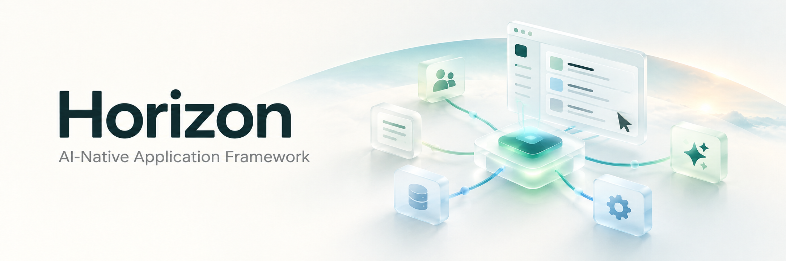
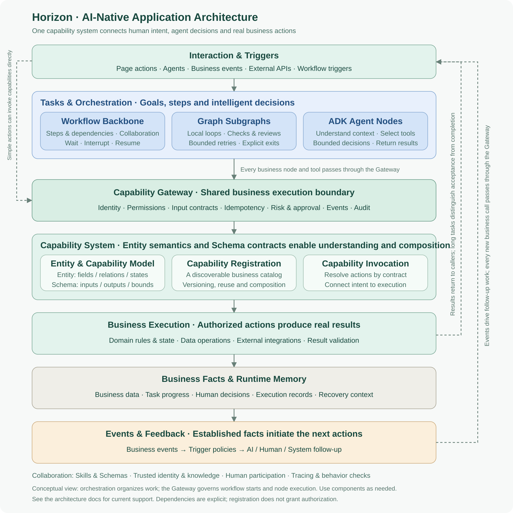
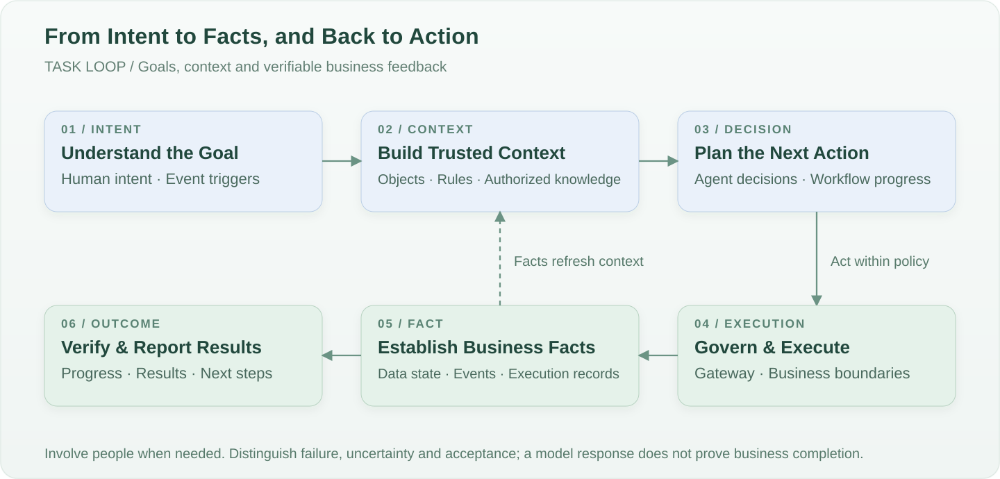
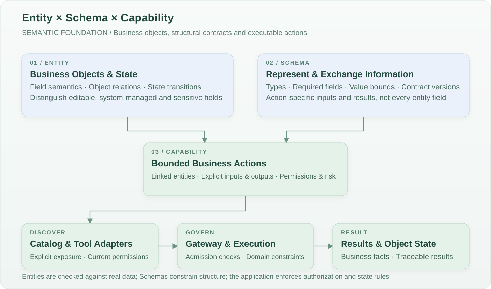
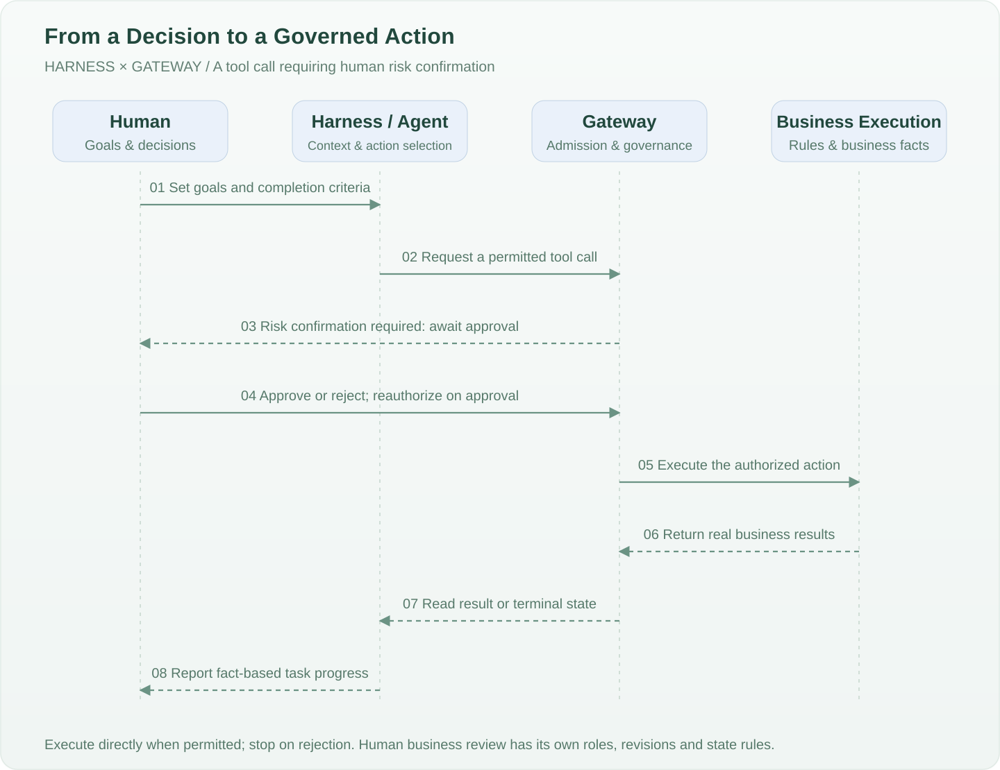
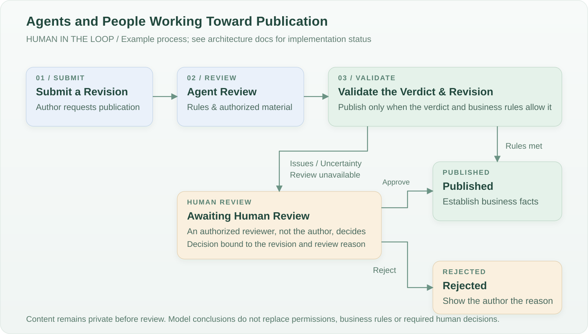
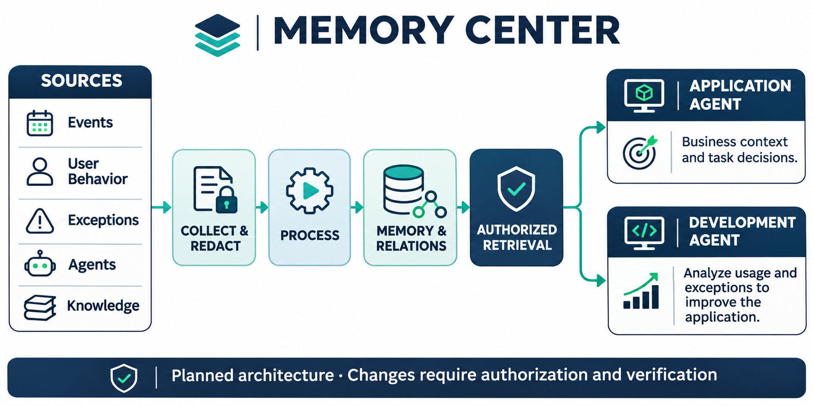
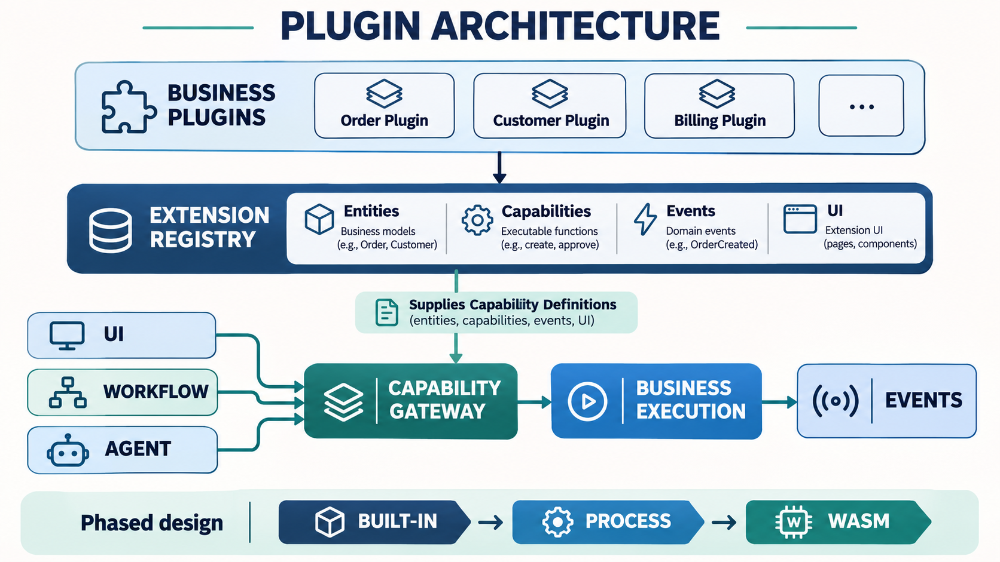

  

<h1 align="center">Horizon</h1>

<strong>People and agents working together through the same business capabilities.</strong>

AI-Native Application Framework

<a href="README.md">简体中文</a> · <strong>English</strong>

Horizon is an AI-native framework for enterprise applications. It brings business entities, Schema contracts, executable capabilities, intelligent decision-making, workflow orchestration, human participation, and business events into a coherent system. Agents can understand tasks, invoke tools, advance work, and act on real results within explicit authorization and business boundaries.

People can initiate work from a page, agents can start from a task, and events can trigger workflows. These entry points share business capabilities, permissions, approvals, and execution records.

**For Horizon, AI-native means making intelligent participation part of how an application operates: the application provides agents with business semantics, trusted context, executable capabilities, and persistent task state. Agents turn goals into actions within governance boundaries, and the application responds with real business results.**

## Conceptual Architecture

[View the original SVG](docs/assets/horizon-capability-architecture.en.svg) · [Read about the concepts and runtime model](docs/architecture.md)

From top to bottom, the framework connects who initiates work, how tasks are organized, which actions are allowed, how capabilities execute, and how results drive further work.

| Layer                                 | Core concepts                                                    | Role in collaboration                                                                                                                                                 |
| ------------------------------------- | ---------------------------------------------------------------- | --------------------------------------------------------------------------------------------------------------------------------------------------------------------- |
| **Interaction and triggers**          | Pages, agents, business events, external APIs, workflow triggers | Receive human intent and system changes, providing entry points for work.                                                                                             |
| **Tasks and orchestration**           | Workflow backbone, Graph subgraphs, ADK Agent nodes              | Organize goals into tasks that can progress: define steps, handle loops, and support bounded autonomous decisions. Simple actions can invoke capabilities directly.   |
| **Capability governance**             | Capability Gateway                                               | Apply consistent identity, permission, input, risk, and approval checks to every capability invocation, and record execution.                                         |
| **Capability system**                 | Entity, Schema, capability model, registration, and triggers     | Describe business objects and action boundaries so capabilities can be understood, discovered, and reused, connecting invocation intent to explicit business actions. |
| **Business execution**                | Domain rules, data operations, external integrations             | Execute authorized actions, maintain business state and data boundaries, and produce verifiable results.                                                              |
| **Business facts and runtime memory** | Business data, task state, execution records, recovery context   | Preserve what happened and how far work has progressed, supporting queries, tracing, and recovery.                                                                    |
| **Events and feedback**               | Business events, trigger policies, follow-up actions             | Feed established facts back into tasks and decisions, initiating another round of governed action.                                                                    |

**Memory Center**, a planned core mechanism, connects experience from multiple sources to governed task context. Plugins extend the business capability system.

This diagram shows responsibilities. Orchestration sits above the Gateway because it organizes work; starting a workflow and executing each business node still require the Gateway. The capability model and registry support execution, but registration does not grant authorization. See the technical documentation for the actual runtime sequence.

## What AI-Native Means in an Application

A user might express a goal such as “Review this content awaiting publication and send anything that needs human judgment to a reviewer.” To advance that work, an agent needs to know the current content state, applicable rules, available actions, when to wait for a human decision, and how to verify completion.

Horizon organizes applications around these needs. Business capabilities define the available actions; knowledge and context inform decisions; orchestration connects actions; governance constrains execution; and business facts and events provide feedback. Natural language, page interactions, and system events can all initiate this process.

In Horizon, the application itself provides the foundations for AI participation:

- **Understandable business semantics**: entities describe objects, relationships, and states; Schemas describe structure; and capabilities describe executable actions, giving agents explicit business context.
- **Discoverable, composable capabilities**: existing capabilities can serve as page actions, agent tools, or workflow nodes and be reused across scenarios.
- **Collaborative decisions**: deterministic rules, model judgments, and human reviews have distinct responsibilities within a shared task.
- **Governed execution**: identity, permissions, risk, approvals, and records apply to every business action.
- **Continuity across steps**: tasks can span multiple steps, waits, interruptions, and resumptions while preserving completed business facts.
- **Feedback from results**: business events become inputs to subsequent intelligent behavior, allowing the application to respond to change.

Together, these mechanisms form a closed loop:

## Entity, Schema, and Capability: A Shared Foundation for Understanding and Action

**Entity describes what exists in the business domain, Schema describes how information is represented, and Capability describes what can be done with it.** Together, they form the framework’s business language. Agents use it to understand objects, prepare arguments, and interpret results; the application executes actions according to actual permissions and business constraints.

For example, an article is an entity with an author, body, revision, and state. Submitting an article is a capability that accepts input for a specific revision and produces an explicit result. Its Schema defines required fields, types, and allowed values. Multiple capabilities can operate on one entity, and different actions can expose different field projections of that entity.

### Entities Give Business Objects Explicit Meaning

Entities express the business meaning of fields, relationships between objects, current states, and allowed state transitions. They also distinguish editable, system-managed, and sensitive fields, establishing separate boundaries for understanding an object and being authorized to modify it. Entity declarations must be checked against the actual data structure, and state transitions must be bound to specific capabilities.

### Schemas Make Exchanges Between People and Models Checkable

Schemas express structural requirements as machine-readable, verifiable contracts. They give tool arguments, workflow definitions, and business results explicit shapes, and support code generation, adaptation, and compatibility checks.

| Contract perspective                    | Question it answers                                                                  | Role in the framework                                                                     |
| --------------------------------------- | ------------------------------------------------------------------------------------ | ----------------------------------------------------------------------------------------- |
| **Capability inputs and outputs**       | What does this action accept and return?                                             | Describe tool arguments and business results, supporting input validation and adaptation. |
| **Workflow specification**              | What steps make up a task, how do they depend on each other, and what budgets apply? | Check definition structure, capability references, and execution bounds.                  |
| **Interfaces and transport**            | How do callers exchange messages with the application?                               | Maintain consistent interface conventions and SDK generation boundaries.                  |
| **Entity model and physical structure** | Do object declarations match actual fields, relationships, and states?               | Check models against database facts to prevent drift between business semantics and data. |

These contracts have separate sources of truth and should not be combined into one universal Schema that attempts to derive every rule. An entity’s complete field set must not automatically become a write payload: each action determines which fields it accepts. Schema validity still requires authorization, data-scope, and business-state checks. Model outputs must be validated as required by the business before driving state changes. See the [entity model](docs/entity-model.md) and [Schema roadmap](docs/agent-generation-plan.md) for the actual scope of generation and validation today.

## The Task Loop: From Intent to Result

An AI-native application advances work toward a goal while retaining responsibility and results at every step. A task can unfold as follows:

| Step                     | How the agent and application collaborate                                                                                                               |
| ------------------------ | ------------------------------------------------------------------------------------------------------------------------------------------------------- |
| **Understand the goal**  | Turn human intent or an event into a task, identify completion criteria, and request missing essential information.                                     |
| **Establish context**    | Obtain the current identity, authorized business objects, relevant knowledge, rules, and existing execution results.                                    |
| **Organize actions**     | Advance steps within an explicit workflow, or let an agent select the next action from permitted capabilities.                                          |
| **Execute capabilities** | Invoke business actions through a shared governance boundary and receive actual outcomes such as success, failure, pending confirmation, or acceptance. |
| **Handle change**        | Apply rules for failures and uncertainty, pausing, resuming, or handing decisions to people when needed.                                                |
| **Verify the result**    | Check completion criteria against business state and explain the result to the initiator; new business events may start follow-up tasks.                |

Tasks therefore have queryable progress and lifecycles. A request returning, a model answering, and a business goal being completed each have distinct meanings. Long-running tasks can wait while preserving committed business facts.

## One Set of Business Capabilities, Multiple Ways to Collaborate

**Capability is the business language an application offers to both people and agents.** It represents a bounded, executable action, such as querying an order, submitting an article, confirming receipt, or archiving a record.

A capability should describe the object it acts on, the input it accepts, the result it produces, who may execute it, and its risks. Pages, agents, and workflows reuse this contract, avoiding separate business rules for different entry points.

Capabilities can be composed into larger business tasks. When developing a feature, discover and reuse existing capabilities first, then consider composition, compatible extensions, or new capabilities.

This also lets an application expand its available actions over time. Once a new capability is integrated, more pages, agents, and workflows can reuse it within explicitly enabled scopes. Routine tasks invoke existing capabilities; new business semantics, rules, and integrations still require engineering development and validation.

## Harness: The Agent’s Working Environment

An agent needs a bounded runtime environment. The **Harness** brings together the model, context, available tools, execution budgets, and task lifecycle so model decisions can participate in the application’s actual work.

In this environment, tools connect to business capabilities, knowledge supplies reference material, and execution results inform subsequent decisions. The model can decide what to query next, which permitted tool to invoke, or what additional information is needed. Deterministic application rules still decide whether an action is authorized, whether data may be changed, and whether a result is valid.

The Harness and Gateway have distinct responsibilities: the Harness organizes intelligent behavior, while the Gateway governs business execution. Tool scope, iteration limits, and visible context require explicit configuration so autonomy grows alongside clear responsibility boundaries.

The following diagram shows a tool call requiring human risk confirmation. Business review tasks must still follow their own role and state rules; the application explicitly configures tool scope and approval requirements.

## How Workflow, Graph, and Agent Work Together

- **Workflow organizes the business backbone**: define steps and dependencies and support waiting, interruption, and recovery in long-running tasks.
- **Graph handles local loops**: express bounded checks, re-evaluation, and retries, with explicit continuation and exit conditions.
- **ADK Agent handles bounded decisions**: use context to choose actions from permitted tools and complete tasks requiring judgment and exploration.

All three use Eino. Tasks select components as needed; simple actions do not have to enter a full workflow. Model judgments remain subject to business rules and execution policies.

## People Remain Part of the Process

AI judgment, risk confirmation, and human business review are distinct steps. The framework incorporates human decisions into the task: who may review, which revision is under review, and why it was approved or rejected should all have clear boundaries.

- **Agents** understand tasks, investigate, propose judgments, and choose actions within permitted scopes.
- **The application and workflows** enforce permissions, business constraints, state transitions, execution records, and recovery.
- **People** set goals, supply information, and take responsibility for decisions requiring human judgment and approval.

For example, a content publication process could be designed as follows:

This is a business design example; see the architecture documentation for implementation progress. An agent cannot approve its own permissions or use a model conclusion in place of a required human decision.

## Context, Knowledge, and Events Ground Intelligent Behavior in the Business

Agent decisions need trusted context: the current identity, task goals, business objects, authorized knowledge, and established facts. Knowledge retrieval provides supporting material, capability invocations provide real results, and business events signal changes.

Events carry correlation information so follow-up tasks can trace their origins. Duplicate events, recursive triggers, and failure handling require explicit bounds to prevent uncontrolled repeated actions from the same business fact.

This feedback lets an application continue working in response to real business changes: completing a task can trigger a notification, detecting an anomaly can initiate an investigation, and receiving a human decision can resume the original workflow. Explicit policies and permissions control the follow-up actions.

Business knowledge, human judgments, and execution records can also inform later knowledge-base maintenance, agent evaluation, and workflow improvement. Updates to knowledge, policies, and workflows still require controlled maintenance. A business event does not itself grant permission to change rules or train models.

## Memory Center: Governed Context for Intelligent Work

**Memory Center is a core memory mechanism of the AI-native framework**, connecting business facts and accumulated experience to future task decisions. Its proposed design collects information from business events, capabilities, agents, workflows, and knowledge sources; normalizes and redacts it; and asynchronously extracts and connects useful memories for governed retrieval.

Application agents use authorized memories for business context and task decisions. Development agents can analyze permitted usage patterns, system exceptions, and past resolutions to identify improvements and refine the application. Changes remain subject to project authorization, review, and verification.

Retrieval respects tenant, identity, and data scope. Memory does not grant permission or replace current business state, audit records, or original knowledge documents. This is a planned architecture; see the [technical design](docs/AI-Native%20Memory%20Center%20技术架构与开发规范.md).

## Plugins: Extending Business Through a Shared Contract

Plugins contribute entities, capabilities, events, and interface extensions. Pages, workflows, and agents reuse the same capability contract and invoke business actions through the Capability Gateway; registration alone does not grant authorization.

The design starts with built-in Go plugins and frontend extensions, with process and WASM runtimes considered in later phases. See the [plugin integration design](docs/ai-native-plugin-integration.md).

## From Building Applications to Using Them

Horizon supports collaboration during both development and operation:

| Stage                     | Supporting mechanisms                                 | Purpose                                                                                                                                                  |
| ------------------------- | ----------------------------------------------------- | -------------------------------------------------------------------------------------------------------------------------------------------------------- |
| **Building applications** | AGENTS, engineering Skills, Schemas, validation gates | Help coding agents understand the architecture, reuse capabilities, clarify business questions, and verify results through behavior.                     |
| **Using applications**    | Built-in assistant, MCP, WebMCP, runtime Skills       | Let agents participate in business through explicitly enabled tools and current permissions; account capabilities and page context have distinct scopes. |

Skills preserve methods for doing work, Schemas describe exchangeable structures, and the Gateway constrains actual execution. Together, they support both code generation and ongoing collaboration within the application.

## Enterprise Foundations and Implementation

The framework provides identity and authorization, organizations and accounts, configuration governance, dictionaries, files, notifications, internationalization, and shared UI foundations. It is implemented with React / TypeScript, Go / Goa, PostgreSQL, and Eino.

Framework mechanisms and individual business integrations have different levels of maturity. Conceptual diagrams do not imply every scenario is available out of the box. Technical documentation records current support, known limitations, and verification results.

- [Local development and startup](docs/local-development.md)
- [Architecture and runtime model](docs/architecture.md) · [Eino orchestration design](docs/orchestration-plan.md)
- [Complete lifecycle example](docs/orchestration-example.md)
- [Agent development steps, clarification, and reuse strategy](docs/agent-workflow.md)
- [Capability decomposition and composition](docs/capability-composition.md) · [Task and Skill routing](docs/agent-tooling.md)
- [Security boundaries](docs/security.md) · [Testing and quality gates](docs/testing.md)
- [Schema roadmap](docs/agent-generation-plan.md) · [Engineering verification records](docs/verification.md)

The diagrams above are available in English; the linked technical documentation currently retains its original language.

## License

Copyright (C) 2026 Horizon contributors

This project is licensed under the [GNU General Public License v3.0 or later](LICENSE) (GPL-3.0-or-later).

You may use, modify, and distribute this project. When distributing derivative works, you must license them under the applicable GPL terms and provide the complete corresponding source code. Providing the project as a network service does not, by itself, require source disclosure to service users under GPLv3. AGPL-3.0 addresses that network-service scenario.

Third-party dependencies and bundled third-party content retain their respective licenses and copyright notices. Eino and the MCP Go SDK use Apache-2.0; Goa, shadcn, and MDXEditor use MIT. These licenses are compatible with GPLv3. Apache-2.0 is not compatible with GPLv2, which is why this project does not use GPLv2.
