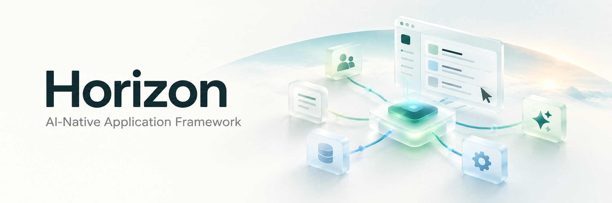

<p align="center">
  
</p>

<h1 align="center">Horizon</h1>
<p align="center"><strong>让人和 Agent，围绕同一套业务能力协作。</strong></p>
<p align="center">AI-Native Application Framework</p>

Horizon 是面向企业应用的 AI 原生框架。它把业务能力、智能决策、流程编排、人工参与和业务事件组织成一个整体，让 Agent 能够在明确的权限与业务边界内理解任务、调用工具、推进工作，并根据真实结果继续行动。

人可以从页面发起工作，Agent 可以从任务开始，流程可以由事件驱动。不同入口共享业务能力，也共享权限、审批和执行记录。

## 什么让应用成为 AI-Native

在 Horizon 中，AI 参与业务的基础由应用本身提供：

- **业务可理解**：对象、动作、输入输出和状态有明确契约，让 Agent 知道能做什么。
- **能力可发现、可组合**：已有业务能力可以成为页面动作、Agent 工具或流程节点，在多个场景中复用。
- **决策可协作**：确定性规则、模型判断和人工审核各有职责，共同推进一个任务。
- **执行可治理**：身份、权限、风险、审批与记录贯穿每一次业务动作。
- **过程可持续**：任务可以经历多步骤、等待、暂停与恢复，已完成的业务事实得到保留。
- **结果可反馈**：业务事件成为后续智能行为的输入，让应用持续响应变化。

这些机制共同形成一个工作闭环：

```text
业务能力 → 业务事实与事件 → AI 理解与决策 → 下一次业务能力调用
                         ↘ 必要时交给人判断 ↗
```

## 概念架构


[查看 SVG 原图](docs/assets/horizon-capability-architecture.svg) · [查看概念与运行机制说明](docs/architecture.md)

从上到下，框架把“谁发起工作”“如何组织任务”“什么动作被允许”“能力如何执行”和“结果如何继续驱动业务”连接起来。

| 层次 | 核心概念 | 在协作中承担什么职责 |
|---|---|---|
| **交互与触发** | 页面、Agent、业务事件、外部 API、流程触发 | 接受人的意图与系统变化，为工作提供入口。 |
| **任务与编排** | Workflow 主干、Graph 子图、ADK Agent 节点 | 将目标组织为可推进的任务：确定步骤、处理循环、开展受限的自主决策。简单动作可以直接调用能力。 |
| **能力治理** | Capability Gateway | 对每次能力调用统一检查身份、权限、输入、风险和审批，并记录执行过程。 |
| **能力体系** | 能力模型、能力注册、能力触发 | 描述业务能做什么，使能力可发现、可复用，并将调用意图关联到明确的业务动作。 |
| **业务执行** | 领域规则、数据操作、外部集成 | 执行被允许的动作，维护业务状态和数据边界，产生可确认的结果。 |
| **业务事实与运行记忆** | 业务数据、任务状态、执行记录、恢复上下文 | 保存发生过什么、当前进行到哪里，为查询、追踪和恢复提供依据。 |
| **事件与反馈** | 业务事件、触发策略、后续行动 | 将已发生的事实送回任务与决策环节，形成下一轮受治理的行动。 |

这是职责视图。编排位于 Gateway 上方表示它组织工作；流程启动和每个业务节点仍须经过 Gateway。能力模型与注册支持执行，注册本身不代表已获授权。具体运行时顺序见技术文档。

## 一套业务能力，多种协作方式

**Capability 是应用对人和 Agent 共同提供的业务语言。** 它表达一个有边界、可执行的动作，例如查询订单、提交文章、确认收货或归档记录。

一项能力应说明它处理什么对象、接受什么输入、产生什么结果，以及谁可以执行、有什么风险。页面、Agent 和流程复用这份契约，避免为不同入口建立不同的业务规则。

能力之间可以组合成更大的业务任务。开发新功能时，优先发现和复用已有能力，再考虑组合、兼容扩展或新增。

## Workflow、Graph 与 Agent 如何配合

- **Workflow 组织业务主干**：明确步骤与依赖，承载长任务的等待、暂停与恢复。
- **Graph 处理局部循环**：表达有边界的检查、复核和重试，明确何时继续、何时退出。
- **ADK Agent 完成受限决策**：结合上下文，从允许的工具中选择行动，完成需要判断与探索的任务。

三者均使用 Eino。任务按需选择组件，简单动作无需强制进入完整流程。模型提出的判断仍需接受业务规则和执行政策的校验。

## 人始终可以参与工作

AI 判断、风险确认与业务人工审核是不同环节。框架将人的决定纳入任务过程：谁可以审核、审核哪一版对象、为什么通过或驳回，都应有清晰边界。

例如，一条内容发布流程可以设计为：

```text
作者提交发布
  → Agent 评审
     ├─ 无问题 → 按业务规则发布
     └─ 有问题 / 不确定 → 待人工审核
        ├─ 通过 → 发布
        └─ 不通过 → 向作者展示原因
```

这是业务设计示例，具体接入进度见架构文档。Agent 不能批准自己的权限，也不能以模型结论替代必要的人工决定。

## 上下文、知识与事件让智能有业务依据

Agent 的判断需要可信上下文：当前身份、任务目标、业务对象、授权知识和已经发生的事实。知识检索为判断提供材料，能力调用提供真实结果，业务事件提示新的变化。

事件携带关联关系，使后续任务可以追溯自己的来源。重复事件、递归触发与失败处理需要明确边界，避免同一业务事实引发无控制的重复行动。

## 从开发应用，到使用应用

Horizon 同时为开发阶段和运行阶段准备协作方式：

| 阶段 | 配套 | 作用 |
|---|---|---|
| **开发应用** | AGENTS、工程 Skills、Schema、验证门禁 | 帮助编码 Agent 理解架构、复用能力、澄清业务问题，并以行为验证结果。 |
| **使用应用** | 内置助手、MCP、WebMCP、运行时 Skills | 让 Agent 在明确开放的工具与当前权限内参与业务；账号能力与页面上下文各有适用范围。 |

Skills 保存做事的方法，Schema 描述可交换的结构，Gateway 约束实际执行。三者协同，既支持生成代码，也支持应用中的持续协作。

## 企业应用基础与工程落地

框架提供身份与权限、组织和账号、配置治理、字典、文件、通知、国际化及统一界面基础，并以 React / TypeScript、Go / Goa、PostgreSQL 和 Eino 承载实现。

框架机制与具体业务接入有各自的成熟度；概念图不表示所有场景都已开箱即用。当前支持范围、已知限制与验证记录保留在技术文档中。

- [本地开发与启动](docs/local-development.md)
- [架构与运行机制](docs/architecture.md) · [Eino 编排方案](docs/orchestration-plan.md)
- [完整生命周期示例](docs/orchestration-example.md)
- [Agent 开发步骤、提问与复用策略](docs/agent-workflow.md)
- [能力拆分与组合](docs/capability-composition.md) · [任务与 Skill 路由](docs/agent-tooling.md)
- [安全边界](docs/security.md) · [测试与质量门禁](docs/testing.md)
- [Schema 路线](docs/agent-generation-plan.md) · [工程验收记录](docs/verification.md)
