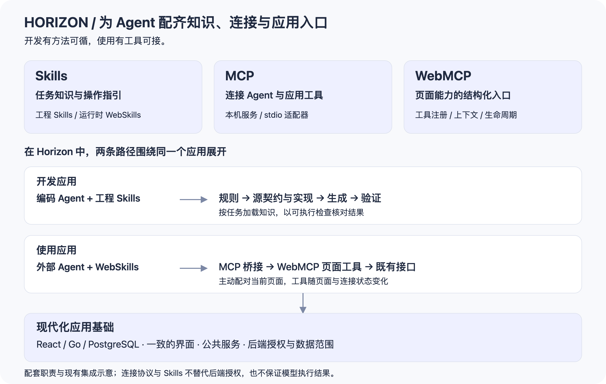

  

<h1 align="center">Horizon</h1>

<strong>为 Agent 开发，也为未来工作。</strong>

让开发、应用与智能协作连接起来的现代化应用框架

Skills · MCP · WebMCP · AI Assistant

  <a href="#agent-需要的不只是代码">为什么需要 Horizon</a> ·
  <a href="#一套配套贯穿开发与使用">生态架构</a> ·
  <a href="#应用本身也准备好了">应用基础</a>

模型越来越擅长写代码。但进入一个真实项目，它仍然需要知道：代码该放在哪里，哪些能力可以复用，如何调用工具，做完以后怎样验证。

应用运行起来以后，还有另一组问题：Agent 怎么知道页面能做什么？怎么连接正在使用的应用？怎么在既有权限下参与工作？

**Horizon 围绕这些问题，把项目 Skills、开发规则、MCP 服务、WebMCP 页面工具、可配置模型的 AI 助手与现代 Web 应用组织在一起。** 它既为 Agent 参与开发准备知识与工具，也让建成的应用继续向 Agent 开放能力，把协作延伸到日常工作。

> 这套基础框架已用于某上市公司的 ERP、MES、OA 等多个信息化系统。Horizon 在企业应用基础之上，继续建设面向 Agent 的开发与协作方式。

## Agent 需要的不只是代码

一次提示可以告诉 Agent 要做什么。长期维护一个系统，还需要把“怎么做”留下来。

项目越大，越需要让经验能够复用、工具能够发现、结果能够验证。否则，每次换一个任务或开启一个会话，都可能重新解释约定、重新寻找入口、重新判断完成标准。

Horizon 将这些上下文放进项目，也给运行中的应用准备了连接入口：

| 配套 | 解决的问题 | 在 Horizon 中如何落地 |
| --- | --- | --- |
| **Skills** | Agent 如何获得项目知识，按已有方法完成任务？ | 按任务加载的工程 Skills，覆盖前端、API、数据库、安全、国际化和质量验证；WebSkills 指导运行时客户端使用页面工具 |
| **MCP** | Agent 如何发现、调用应用开放的工具？ | 本机 MCP 服务与 stdio 适配器，将外部客户端连接到已配对页面，并转发工具目录变化 |
| **WebMCP** | 网页如何向 Agent 描述并开放自身能力？ | 页面工具注册表，按页面上下文提供结构化工具，随路由和连接生命周期更新或撤销 |
| **规则与验证** | Agent 如何遵循工程边界，确认工作结果？ | 分层 AGENTS.md、任务路由、契约与代码生成，以及可执行的质量检查 |

这些配套有各自的职责：Skills 提供方法与知识，MCP 负责工具连接，WebMCP 将工具落实到页面，工程规则与测试为开发结果提供检查依据。

## 一套配套，贯穿开发与使用

### 开发时，项目经验可以被 Agent 接着用

新增一个功能，Agent 可以沿任务路由找到相关 Skill，读取目标目录的约定，再沿着 API 契约、服务、SQL、生成 SDK 和页面完成修改。

哪些代码可以编辑、哪些需要生成，业务应该接入什么公共能力，改动需要哪些检查，都有对应的入口。团队积累的方法随代码一起维护，后续任务可以继续使用。

这也是 Skills 在 Agent 开发中的价值：**让专业知识成为可按需加载、可版本管理、可复用的项目资产。** 模型和客户端可以变化，项目的方法与约定仍然留在仓库中；实际加载方式取决于客户端支持。

### 使用时，业务能力继续向 Agent 开放

应用交付以后，Agent 的工作可以继续。查找信息、筛选记录、查看详情，这些日常操作都可以成为应用向 Agent 提供的工具。

Horizon 已内置 MCP、WebMCP 与支持自由配置模型的 AI 助手，配合 WebSkills 提供使用指引。外部客户端通过 MCP 发现工具，再调用当前页面开放的能力；页面切换时，可用工具也随之更新。

随着功能开发，Horizon 会持续完善相应的 MCP、WebMCP 服务与功能工具，让新业务拥有明确的 Agent 接入路径。工具范围、输入输出与授权边界随功能一起设计和维护，逐步增加 Agent 能参与的工作。

当前提供 Codex、WorkBuddy 的 MCP 与 WebSkills 设置。Claude 等支持 MCP 的客户端可按各自的连接方式接入，具体配置与可用能力以客户端支持及项目适配为准。现有工具覆盖导航、筛选、只读详情与脱敏诊断，业务访问继续经过后端权限校验。

### 同一个应用，容纳不同的工作方式

你可以在 Horizon 内自由配置模型，通过内置 AI 助手处理当前工作；也可以接入 Codex、Claude、WorkBuddy 等平台，在自己熟悉的 Agent 环境中调用系统能力。模型和协作入口由你选择，业务能力随应用持续积累。

内置助手与外部 Agent 围绕应用开放的业务能力协作。随着功能和工具逐步完善，使用者可以在页面操作、对话协助和外部 Agent 之间选择适合当前任务的方式。

**Horizon 不仅为 Agent 参与软件开发提供配套，也在为 Agent 参与日常工作铺路。** 项目中的知识可以成为 Skills，应用中的能力可以成为工具，团队积累的业务经验也就有了继续被使用和扩展的机会。

## 应用本身，也准备好了

Agent 需要有用的工具，团队也需要一套能承载真实业务的应用。

Horizon 采用 **React + TypeScript + shadcn/ui** 构建现代界面，以 **Go + Goa + PostgreSQL** 承载服务和数据。身份、权限和公共服务构成业务基础，深浅主题、中英文与一致的页面设计照顾日常使用。

API 从 Goa DSL 生成 OpenAPI 与前端 SDK，SQL 通过 sqlc 生成类型化访问代码。清晰的源文件与生成边界，既方便开发者维护，也为编码 Agent 提供明确的修改路径。

业务功能在这套基础上扩展，Agent 配套也沿着相同的接口和授权边界扩展。**从开发项目到使用应用，团队积累的代码、知识和工具可以一起生长。**

---

Horizon 适合希望把 Agent 持续引入开发和日常工作的团队：让下一次开发有经验可循，让下一种协作有工具可接。
