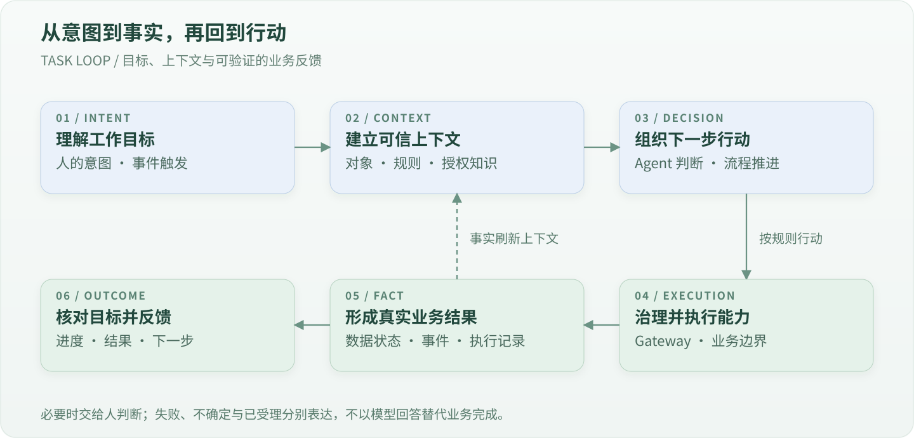
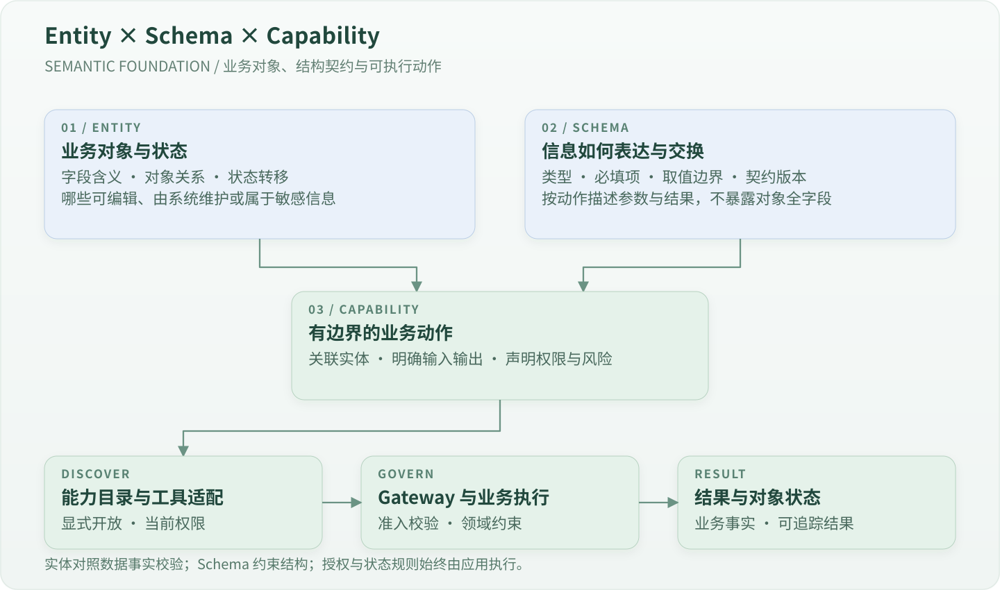
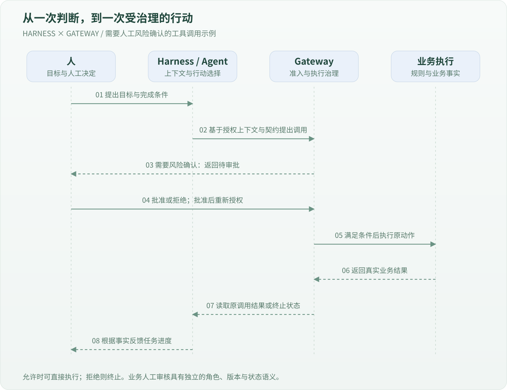
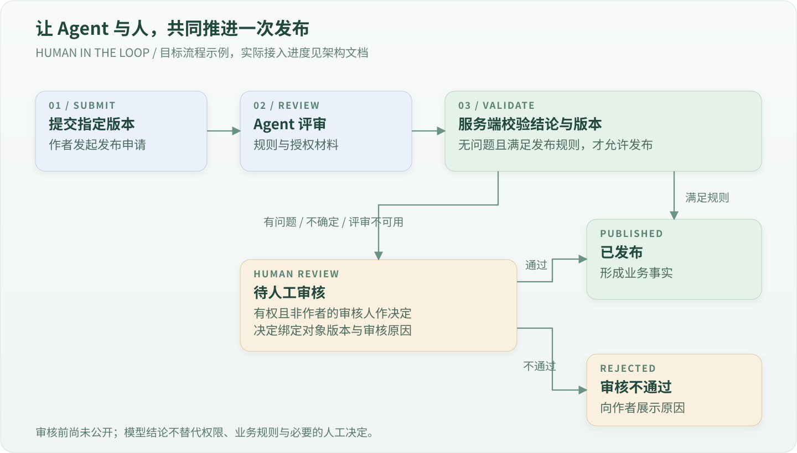

  

<h1 align="center">Horizon</h1>

<strong>让人和 Agent，围绕同一套业务能力协作。</strong>

AI-Native Application Framework

Horizon 是面向企业应用的 AI 原生框架。它把业务实体、Schema 契约、可执行能力、智能决策、流程编排、人工参与和业务事件组织成一个整体，让 Agent 能够在明确的权限与业务边界内理解任务、调用工具、推进工作，并根据真实结果继续行动。

人可以从页面发起工作，Agent 可以从任务开始，流程可以由事件驱动。不同入口共享业务能力，也共享权限、审批和执行记录。

**Horizon 所说的 AI-Native，是让智能参与成为应用的运行机制：应用向 Agent 提供业务语义、可信上下文、可执行能力和持续的任务状态，Agent 在治理边界内把目标转化为行动，应用再以真实业务结果回应。**

## 概念架构

[查看 SVG 原图](docs/assets/horizon-capability-architecture.svg) · [查看概念与运行机制说明](docs/architecture.md)

从上到下，框架把“谁发起工作”“如何组织任务”“什么动作被允许”“能力如何执行”和“结果如何继续驱动业务”连接起来。

| 层次 | 核心概念 | 在协作中承担什么职责 |
|---|---|---|
| **交互与触发** | 页面、Agent、业务事件、外部 API、流程触发 | 接受人的意图与系统变化，为工作提供入口。 |
| **任务与编排** | Workflow 主干、Graph 子图、ADK Agent 节点 | 将目标组织为可推进的任务：确定步骤、处理循环、开展受限的自主决策。简单动作可以直接调用能力。 |
| **能力治理** | Capability Gateway | 对每次能力调用统一检查身份、权限、输入、风险和审批，并记录执行过程。 |
| **能力体系** | Entity、Schema、能力模型、能力注册与触发 | 描述对象及其动作边界，使能力可理解、可发现、可复用，并将调用意图关联到明确的业务动作。 |
| **业务执行** | 领域规则、数据操作、外部集成 | 执行被允许的动作，维护业务状态和数据边界，产生可确认的结果。 |
| **业务事实与运行记忆** | 业务数据、任务状态、执行记录、恢复上下文 | 保存发生过什么、当前进行到哪里，为查询、追踪和恢复提供依据。 |
| **事件与反馈** | 业务事件、触发策略、后续行动 | 将已发生的事实送回任务与决策环节，形成下一轮受治理的行动。 |

这是职责视图。编排位于 Gateway 上方表示它组织工作；流程启动和每个业务节点仍须经过 Gateway。能力模型与注册支持执行，注册本身不代表已获授权。具体运行时顺序见技术文档。

## AI-Native 如何体现在应用中

用户可以表达一个目标，例如“检查这些待发布内容，并把需要人工判断的部分交给审核人”。要推进这项工作，Agent 需要知道内容当前处于什么状态、适用什么规则、可以调用哪些动作、什么时候必须等待人的决定，以及怎样确认工作已经完成。

Horizon 围绕这些需要组织应用。业务能力构成可执行的行动空间，知识和上下文提供判断依据，任务编排连接多个动作，治理机制约束执行，业务事实和事件提供反馈。自然语言、页面操作和系统事件都可以成为这套机制的入口。

在 Horizon 中，AI 参与业务的基础由应用本身提供：

- **业务可理解**：实体描述对象、关系与状态，Schema 描述结构，能力描述可执行动作，让 Agent 有明确的业务语义依据。
- **能力可发现、可组合**：已有业务能力可以成为页面动作、Agent 工具或流程节点，在多个场景中复用。
- **决策可协作**：确定性规则、模型判断和人工审核各有职责，共同推进一个任务。
- **执行可治理**：身份、权限、风险、审批与记录贯穿每一次业务动作。
- **过程可持续**：任务可以经历多步骤、等待、暂停与恢复，已完成的业务事实得到保留。
- **结果可反馈**：业务事件成为后续智能行为的输入，让应用持续响应变化。

这些机制共同形成一个工作闭环：

## 实体、Schema 与能力：AI 理解和行动的共同基础

**Entity 描述业务世界里有什么，Schema 描述信息如何表达，Capability 描述可以对它做什么。** 三者共同构成框架的业务语言：Agent 据此理解对象、准备参数和识别结果，应用依据真实权限与业务约束执行动作。

例如，“文章”是实体，它具有作者、正文、版本和状态；“提交文章”是能力，它接受指定版本的输入并产生明确结果；Schema 约束输入中哪些字段必填、类型是什么、允许哪些取值。一个实体可以被多个能力操作，同一个实体在不同动作中也可以有不同的字段投影。

### 实体让业务对象具有明确语义

实体表达字段的业务含义、对象之间的关系、当前状态与允许的状态变化。它还区分可编辑字段、系统字段和敏感字段，使“认识一个对象”与“获准修改它”各有边界。实体声明需要与实际数据结构核对，状态转移绑定到具体能力。

### Schema 让人与模型交换可检查的结构

Schema 将结构要求表达为机器可读取、可检查的契约，让工具参数、流程定义和业务结果拥有明确形状，并为代码生成、适配和兼容性检查提供依据。

| 契约视角 | 回答的问题 | 在框架中的作用 |
|---|---|---|
| **能力输入与输出** | 这个动作接收什么、返回什么？ | 描述工具参数和业务结果，支持输入校验与适配。 |
| **流程规格** | 任务由哪些步骤组成、如何依赖、有何预算？ | 检查定义结构、能力引用和运行边界。 |
| **接口与传输** | 调用方如何与应用交换消息？ | 维护统一接口约定及 SDK 生成边界。 |
| **实体模型与物理结构** | 对象声明是否符合真实字段、关系和状态？ | 对照数据库事实检查模型，避免业务语义与数据漂移。 |

这些契约有各自的事实来源，不应合并成一个推导所有规则的万能 Schema。实体全字段也不能直接成为写入参数：可传什么由具体动作决定。Schema 合法仍需经过授权、数据范围和业务状态检查；模型输出按业务需要验证后才能驱动状态变化。当前生成与校验的实际覆盖范围见 [实体模型](docs/entity-model.md) 和 [Schema 路线](docs/agent-generation-plan.md)。

## 从意图到结果的任务闭环

AI 原生应用围绕目标推进工作，也保留每一步的责任和结果。一次任务可以按以下方式展开：

| 环节 | Agent 与应用如何协作 |
|---|---|
| **理解目标** | 将人的意图或事件表达为任务，识别完成条件；关键信息缺失时请求补充。 |
| **建立上下文** | 获取当前身份、授权业务对象、相关知识、规则与已有执行结果。 |
| **组织行动** | 在明确的流程内推进步骤，或由 Agent 从允许的能力中选择下一步。 |
| **执行能力** | 经统一治理边界调用业务动作，得到成功、失败、待确认或已受理等真实结果。 |
| **处理变化** | 按规则处理失败与不确定性，必要时暂停、恢复或交给人决定。 |
| **确认结果** | 根据业务状态核对完成条件，向发起方说明结果；新的业务事件可以启动后续任务。 |

任务因此具有可查询的进度与生命周期。一次请求返回、一次模型回答和一个业务目标完成分别有自己的含义；长任务可以等待，而已提交的业务事实得到保留。

## 一套业务能力，多种协作方式

**Capability 是应用对人和 Agent 共同提供的业务语言。** 它表达一个有边界、可执行的动作，例如查询订单、提交文章、确认收货或归档记录。

一项能力应说明它处理什么对象、接受什么输入、产生什么结果，以及谁可以执行、有什么风险。页面、Agent 和流程复用这份契约，避免为不同入口建立不同的业务规则。

能力之间可以组合成更大的业务任务。开发新功能时，优先发现和复用已有能力，再考虑组合、兼容扩展或新增。

这也让应用能够逐步扩展自己的行动空间：新能力接入后，可在明确开放的范围内被更多页面、Agent 和流程复用。日常任务通过调用既有能力完成；新增业务语义、规则或集成仍通过工程开发和验证交付。

## Harness 为 Agent 提供工作的环境

Agent 需要在一个有边界的运行环境中工作。**Harness** 负责组织模型、上下文、可用工具、执行预算与任务生命周期，让模型的判断能够进入应用的实际工作过程。

在这套环境里，工具连接业务能力，知识提供参考，执行结果成为后续判断的依据。模型可以决定下一步查询什么、调用哪个已允许的工具，或说明还需要什么信息；动作是否有权执行、数据能否被修改、结果是否有效，仍由应用的确定性规则判断。

Harness 与 Gateway 各有职责：前者组织智能行为，后者治理业务执行。工具范围、迭代次数和可见上下文都需要明确配置，使自主性与责任边界一起扩大。

下面展示一次需要人工风险确认的工具调用。业务人工审核任务仍需按自身角色与状态规则设计；工具范围和审批要求由应用明确配置。

## Workflow、Graph 与 Agent 如何配合

- **Workflow 组织业务主干**：明确步骤与依赖，承载长任务的等待、暂停与恢复。
- **Graph 处理局部循环**：表达有边界的检查、复核和重试，明确何时继续、何时退出。
- **ADK Agent 完成受限决策**：结合上下文，从允许的工具中选择行动，完成需要判断与探索的任务。

三者均使用 Eino。任务按需选择组件，简单动作无需强制进入完整流程。模型提出的判断仍需接受业务规则和执行政策的校验。

## 人始终可以参与工作

AI 判断、风险确认与业务人工审核是不同环节。框架将人的决定纳入任务过程：谁可以审核、审核哪一版对象、为什么通过或驳回，都应有清晰边界。

- **Agent** 负责理解、调查、提出判断和在允许范围内选择行动。
- **应用与流程** 负责权限、业务约束、状态迁移、执行记录与恢复。
- **人** 设定目标、补充信息，并承担需要人工判断与批准的决定。

例如，一条内容发布流程可以设计为：

这是业务设计示例，具体接入进度见架构文档。Agent 不能批准自己的权限，也不能以模型结论替代必要的人工决定。

## 上下文、知识与事件让智能有业务依据

Agent 的判断需要可信上下文：当前身份、任务目标、业务对象、授权知识和已经发生的事实。知识检索为判断提供材料，能力调用提供真实结果，业务事件提示新的变化。

事件携带关联关系，使后续任务可以追溯自己的来源。重复事件、递归触发与失败处理需要明确边界，避免同一业务事实引发无控制的重复行动。

这种反馈使应用能够围绕真实业务变化持续开展工作：任务完成后可以触发通知，出现异常可以发起调查，获得人工结论可以继续原有流程。具体后续动作由显式策略与权限控制。

业务知识、人工判断和执行记录还可以成为后续维护知识库、评估 Agent 和改进流程的依据。知识、策略与流程的更新仍需受控维护；业务事件本身不授予修改规则或训练模型的权限。

## 从开发应用，到使用应用

Horizon 同时为开发阶段和运行阶段准备协作方式：

| 阶段 | 配套 | 作用 |
|---|---|---|
| **开发应用** | AGENTS、工程 Skills、Schema、验证门禁 | 帮助编码 Agent 理解架构、复用能力、澄清业务问题，并以行为验证结果。 |
| **使用应用** | 内置助手、MCP、WebMCP、运行时 Skills | 让 Agent 在明确开放的工具与当前权限内参与业务；账号能力与页面上下文各有适用范围。 |

Skills 保存做事的方法，Schema 描述可交换的结构，Gateway 约束实际执行。三者协同，既支持生成代码，也支持应用中的持续协作。

## 企业应用基础与工程落地

框架提供身份与权限、组织和账号、配置治理、字典、文件、通知、国际化及统一界面基础，并以 React / TypeScript、Go / Goa、PostgreSQL 和 Eino 承载实现。

框架机制与具体业务接入有各自的成熟度；概念图不表示所有场景都已开箱即用。当前支持范围、已知限制与验证记录保留在技术文档中。

- [本地开发与启动](docs/local-development.md)
- [架构与运行机制](docs/architecture.md) · [Eino 编排方案](docs/orchestration-plan.md)
- [完整生命周期示例](docs/orchestration-example.md)
- [Agent 开发步骤、提问与复用策略](docs/agent-workflow.md)
- [能力拆分与组合](docs/capability-composition.md) · [任务与 Skill 路由](docs/agent-tooling.md)
- [安全边界](docs/security.md) · [测试与质量门禁](docs/testing.md)
- [Schema 路线](docs/agent-generation-plan.md) · [工程验收记录](docs/verification.md)

## 开源协议

本项目采用 [MIT License](LICENSE)。第三方依赖及随附的第三方内容保留各自的许可证与版权声明。
