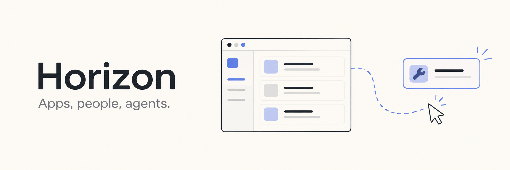
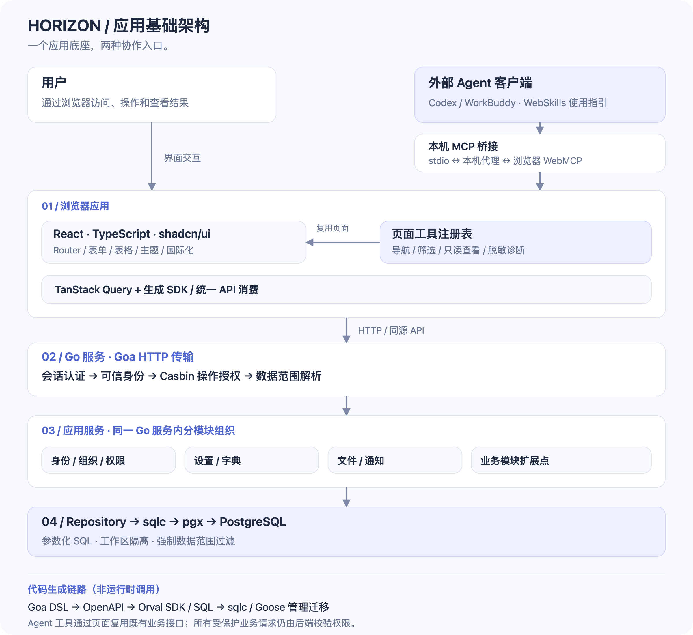

  

<h1 align="center">Horizon</h1>

<strong>把时间留给业务，把应用交给未来。</strong>

面向 Agent 时代的现代化应用基础框架

React · Go · PostgreSQL · Agent Ready

  <a href="#为什么是-horizon">为什么是 Horizon</a> ·
  <a href="#架构一览">架构一览</a> ·
  <a href="#让-agent-成为应用的协作者">Agent 连接</a>

企业应用的下一步，是让人和 Agent 都能用好它。

**Horizon 把现代 Web 界面、企业应用基础和 Agent 连接放进同一套框架。** 你可以从一个完整的应用底座开始构建业务，再把适合协作的能力逐步开放给 Agent。

> **已用于某上市公司的 ERP、MES、OA 等多个信息化系统，作为这些系统的基础框架。**
>
> 业务各不相同，基础可以复用。Horizon 让下一套系统从已有积累出发。

## 为什么是 Horizon

### 新项目，从业务开始

订单、生产、审批，各有各的复杂。账号、组织、权限、配置、附件和通知，却常常要在每个项目里重新建设。

Horizon 把这些通用能力准备好，让团队直接进入业务开发。多个系统可以沿用相同的基础约定，新模块也有现成的服务可以接入。少维护几套重复实现，就能把更多精力放在产品真正需要解决的问题上。

### 企业软件，也值得拥有现代体验

简洁的布局、清楚的信息层级、统一的表格与表单，加上深浅主题和中英文支持，构成 Horizon 的日常使用体验。

前端采用 React、TypeScript 与 shadcn/ui，页面和组件沿用同一套设计约定。增加一个业务模块时，团队可以顺着已有风格继续构建，让应用随着功能增长仍然保持一致。

### 今天交付应用，也为 Agent 留好入口

用户通过页面操作，Agent 通过应用开放的工具参与工作。两种入口共享已有业务接口与后端权限校验，让智能协作有明确的边界，也有持续扩展的路径。

Horizon 目前已开放页面导航、筛选、只读查看和诊断能力。业务系统可以先服务好今天的用户，再按需要增加面向 Agent 的工具。

## 架构一览

**React 负责交互，Go 承载服务，PostgreSQL 保存数据。** 单仓库、单 Go 服务，按职责组织模块，让业务扩展、权限控制和数据访问各有位置。

从上到下，这套架构解决四件事：

| 层次 | 如何组织 | 带来的价值 |
| --- | --- | --- |
| **应用体验** | React + shadcn/ui，TanStack Query 管理远程状态，生成 SDK 消费 API | 页面沿用一致的交互与数据访问方式，新增模块有清晰起点 |
| **Agent 连接** | 页面工具注册表 + WebMCP + WebSkills，通过本机 MCP 桥接连接外部客户端 | 让 Agent 发现和调用已开放的页面能力，复用当前页面上下文 |
| **服务与权限** | Goa HTTP 传输，模块化应用服务，可信身份、Casbin 授权与数据范围解析 | 业务逻辑集中在后端，操作权限与数据访问范围都有明确落点 |
| **数据与持久化** | Repository + sqlc + pgx + PostgreSQL，Goose 管理迁移 | 从参数化查询到工作区隔离，在数据访问层落实约束 |

**接口从同一份契约出发。** Goa DSL 生成服务接口与 OpenAPI，再由 Orval 生成前端 SDK；SQL 生成类型化访问代码。接口和数据结构变化有统一源头，人和编码 Agent 都能沿着同一条链路修改。

身份、设置、字典、文件与通知作为公共服务供业务模块复用。ERP、MES、OA 是框架的实际使用场景；仓库提供应用基础与扩展位置，具体业务按项目需要构建。

## 让 Agent 成为应用的协作者

当你说“找到这个页面，筛选这些账号，再打开详情”，应用需要向 Agent 提供足够清楚的工具和使用说明。

Horizon 已通过 **WebMCP** 将页面能力注册为结构化工具，并通过 **WebSkills** 提供使用指引，支持连接 Codex、WorkBuddy 等外部客户端。工具目录随页面变化更新，让 Agent 使用与当前工作相关的能力。

连接由用户主动发起，当前用于本机配对。已开放的工具覆盖导航、筛选、只读查看和脱敏诊断；业务数据仍通过既有接口和后端授权获取。后续扩展可以继续沿用这条路径。

## 一套基础，继续构建

Horizon 适合需要持续迭代的企业应用、内部工作台，以及希望把 Agent 引入日常工作的业务系统。

**从已经需要的基础出发，做出你自己的应用；当新的协作方式到来时，让它接得进来。**
