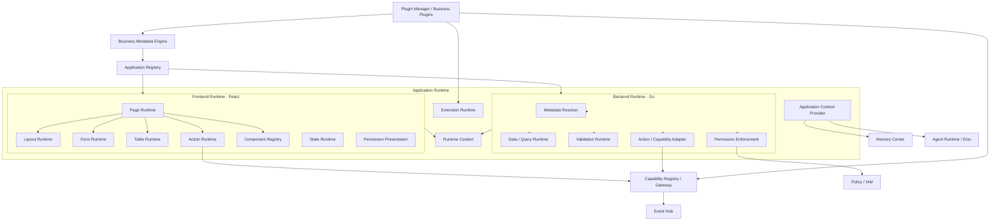
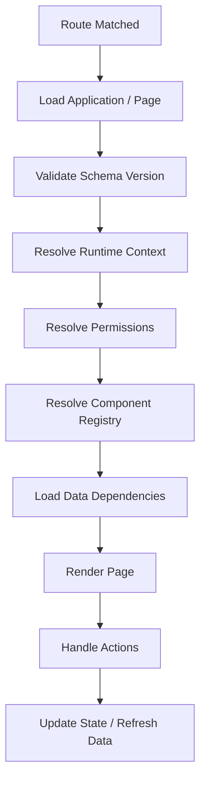
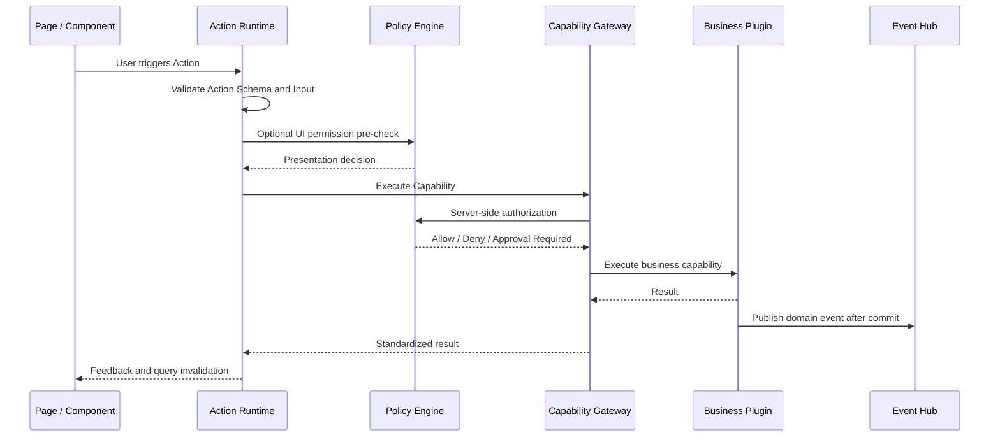
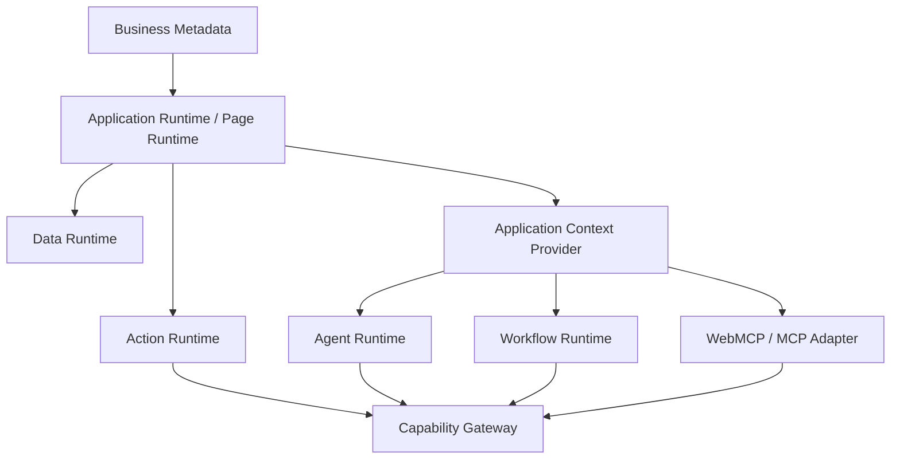

# AI-Native Application Runtime 开发实施规范

> 版本：1.0  
> 类型：架构设计、技术方案与 Codex 开发规范  
> 目标：在已实现的 Business Metadata Engine 之上，建设可扩展、可治理、AI-Native 的企业应用运行时。  
> 适用范围：ERP、MES、WMS、QMS、APS、CRM、OA 等企业应用。  
> 建议技术方向：React + TypeScript、Go、PostgreSQL、Redis、Capability Gateway、Policy Engine、Event Hub、Eino。

---

# 0. 给 Codex 的执行说明

本文件描述目标架构，不代表仓库中所有模块都已存在。**开始编码前必须先审查当前仓库，不能直接假设现有实现。**

## 0.1 仓库审查要求

1. 读取 `AGENTS.md`、README、架构文档、开发规范和模块说明。
2. 检查 Business Metadata Engine：Entity、Field、Relation、Metadata Schema、版本、存储和 API。
3. 检查 Capability Registry / Gateway、IAM / Policy、Plugin System、Event Hub、Memory Center 的实际实现。
4. 检查前端框架、路由、组件库、数据请求、表单、表格和状态管理方案。
5. 检查 Go 工程结构、依赖注入、数据库访问、错误处理、日志、迁移和测试约定。
6. 优先复用现有模块、接口和契约，不重复建设。
7. 不得擅自重命名、替换或破坏已有 Metadata Schema。
8. 若本文示例与现有 Schema 不一致，先实现 Adapter / Mapper；只有确认无法适配并给出迁移方案后，才考虑调整底层模型。
9. 对尚未实现的模块定义接口或 Adapter，不得假设其已经存在。
10. 每个阶段都必须运行测试、Lint、类型检查和构建，并报告实际结果。

## 0.2 推荐执行顺序

Codex 首轮不要直接开发全部模块，应先完成：

- 仓库现状分析和差距清单。
- 已有 Metadata 到 Runtime 内部模型的映射设计。
- 模块依赖和目标目录设计。
- 第一阶段 MVP 实施计划。
- 经确认后分阶段提交可运行代码、测试和文档。

## 0.3 禁止事项

- React 页面不得硬编码业务 API 路径绕过 Capability Gateway。
- 前端权限判断不得代替服务端权限校验。
- 不得在 Metadata 中放任意 JavaScript 字符串并通过 `eval` / `Function` 执行。
- 不得由 Runtime 直接拼接或执行任意 SQL。
- 不得将复杂领域事务强行抽象成通用 CRUD。
- 不得让页面、Agent、Workflow 各自重复实现同一业务动作。
- 不得在未检查仓库前新增与现有 Metadata Engine 重复的模型。
- 不得强制所有页面 Schema 化；必须保留 Hybrid / Custom 页面扩展方式。

---

# 1. 项目定位与目标

## 1.1 定义

**Application Runtime 是建立在 Business Metadata Engine 之上的应用执行引擎。**

它读取应用定义、页面 Schema、数据定义、动作定义、权限策略和扩展组件，并将其解释为可运行的企业应用。

它不只是动态页面渲染器，也不负责实现 ERP / MES 的具体领域业务逻辑。

核心目标：

> 业务插件提供业务定义和必要的领域逻辑；Application Runtime 将其转换成可运行的页面、数据交互、业务操作和 AI 上下文。

## 1.2 与其他平台模块的边界

| 模块 | 核心职责 | 不承担的职责 |
|---|---|---|
| Business Metadata Engine | 定义 Entity、Field、Relation、业务元数据及版本 | React 页面渲染 |
| Application Runtime | 解释元数据并运行页面、数据和动作 | 具体 MES / ERP 领域规则 |
| Capability Registry | 注册 Capability 契约、参数、版本 | 页面渲染 |
| Capability Gateway | 统一执行 Capability、鉴权、审计 | 页面状态管理 |
| IAM / Policy | 身份、角色、数据范围、策略决策 | 前端自行复制授权逻辑 |
| Plugin Manager | 插件安装、生命周期、依赖和版本 | 页面 Schema 解释 |
| Agent Runtime | Agent 规划、工具调用和任务执行 | 绕过 Gateway 修改业务数据 |
| Workflow Runtime | 流程实例、节点执行和人工任务 | 复制业务领域逻辑 |
| Memory Center | 记忆采集、检索、整合和治理 | 业务主数据来源 |
| Event Hub | 业务事件传递和异步触发 | 代替业务事务数据库 |

## 1.3 目标开发体验

业务插件提供：

- Entity / Field / Relation Metadata。
- Page / View Schema。
- Form / Table Schema。
- Action 与 Capability 绑定。
- Permission Policy 引用。
- Business Event 定义。
- 必要的 Go 领域服务和自定义 React 组件。

Runtime 提供：

- 应用导航和页面装载。
- 列表、详情、表单等标准页面。
- 动态字段、表格和数据查询。
- Capability 按钮与操作反馈。
- 权限控制和 Runtime Context。
- Agent 可理解的页面语义。
- WebMCP / AG-UI 等 AI 接入适配点。

---

# 2. 设计原则

1. **Metadata-driven, not Metadata-only**：常规页面由元数据驱动，复杂页面允许自定义 React。
2. **Capability-first**：所有业务动作通过 Capability 契约执行，页面、Agent、Workflow、MCP 共用。
3. **Server-authoritative**：服务端是权限、数据校验和业务执行的权威。
4. **Contract-first**：前后端通过稳定、版本化契约协作。
5. **Plugin-friendly**：插件可贡献页面、组件、动作、数据适配器和上下文提供者。
6. **AI-ready by design**：页面、实体和动作具备机器可读的业务语义。
7. **Secure by default**：默认拒绝未知组件、未知动作、未知字段和未授权数据。
8. **Extensible but bounded**：扩展必须经过注册、版本、权限和安全检查。
9. **Domain logic stays in domain modules**：复杂业务逻辑不进入通用 Runtime。
10. **Incremental delivery**：先完成列表、详情、表单闭环，再逐步扩展。

---

# 3. 总体架构



## 3.1 前端职责

React Runtime 负责：

- 应用 Shell、导航和页面装载。
- Schema Renderer。
- Component Registry。
- Form / Table / Detail Renderer。
- Action Runtime。
- 页面与应用状态。
- 权限结果展示。
- Runtime Context 构建。
- AI 页面语义和 WebMCP Adapter。

不负责最终权限裁决、SQL 执行或复杂业务规则。

## 3.2 后端职责

Go Runtime 负责：

- 应用和页面元数据解析。
- Schema 版本校验。
- 安全数据查询和字段投影。
- 服务端校验。
- 权限执行和数据范围过滤。
- Capability 调用适配。
- Runtime Context 校验。
- 元数据缓存和失效。
- 插件扩展接口和审计关联。

---

# 4. 核心模块

## 4.1 Application Registry：应用注册与装载

管理平台内可安装、可授权、可导航的应用定义。

建议层级：

```text
Tenant
  └── Application
       └── Module
            └── Page
                 └── View / Action
```

应用定义至少需要：

- `appId`、`appVersion`、`pluginId`
- `name`、`description`、`icon`
- `navigation`、`modules`、`pages`
- `requiredCapabilities`
- `requiredPermissions`
- `dependencies`
- `metadataVersion`
- `runtimeCompatibility`

优先复用已有 Application / Plugin Metadata，不重复建模。

运行要求：

- 支持应用安装、启用、停用。
- 支持租户级应用授权。
- 支持按权限过滤菜单。
- 支持应用版本和依赖检查。
- 支持应用升级后的 Schema 兼容检查。
- 应用不可用时显示可诊断错误，不允许静默空白。

## 4.2 Page Runtime：页面运行引擎

根据 Page Schema 构建 React 页面。

| 页面类型 | 用途 | 优先级 |
|---|---|---|
| `list` | 列表、查询、批量操作 | P0 |
| `detail` | 单条记录详情 | P0 |
| `form` | 新增和编辑表单 | P0 |
| `custom` | 自定义 React 页面 | P0（扩展机制） |
| `dashboard` | 指标和图表布局 | P1 |
| `tree` | BOM、组织、工艺树 | P1 |
| `calendar` | 日历排程 | P2 |
| `gantt` | APS 甘特图 | P2 |

Page Schema 示例（仅作目标示意，实际优先适配仓库已有 Schema）：

```json
{
  "schemaVersion": "1.0",
  "pageId": "mes.production-order.list",
  "pageType": "list",
  "title": "生产工单",
  "entityRef": "mes.production_order",
  "layout": {
    "type": "standard",
    "regions": [
      {
        "name": "filters",
        "component": "FilterPanel",
        "configRef": "production-order.filters"
      },
      {
        "name": "content",
        "component": "DataTable",
        "configRef": "production-order.table"
      }
    ]
  },
  "actions": ["production.order.create"]
}
```

页面加载生命周期：



必须处理 Loading、Schema 错误、组件未注册、插件未启用、权限不足、数据加载失败和组件渲染异常。

## 4.3 Component Registry：组件注册中心

将 Schema 中的组件名映射为可信 React 组件及其 Props Schema。

组件分类：

| 类别 | 示例 |
|---|---|
| Core | Button、Input、Select、Dialog、Tabs |
| Layout | PageLayout、Grid、Section、Drawer |
| Data | DataTable、FilterPanel、DataCard |
| Business | BOM Tree、Process Route、Inventory Ledger |
| Visualization | Chart、Gantt、Calendar、3D View |
| AI | Agent Panel、AI Action、Context Preview |

注册契约示例：

```typescript
import type { ComponentType } from "react";

export interface RuntimeComponentDefinition<TProps = unknown> {
  name: string;
  version: string;
  category: string;
  component: ComponentType<TProps>;
  propsSchema: object;
  description?: string;
  supportedSlots?: string[];
  requiredCapabilities?: string[];
  aiSemantic?: {
    description: string;
    exposedProperties?: string[];
    supportedActions?: string[];
  };
}
```

要求：

- 组件名称唯一且有版本。
- Props 必须经过 Schema 校验。
- 未注册组件默认拒绝渲染。
- 插件组件声明来源、版本和依赖。
- 支持组件能力描述和 AI 语义描述。
- 卸载插件时清理注册项和资源。
- 组件不能绕过 Runtime Context 和权限体系。

自定义 React 组件必须通过可信插件包注册。不要在普通 Metadata 中执行任意 JavaScript。插件隔离方式（iframe、Module Federation 等）需结合现有架构评估，不在 MVP 强行引入。

## 4.4 Layout Runtime：布局运行引擎

应用 Shell：

- Sidebar / Navigation
- Header
- Breadcrumb
- Tab Workspace
- Page Container
- Notification
- Command Palette
- Dialog / Drawer Host

页面布局：

- Single Column
- Two Column
- Grid
- Split View
- Master / Detail
- Tabbed Sections

要求：

- 布局元数据与 Entity Metadata 分离。
- 支持应用级 Shell 扩展。
- 支持响应式断点。
- 支持 Web 与 PDA / 移动布局差异。
- 页面切换时按策略保留或销毁状态。

## 4.5 Data Runtime：数据运行引擎

提供统一、受控的数据读取和简单数据访问接口。

内部能力：

- Entity Query
- Relation Query
- Filter Parser
- Sort Parser
- Pagination
- Projection / Field Selection
- Aggregation（按需）
- Data Transformation
- Cache Metadata
- Query Audit

Query 示例：

```json
{
  "entityRef": "mes.production_order",
  "select": ["orderNo", "product", "planQuantity", "completedQuantity", "status"],
  "filter": {
    "status": {
      "operator": "in",
      "value": ["released", "processing"]
    }
  },
  "sort": [{"field": "createdAt", "direction": "desc"}],
  "pagination": {"page": 1, "pageSize": 20}
}
```

后端处理顺序：

1. 验证身份和租户。
2. 解析 Entity / Field / Relation Metadata。
3. 验证字段和操作符白名单。
4. 执行数据权限过滤。
5. 执行字段级权限过滤。
6. 生成参数化查询或调用已注册 Query Provider。
7. 执行分页、排序。
8. 数据脱敏和响应投影。
9. 返回统一响应和 Trace 信息。

安全要求：

- 前端不能传任意 SQL。
- 字段名来自 Metadata 白名单。
- 操作符来自允许列表。
- 关联查询必须经过权限检查。
- 防止跨租户查询。
- 限制分页大小、查询深度和关联展开数量。
- 复杂查询设置超时和资源限制。
- 不允许通用 CRUD 绕过领域服务。

| 操作 | 推荐执行方式 |
|---|---|
| 查询列表、详情、关联数据 | Data Runtime |
| 简单草稿字段编辑 | 按业务模型决定，可走受控 Data Runtime |
| 工单下达、完工 | Capability |
| 库存扣减 / 预留 | Capability |
| 质量判定 / MRB | Capability |
| 财务过账 | Capability |

Data Runtime 负责数据访问，不承担复杂业务事务。

## 4.6 Form Runtime：动态表单引擎

支持：

- 文本、数字、金额、日期、时间。
- 单选、多选、远程 Select。
- Reference / Relation Picker。
- 布尔、开关、文件、附件。
- 子表 / 明细表。
- 分组、折叠、Tabs。
- 默认值和校验。
- 字段联动、条件显示。
- 只读、禁用、隐藏。
- 远程搜索。
- 自定义字段控件。
- 保存草稿和未保存提示。

必须区分：

1. **Entity Field**：业务含义、类型、约束和存储映射。
2. **Form Field**：某个表单中的组件、布局、默认值和交互。
3. **Permission Policy**：当前用户是否可见、可读、可写。

前端校验用于体验，服务端必须再次校验；复杂业务约束由领域服务负责。

若没有既定方案，可评估 React Hook Form + Zod；优先复用已有技术栈。

## 4.7 Table Runtime：动态表格引擎

MVP 支持：

- 动态列、字段格式化。
- 排序、分页、筛选。
- 行选择、列显隐、列宽、固定列。
- 行点击。
- 空状态和错误状态。
- 行级 Action。
- 通过 Capability 执行批量 Action。

后续支持行内编辑、分组、汇总、导入导出、虚拟滚动、自定义单元格、树形表格和服务端聚合。

若没有既定方案，可评估 TanStack Table。它是前端表格状态和数据模型工具，不是后端框架。

## 4.8 Action Runtime：统一业务动作执行引擎

**Action Runtime 是 Application Runtime 与 Capability Registry 之间最重要的连接点，也是 AI-Native 设计的关键。**

Action 类型：

| 类型 | 用途 |
|---|---|
| `capability` | 调用 Capability Gateway |
| `navigation` | 页面跳转 |
| `dialog` | 打开对话框 |
| `workflow` | 启动或操作 Workflow |
| `agent` | 发起 Agent 任务 |
| `batch` | 对选中记录批量执行 |
| `custom` | 调用已注册的可信扩展动作 |

Action Schema 示例：

```json
{
  "actionId": "production-order.release",
  "label": "下达工单",
  "type": "capability",
  "capabilityRef": "production.order.release",
  "inputMapping": {
    "orderId": "$context.record.id"
  },
  "presentation": {
    "variant": "primary",
    "confirm": {
      "enabled": true,
      "title": "确认下达生产工单？"
    }
  },
  "resultHandling": {
    "successMessage": "工单下达成功",
    "invalidateQueries": ["production_order"]
  }
}
```

Input Mapping 必须使用受限、可验证的表达式，不允许执行任意 JavaScript。建议支持：

- `$context.user.id`
- `$context.tenant.id`
- `$context.page.id`
- `$context.entity.id`
- `$context.record.id`
- `$context.record.status`
- `$context.selection.ids`
- `$form.values.fieldName`
- `$event.payload.fieldName`

表达式必须有类型检查、空值处理和白名单限制。

动作执行流程：



安全要求：

- UI 预检查只用于展示体验。
- Gateway 必须重新鉴权。
- 用户身份来自可信认证上下文，不信任前端传入的 `userId`。
- 记录 actor、tenant、source、capability、resource、result、traceId。
- 高风险动作支持确认、审批或额外授权。
- 批量操作有数量上限和部分失败结构。
- 超时、重试和重复提交必须考虑幂等键。
- 页面 Action 不得直接修改业务数据库。

AI Action 不得绕过 Capability：它启动受控 Agent Task 或 Workflow，Agent 最终仍通过 Capability Gateway 执行业务动作。

## 4.9 State Runtime：状态管理

| 状态类型 | 示例 | 管理方式 |
|---|---|---|
| Component State | Dialog 是否打开 | React State |
| Page State | 筛选、排序、选中行 | Page Runtime |
| Application State | 当前租户、语言、主题 | Application Context |
| Server State | 工单、库存、设备数据 | Server State Cache |
| Draft State | 未提交表单 | Form Runtime |
| Task State | Agent / Workflow 任务进度 | Task / Agent Runtime |

要求：

- URL 状态同步。
- 页面缓存策略。
- 表单未保存提示。
- 页面切换恢复。
- 多标签页隔离。
- 租户切换时清理租户缓存。
- 权限变更后相关缓存失效。
- 不在浏览器长期存储敏感业务数据或凭据。

优先组合 React 原生状态、TanStack Query 和现有状态管理工具，不重复造大型状态管理框架。

## 4.10 Permission Runtime：权限呈现与服务端执行

权限维度：

- Application Permission：能否访问应用。
- Page Permission：能否访问页面。
- Action Permission：能否执行动作。
- Field Permission：能否读取或修改字段。
- Data Permission：能否访问某条业务数据。
- Component Permission：是否允许使用受控组件或功能。

原则：

- Policy Engine 是统一策略决策来源。
- Frontend Runtime 负责展示策略结果。
- Backend Runtime / Capability Gateway 负责强制执行。
- 默认拒绝未知权限和未知资源。
- 数据权限在查询执行前过滤。
- 字段权限在响应投影和写入校验时执行。
- 不向不可信客户端暴露完整敏感权限规则。

## 4.11 Runtime Context：统一运行上下文

Runtime Context 是页面、数据、动作、Agent 和 Workflow 之间共享的上下文契约。

```json
{
  "requestId": "req_xxx",
  "traceId": "trace_xxx",
  "tenant": {"id": "tenant_001"},
  "principal": {"id": "user_001", "type": "user"},
  "application": {"id": "mes", "version": "1.0.0"},
  "page": {"id": "production-order.detail", "type": "detail"},
  "entity": {"ref": "mes.production_order"},
  "record": {"id": "MO001"},
  "session": {"id": "session_xxx"},
  "locale": "zh-CN",
  "timezone": "Asia/Shanghai"
}
```

安全要求：

- 前端 Context 只提供 UI 和导航所需信息。
- 后端从认证会话重新确定 principal 和 tenant。
- 前端传入的 record ID 必须重新执行数据权限校验。
- Context 不携带密码、Token、模型密钥或不必要的个人信息。
- Agent Context 需进一步权限裁剪和 Token Budget 控制。

## 4.12 Application Context Provider：AI 页面语义层

目标：让 Agent 理解当前页面、当前业务对象、选中数据和可用动作，而不是仅通过 DOM 猜测。

Page Semantic Context 示例：

```json
{
  "application": "MES",
  "page": {
    "id": "production-order.detail",
    "title": "生产工单详情",
    "businessDomain": "production"
  },
  "entity": {
    "ref": "mes.production_order",
    "label": "生产工单"
  },
  "record": {
    "id": "MO001",
    "status": "released"
  },
  "selection": [],
  "availableActions": [
    {
      "actionId": "production.order.complete",
      "capabilityRef": "production.order.complete",
      "label": "完工"
    }
  ],
  "relatedEntities": [
    "mes.process_task",
    "mes.quality_record"
  ]
}
```

Context Provider 负责：

1. 获取页面结构。
2. 获取当前页面状态、记录和选择集。
3. 解析当前用户可访问的字段和动作。
4. 过滤无权限信息。
5. 生成 Agent 可消费的结构化上下文。
6. 提供上下文版本和来源。
7. 按需检索相关 Memory，不将全部记忆塞入页面上下文。

集成方式：

- Eino Agent：通过 Adapter / Tool 获取 Page Context。
- AG-UI：展示 Agent 状态、执行反馈。
- WebMCP：暴露当前页面允许的语义动作。
- Memory Center：按实体、用户和任务检索相关记忆。
- Capability Gateway：Agent 执行业务动作的统一入口。

WebMCP 不是页面语义的唯一来源，也不能替代服务端权限、Capability Gateway、业务事务或浏览器 UI 自动化测试。

## 4.13 Extension Runtime：运行时扩展引擎

插件可扩展：

- Application / Navigation。
- Page Definition。
- Component。
- Renderer。
- Action Adapter。
- Data Provider。
- Context Provider。
- Custom View。
- Theme / Locale Resource。

扩展需声明：

- `extensionId`
- `pluginId`
- `version`
- `extensionType`
- `runtimeCompatibility`
- `dependencies`
- `permissions`
- `entry`
- `schemaVersion`

生命周期：

```text
Discovered -> Validated -> Installed -> Registered
           -> Enabled -> Running
           -> Disabled / Upgraded / Uninstalled
```

安全要求：

- 只有已安装、启用且可信的插件可注册运行时代码。
- Metadata 只能引用已注册组件和动作。
- 扩展必须声明权限。
- 组件错误不能拖垮整个应用 Shell。
- 插件升级检查依赖和 Schema 兼容性。
- 插件卸载清理注册、缓存和资源。
- 未审核脚本不得进入生产运行环境。

---

# 5. 页面运行模式

不强制所有页面 Schema 化。

| 模式 | 实现 | 使用场景 |
|---|---|---|
| Metadata-driven | 页面完全由 Schema 渲染 | 主数据、标准 CRUD、普通列表表单 |
| Hybrid | Schema 布局 + React 自定义组件 | MES 工单、质量检验、库存台账 |
| Custom | 完整 React 页面 | 3D 车间、复杂 APS 甘特图、设备控制台 |

三种模式都应接入统一 Runtime Context、IAM / Policy、Capability Gateway、Event / Trace、导航和错误处理；AI Context 按需接入。

---

# 6. 前端技术建议

优先复用仓库已有技术栈。若尚未确定，可评估：

| 领域 | 候选技术 | 职责 |
|---|---|---|
| UI | React + TypeScript | 应用 UI |
| UI Components | shadcn/ui | 基础组件 |
| Styling | Tailwind CSS | 样式 |
| Table | TanStack Table | 表格状态和模型 |
| Server State | TanStack Query | 请求缓存和失效 |
| Form | React Hook Form | 表单状态 |
| Validation | Zod | 客户端 Schema 校验 |
| Routing | React Router 或现有路由 | 页面导航 |
| AI UI | AG-UI Adapter | Agent 交互 |
| Page Agent | WebMCP Adapter | 页面工具暴露 |

注意：

- TanStack Table / Query 都不是后端框架。
- 不要引入多个功能重叠的表单、表格和状态管理库。
- 若项目已有成熟方案，不要为追求某个技术栈而整体替换。

---

# 7. 后端模块与接口草案

优先复用仓库已有 Go 框架和工程约定。

| 模块 | 职责 |
|---|---|
| Application Service | 应用装载和应用授权 |
| Metadata Adapter | 适配现有 Business Metadata Engine |
| Schema Validator | 页面和动作 Schema 校验 |
| Query Runtime | 安全查询和字段投影 |
| Permission Adapter | 连接 Policy / IAM |
| Capability Adapter | 连接 Capability Gateway |
| Runtime Context | 可信上下文构建 |
| Extension Registry | 插件扩展注册和兼容检查 |
| Cache | 元数据缓存和失效 |
| Observability | 日志、指标、Trace |

逻辑接口草案，需按现有仓库调整：

```go
type ApplicationResolver interface {
    ResolveApplication(ctx context.Context, appID string) (*ApplicationDefinition, error)
}

type PageResolver interface {
    ResolvePage(ctx context.Context, appID, pageID string) (*PageDefinition, error)
}

type QueryRuntime interface {
    Execute(ctx context.Context, query QueryRequest) (QueryResult, error)
}

type ActionDispatcher interface {
    Execute(ctx context.Context, req ActionRequest) (ActionResult, error)
}

type RuntimeContextProvider interface {
    Resolve(ctx context.Context, req RuntimeContextRequest) (*RuntimeContext, error)
}
```

接口必须遵循项目现有的错误、日志、租户和依赖注入约定，不重复创建已有服务。

---

# 8. 契约与版本管理

至少明确：

- Application Definition。
- Page Definition。
- Layout Schema。
- Form Schema。
- Table Schema。
- Action Schema。
- Component Definition。
- Runtime Context。
- Query Request / Response。
- Action Request / Response。
- Page Semantic Context。

优先使用仓库已有契约机制。若尚无统一方案，可评估 JSON Schema、OpenAPI 或 Protobuf。

要求：

- 前后端共享同一契约来源。
- 支持代码生成或类型校验。
- 每份 Schema 有版本。
- 不允许前后端手工维护两套长期漂移的定义。
- Runtime 声明支持的 Schema 版本范围。
- Component 声明支持的 Props Schema 版本。
- Plugin 声明 Runtime 兼容范围。
- Metadata 发布前执行兼容性校验。
- 不支持的版本返回可诊断错误。

---

# 9. 错误处理与可观测性

标准错误码建议：

- `APPLICATION_NOT_FOUND`
- `PAGE_NOT_FOUND`
- `SCHEMA_INVALID`
- `SCHEMA_VERSION_UNSUPPORTED`
- `COMPONENT_NOT_REGISTERED`
- `PLUGIN_NOT_INSTALLED`
- `PLUGIN_INCOMPATIBLE`
- `PERMISSION_DENIED`
- `DATA_SCOPE_DENIED`
- `FIELD_NOT_ALLOWED`
- `QUERY_LIMIT_EXCEEDED`
- `ACTION_NOT_FOUND`
- `CAPABILITY_EXECUTION_FAILED`
- `RUNTIME_CONTEXT_INVALID`

错误响应不得泄漏 SQL、堆栈、密钥或敏感业务数据。

一次用户操作应尽可能关联：

```text
Browser Interaction
  -> Page Runtime
  -> Action Runtime
  -> Capability Gateway
  -> Business Plugin
  -> Domain Event
  -> Event Hub
  -> Memory / Agent / Workflow
```

关联字段：

- `requestId`
- `traceId`
- `correlationId`
- `tenantId`
- `principalId`
- `applicationId`
- `pageId`
- `actionId`
- `capabilityId`
- `resourceType`
- `resourceId`

不要将敏感表单值作为 Trace Attribute。

---

# 10. 安全要求

## 10.1 身份与租户

- 用户身份来自可信认证会话。
- 租户身份由服务端校验。
- 不信任前端传入的 principal / tenant。
- 所有查询和动作都有租户边界。
- 跨租户访问必须有明确系统级授权。

## 10.2 数据安全

- 字段白名单、查询操作符白名单。
- 查询深度和分页限制。
- 参数化查询。
- 数据权限过滤。
- 字段级读写控制。
- 敏感字段脱敏。
- 文件上传类型和大小限制。

## 10.3 动作安全

- Gateway 服务端鉴权。
- Capability 参数校验。
- 幂等和重复提交保护。
- 高风险动作二次确认 / 审批。
- 关键操作审计。
- Agent 与用户委托关系可追踪。
- Agent 不得直接获得数据库凭据。

## 10.4 扩展安全

- 插件来源可信。
- 插件版本兼容。
- 组件注册白名单。
- 扩展权限声明。
- 自定义代码受控加载。
- 插件故障隔离。
- 未审核脚本不得进入生产环境。

---

# 11. 第一阶段 MVP

第一阶段目标不是完整低代码平台，而是建立最小可用、可扩展、可验证的 Application Runtime。

## 11.1 必须交付

1. Application Registry 最小装载能力（已有则复用）。
2. 现有 Business Metadata Engine Adapter。
3. Page Definition 解析。
4. Component Registry。
5. Page Runtime。
6. Layout Runtime 基础布局。
7. List Renderer。
8. Detail Renderer。
9. Form Renderer。
10. 基础 Data Runtime。
11. Runtime Context。
12. 错误边界和可诊断错误。
13. 最小权限集成接口。
14. 单元测试、集成测试和真实业务示例。

## 11.2 暂不做

- 完整 AI Application Builder。
- 任意 JavaScript 动态执行。
- 完整 Workflow 编辑器。
- 复杂甘特图和 3D Runtime。
- 完整报表设计器。
- 全功能移动端设计器。
- 自动生成 Go 领域业务代码。
- 复杂跨系统事务编排。

## 11.3 MVP 验收场景：MES 生产工单

1. Runtime 读取已有 `production_order` Entity Metadata。
2. 根据 Page Schema 生成生产工单列表。
3. 支持查询、分页、排序和筛选。
4. 点击记录进入详情页。
5. 根据 Form Schema 生成新增 / 编辑表单。
6. 字段类型、必填、只读和隐藏规则生效。
7. 关联数据受控加载。
8. 无权限用户无法通过直接请求读取受限数据。
9. Schema 错误、组件缺失和接口错误有明确提示。
10. 标准 CRUD 页面不需要单独编写 React 页面。
11. 复杂业务操作不通过通用 CRUD 绕过领域服务。
12. 页面拥有供后续 AI 集成的 Runtime Context。

---

# 12. 后续实施阶段

## Phase 2：Action Runtime 与 Capability 集成

交付：

- Action Schema / Registry / Runtime。
- Input Mapping DSL。
- Capability Gateway Adapter。
- 确认弹窗。
- 成功 / 失败反馈。
- Query Invalidation。
- 批量操作。
- 操作审计关联。

验收：生产工单详情页的“下达工单”按钮由 Action Schema 定义，参数从当前记录映射，前端可预检查权限，Gateway 重新鉴权，MES 领域服务执行，成功后发布 Domain Event，页面刷新相关查询，全链路关联 Trace ID。

## Phase 3：插件扩展

交付：

- Plugin Page Contribution。
- Plugin Component Registry。
- Custom Renderer。
- Action Adapter。
- Data Provider Adapter。
- Runtime Compatibility Check。
- Plugin Lifecycle Integration。
- 扩展权限声明和测试工具。

验收：MES 插件可注册 `ProcessRouteEditor`；安装后可被页面 Schema 引用；未安装或禁用时有可诊断提示；升级前检查兼容性；插件组件不能绕过统一权限和 Gateway。

## Phase 4：AI-Native 集成

交付：

1. Application Context Provider。
2. Page Semantic Context。
3. Agent Context Adapter。
4. AG-UI Adapter。
5. WebMCP Adapter。
6. Capability 自动发现。
7. Memory Context Adapter。
8. Agent 操作反馈和状态展示。

验收：用户在生产工单详情页询问“帮我分析这个工单为什么没有完成”，Agent 能获取当前页面、工单 ID、权限允许的字段、状态、关联工序和质量记录的授权引用、可用 Capability 和相关记忆。修改数据时仍通过 Capability Gateway。

## Phase 5：复杂企业视图

按业务优先级扩展：

- Dashboard Runtime。
- Tree Runtime。
- Calendar Runtime。
- Gantt Runtime。
- Master / Detail Runtime。
- PDA / Mobile Runtime。
- 报表和数据可视化。
- 3D / 工业专用视图。

复杂可视化可使用可信 React 插件组件，但仍遵循统一 Runtime Context、权限和动作体系。

---

# 13. 建议目录结构

以下为逻辑结构，实际目录必须服从现有仓库组织方式。

```text
application-runtime/
├── frontend/
│   ├── core/
│   │   ├── runtime/
│   │   ├── context/
│   │   ├── lifecycle/
│   │   └── errors/
│   ├── renderer/
│   │   ├── page/
│   │   ├── layout/
│   │   ├── form/
│   │   ├── table/
│   │   └── detail/
│   ├── registry/
│   │   ├── component/
│   │   ├── renderer/
│   │   └── action/
│   ├── data/
│   ├── action/
│   ├── state/
│   ├── permission/
│   ├── extension/
│   └── ai-context/
├── backend/
│   ├── application/
│   ├── metadata-adapter/
│   ├── schema/
│   ├── query/
│   ├── validation/
│   ├── permission/
│   ├── action/
│   ├── context/
│   ├── extension/
│   └── observability/
├── contracts/
│   ├── application/
│   ├── page/
│   ├── form/
│   ├── table/
│   ├── action/
│   └── runtime-context/
├── examples/
│   └── mes-production-order/
└── docs/
    ├── architecture.md
    ├── contracts.md
    ├── extension-guide.md
    └── development-guide.md
```

---

# 14. 测试策略

## 14.1 单元测试

- Schema 校验。
- Metadata Adapter。
- Component Registry。
- Input Mapping。
- Query Filter Parser。
- 权限结果映射。
- Runtime Context 生成。
- 错误分类。

## 14.2 集成测试

- Metadata Engine -> Page Runtime。
- Page Runtime -> Data Runtime。
- Action Runtime -> Capability Gateway。
- Policy -> Query Runtime。
- Plugin -> Component Registry。
- Agent Context Provider -> Runtime Context。

## 14.3 E2E 测试

至少覆盖：

- 列表加载、筛选、分页。
- 详情导航。
- 新增和编辑表单。
- 字段权限。
- 数据权限。
- Capability Action 执行。
- 无权限动作拦截。
- 组件缺失错误。
- Schema 版本不兼容。
- 租户切换后的缓存隔离。

## 14.4 AI 回归测试预留

- Agent 是否获得正确 Page Context。
- Agent 是否只能发现授权 Capability。
- Agent 是否调用正确 Capability。
- Agent 是否使用当前记录 ID。
- Agent 是否无法绕过服务端权限。
- Agent 执行失败时是否正确呈现结果。

---

# 15. 性能与缓存

- Application / Page Metadata 可缓存。
- Cache Key 包含租户、应用版本、元数据版本等必要维度。
- 元数据更新、插件升级和权限变更触发相应失效。
- 不缓存未授权数据。
- Server State Cache 按用户 / 租户 / 权限上下文隔离。
- 列表查询默认分页。
- 大型表格按需使用虚拟滚动。
- 页面组件按需加载。
- 插件组件按需加载。
- 页面上下文只提供当前任务所需数据。
- AI Context 设置字段白名单和 Token Budget。

---

# 16. 架构决策记录（ADR）

## ADR-001：Application Runtime 与 Metadata Engine 分离

Metadata Engine 负责定义，Application Runtime 负责解释和执行，避免元数据层与 UI / 执行机制耦合。

## ADR-002：Schema-driven 与 Custom React 并存

标准 CRUD 使用 Schema，复杂制造业务使用 Hybrid / Custom 页面。

## ADR-003：业务动作统一走 Capability Gateway

页面、Agent、Workflow、MCP 最终复用同一业务 Capability，统一权限、审计、幂等、事件和业务结果。

## ADR-004：通用 Data Runtime 不替代领域服务

通用 Runtime 负责查询和简单数据访问；复杂业务变更调用领域 Capability，避免破坏业务不变量和跨模块事务。

## ADR-005：Page Semantic Context 由 Runtime 原生提供

AI 上下文不依赖 DOM 猜测；WebMCP 是适配器而非唯一语义来源。

## ADR-006：Metadata 中禁止任意代码执行

使用受限 Schema 和表达式 DSL；自定义代码通过可信插件扩展。

---

# 17. Codex 首轮任务拆分

## Task 0：仓库审查（先做，不修改业务代码）

1. 识别前后端技术栈。
2. 识别现有 Business Metadata Engine。
3. 识别 Capability Registry / Gateway。
4. 识别 IAM / Policy。
5. 识别 Plugin System。
6. 识别 Event Hub。
7. 识别前端组件和数据请求体系。
8. 识别已有 Schema 和版本管理。
9. 标出可复用模块、缺失模块和冲突点。
10. 输出 `docs/application-runtime-gap-analysis.md`。

## Task 1：目标设计与契约映射

1. 将现有 Metadata Schema 映射到 Application Runtime。
2. 定义 Page Definition 最小模型。
3. 定义 Runtime Context。
4. 定义 Component Registry 契约。
5. 定义 Query Request / Response。
6. 定义错误模型。
7. 明确前后端契约来源。
8. 输出 ADR 和实现计划。

## Task 2：实现 MVP

按第 11 节实施，优先打通 MES 生产工单列表、详情和表单。

## Task 3：质量门禁

- 单元测试通过。
- 集成测试通过。
- 前端 TypeScript 检查通过。
- Lint 通过。
- Go test 通过。
- 构建通过。
- 不存在绕过权限或任意 SQL 执行路径。
- 提供可复现的本地运行说明。

---

# 18. 最终验收标准

第一阶段完成后必须满足：

1. 读取并复用现有 Business Metadata Engine。
2. 标准 CRUD 页面无需单独编写 React 页面。
3. 通过 Page Schema 生成 List、Detail、Form。
4. 页面读取 Entity 和 Relation Metadata。
5. 查询由服务端 Data Runtime 受控执行。
6. 支持分页、筛选、排序和字段投影。
7. 权限在服务端强制执行。
8. 页面拥有统一 Runtime Context。
9. 未知组件和无效 Schema 有明确错误。
10. 复杂业务操作保留领域 Capability 入口。
11. 页面与业务模块通过稳定契约解耦。
12. 为 Action Runtime、Agent Context 和 WebMCP 留出明确扩展点。
13. 有自动化测试和 MES 示例。
14. 不破坏现有业务模块和 Metadata 数据。

---

# 19. 最终架构目标

业务插件提供：

```text
Business Plugin
  ├── Entity Metadata
  ├── Relation Metadata
  ├── Page / View Schema
  ├── Form / Table Schema
  ├── Capability Definitions
  ├── Permission References
  ├── Business Events
  ├── Optional React Components
  └── Domain Services
```

Application Runtime 转换为：

```text
Runnable Enterprise Application
  ├── Navigation
  ├── List / Detail / Form Pages
  ├── Data Query
  ├── Business Actions
  ├── Permission-aware UI
  ├── Runtime Context
  ├── Agent Semantic Context
  └── Plugin Extensions
```

统一执行关系：



**最终原则：业务定义一次，运行时统一解释；业务能力实现一次，页面、Agent、Workflow 和外部工具统一调用。**

Application Runtime 的成功标准不是能渲染多少种组件，而是能否让新业务模块以更少的重复代码，获得一致的页面、数据、权限、操作和 AI 接入能力。
