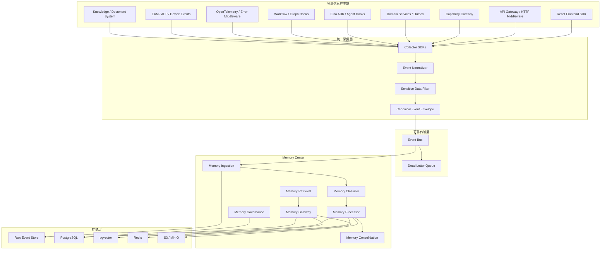
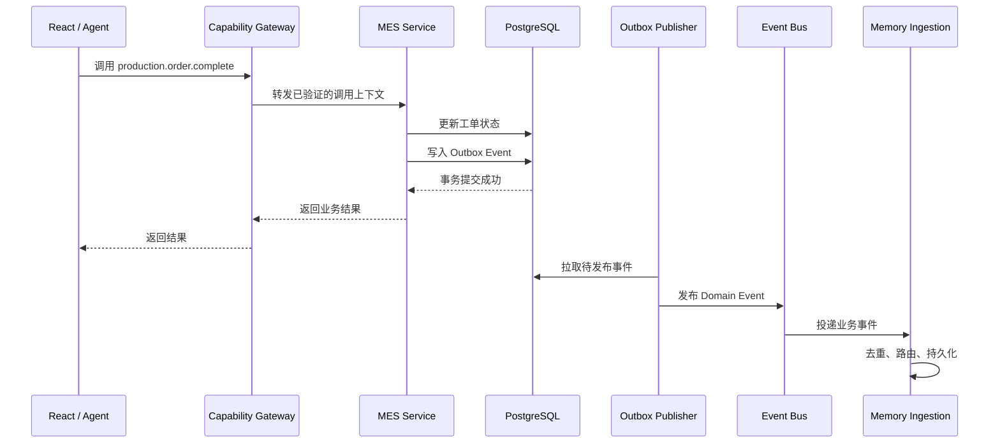
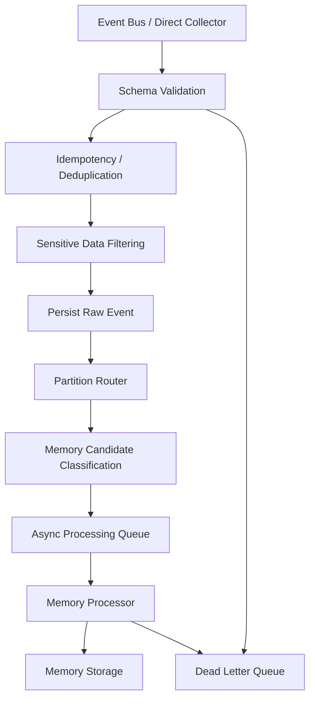
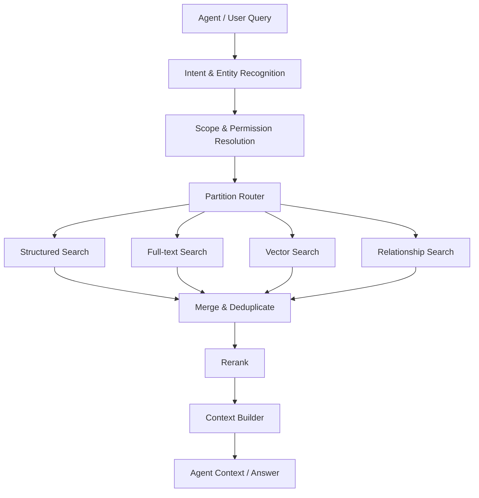

# AI-Native Memory Center 技术架构与开发规范

> 版本：1.0  
> 类型：技术架构、数据规范与实施指南  
> 适用范围：ERP、MES、WMS、QMS、APS、CRM、OA 及企业 Agent  
> 技术建议：Go、PostgreSQL、pgvector、Redis、Event Bus、OpenTelemetry、Eino  
> 核心原则：多源采集、事件驱动、异步提炼、分区治理、统一检索、权限优先

---

## 1. 建设目标

建设全平台共享的 **Memory Center（记忆中心）**，持续收集用户、Agent、业务系统和基础设施产生的信息，并将有长期价值、可检索、可复用的信息沉淀为记忆。

Memory Center 不只是 Agent 长期记忆、日志平台或 RAG 知识库。它需要支持：

- 用户与 Agent 的个性化记忆。
- 用户操作历史和审计关联。
- 系统异常、故障及解决经验。
- 企业业务过程与业务实体历史。
- 企业知识、规则、SOP 和经验。
- Agent、Workflow、Tool、Capability 执行历史。
- 记忆之间的实体、事件和因果关系。
- 基于历史信息的主动提醒、风险识别和辅助决策。

### 应用 Agent 与开发 Agent 的记忆使用

Memory Center 同时服务于应用运行和应用开发。应用 Agent 在授权范围内检索业务上下文、历史事件和经验，辅助完成业务任务；开发 Agent 在获得授权后使用用户习惯、系统异常及历史解决经验，分析问题、识别改进机会，并结合项目代码与工程规范完善功能。

两类使用者均须遵守租户、身份、数据范围和敏感信息治理。开发 Agent 应优先使用经过筛选、脱敏或聚合的记忆，并核对来源和时效；记忆不是修改、发布或访问其他租户数据的授权。代码变更和交付继续遵循项目审查与验证流程。该接入为规划内容，具体能力与授权机制按实施进度建设。

### 1.1 非目标

Memory Center 不取代：

- 业务数据库：业务当前状态仍以业务系统为准。
- 审计系统：审计记录保留原始、可验证的操作事实。
- 日志平台：原始日志和堆栈不应全部转成长期记忆。
- OpenTelemetry：Trace、Metric、Log 仍由可观测性体系负责。
- 知识库：文档原件、版本和审批仍由知识管理模块负责。
- Agent Runtime：Memory Center 提供记忆服务，不负责模型推理。

---

## 2. 核心架构决策：网关参与采集，但不是唯一采集点

**不能只依赖 API Gateway 或 Capability Gateway 收集所有信息。**

网关只能观察经过自身的请求，无法完整看到页面内部交互、业务事务最终结果、数据库提交、Agent 内部工具执行、设备报警以及异步任务结果。

推荐采用：

- 多源采集（Multi-Source Collection）
- 统一事件协议（Canonical Event Schema）
- 事件总线（Event Bus）
- Memory Ingestion（记忆摄取）
- Memory Processor（记忆处理）
- Memory Storage（记忆存储）
- Memory Retrieval（记忆检索）

### 2.1 总体架构



### 2.2 关键职责边界

| 层 | 负责什么 | 不负责什么 |
|---|---|---|
| 业务与运行时采集点 | 记录操作、结果和事件 | 自行总结长期记忆 |
| Collector SDK | 统一接口、上下文和事件格式 | 判断记忆长期价值 |
| Event Normalizer | 规范字段、时间、来源和类型 | 改写业务事实 |
| Sensitive Data Filter | 脱敏、过滤禁止采集内容 | 代替权限系统 |
| Event Bus | 可靠传递、重试、削峰 | 语义理解 |
| Memory Ingestion | 接收、去重、路由和持久化 | 执行实际业务操作 |
| Memory Processor | 分类、摘要、提炼、关联 | 修改业务数据库 |
| Memory Gateway | 检索、权限过滤和上下文组装 | 绕过业务权限 |
| Memory Governance | 保留、纠正、归档、删除和审计 | 改变业务数据 |

---

## 3. 六大记忆分区

分区是逻辑分类和治理边界，不意味着每个分区都要使用独立数据库。

### 3.1 Agent Memory：用户与 Agent 记忆

记录用户与 Agent 之间具有长期价值的事实、偏好、目标和经历。

| 子类型 | 说明 | 示例 |
|---|---|---|
| Profile Memory | 用户主动提供的背景 | 用户负责生产管理 |
| Semantic Memory | 相对稳定的事实 | 企业采用离散制造流程 |
| Preference Memory | 用户偏好 | 用户希望报表优先展示异常 |
| Episodic Memory | 历史经历 | 上次外协退料处理过程 |
| Project Memory | 项目上下文 | 正在建设 MES 与 WMS 集成 |
| Relationship Memory | 用户与项目、部门、Agent 的关系 | 用户负责某项目审批 |

要求：

- 用户明确表达的信息可以成为高优先级记忆候选。
- 从行为推断的偏好必须标注为推断，不能冒充用户明确表达。
- 支持用户确认、纠正和拒绝保存。
- 支持个人、项目、部门、组织等作用域。
- Agent 之间共享记忆必须经过授权。

### 3.2 Activity Memory：用户操作记忆

记录用户在系统中的操作轨迹：

- 页面访问、页面交互。
- 查询、创建、修改、删除。
- 审批、转交、撤回。
- 入库、出库、报工、完工等业务动作。
- 用户发起的 Agent 任务。
- 用户通过 Agent 执行的 Capability。

Activity、Audit、Domain Event 要区分：

| 类型 | 目标 | 示例 |
|---|---|---|
| Activity | 了解用户做过什么 | 用户打开生产工单详情 |
| Audit | 证明谁在何种权限下执行了什么变更 | 用户将数量从 100 修改为 120 |
| Domain Event | 表达业务事实发生变化 | 工单数量已调整为 120 |

三者通过 `event_id`、`trace_id`、`resource_id` 等关联，但不应简单合并。

### 3.3 Exception Memory：系统异常记忆

记录系统故障、业务异常、Agent 异常、Workflow 失败及解决经验。

异常生命周期：

```text
Detected -> Classified -> Fingerprinted -> Correlated
         -> Investigating -> Resolved / Unresolved
         -> Verified -> Consolidated
```

每条异常记忆尽可能包含：

- 原始异常引用、异常指纹。
- 模块、服务、版本和环境。
- 发生时间和影响范围。
- 关联 Trace、请求和业务实体。
- 原因分析及可信度。
- 解决方案及来源。
- 是否经过人工验证、是否复发。
- 最后验证时间。

原始日志、堆栈和 Trace 存在可观测性系统；Exception Memory 保存结构化摘要、关联关系和可复用经验。

根因应区分 `suspected`、`confirmed`、`unknown`；解决方案应区分建议、尝试和验证成功。不能仅凭 LLM 推测就标记为已确认。

### 3.4 Business Memory：业务过程记忆

记录业务实体的历史过程、状态变化、关联事件和处理结果。

适用 ERP 订单与采购、MES 工单与工序、WMS 库存与出入库、QMS 检验与质量处置、APS 排产与资源冲突等。

业务记忆不能取代业务主数据和交易记录。业务当前状态以业务数据库为准；Memory Center 负责历史检索、跨事件关联、经验总结和 Agent 上下文。

### 3.5 Knowledge Memory：知识与经验记忆

包含企业制度、SOP、工艺规范、设备说明书、产品技术文档、业务规则、历史问题解决方案和已审核的 AI 经验总结。

必须保留来源、版本、生效时间、失效时间、适用组织和审核状态。失效知识不能作为当前有效规则直接提供给 Agent。

### 3.6 Execution Memory：Agent 与 Workflow 执行记忆

记录：

- 任务目标和输入摘要。
- Agent / Workflow / Graph 标识和版本。
- 计划摘要（不保存隐藏推理链）。
- Tool、Capability 调用记录。
- 输入输出摘要和结果引用。
- 执行时间、重试、异常和取消。
- 人工审批和用户反馈。
- 最终任务状态。

不应把模型隐藏推理链（Chain of Thought）作为长期记忆保存，应保存可审计的任务摘要、决策依据、工具调用和执行结果。

---

## 4. 信息如何自动收集：多源采集设计

### 4.1 采集点总表

| 信息来源 | 采集位置 | 主要事件 | 目标分区 |
|---|---|---|---|
| 页面访问与交互 | React SDK | page_view、interaction | Activity |
| API 请求 | API Gateway / Middleware | request、response、access | Activity / Exception |
| 业务能力调用 | Capability Gateway | invocation、result、denied | Activity / Execution |
| 业务数据变更 | Domain Service / Outbox | created、updated、completed | Business / Activity |
| Agent 对话 | Agent Runtime Hook | user_message、task_result | Agent / Execution |
| Agent Tool 调用 | Tool / Capability Adapter | tool_started、tool_finished | Execution / Activity |
| Workflow | Workflow Runtime Hook | instance_started、node_failed | Execution / Exception |
| 系统异常 | Error Middleware / OTel | exception、error、trace | Exception |
| 数据库 | ORM / Repository / Audit | mutation、transaction | Activity / Audit |
| 设备系统 | EAM / AEP Connector | alarm、state_change | Business / Exception |
| 知识文档 | Knowledge Service | document_published、expired | Knowledge |

### 4.2 API Gateway 应采集什么

适合采集：

- Request ID、Trace ID。
- 请求路径、HTTP 方法。
- 用户身份和租户上下文。
- 请求时间、响应时间。
- HTTP 状态码。
- 来源客户端。
- 限流、鉴权失败和请求异常。

默认不记录完整请求体和响应体，避免密码、Token、个人信息和业务敏感数据泄漏。

API Gateway 不知道业务事务是否真正提交，因此不能把 HTTP 200 直接视为业务成功。

### 4.3 Capability Gateway 应采集什么

Capability Gateway 是重要采集点，因为页面、Workflow、Agent、MCP 等可能通过它调用业务能力。

```json
{
  "eventType": "capability.invocation.completed",
  "capability": "production.order.complete",
  "capabilityVersion": "1.0.0",
  "pluginId": "com.example.mes",
  "tenantId": "tenant_001",
  "principal": {
    "id": "user_001",
    "type": "user"
  },
  "source": {
    "type": "agent",
    "id": "mes-agent"
  },
  "resource": {
    "type": "production_order",
    "id": "MO20261104001"
  },
  "result": "success",
  "durationMs": 320,
  "traceId": "trace_001"
}
```

Gateway 记录调用主体、来源、Capability 名称和版本、目标资源、权限判定、耗时、状态、Trace ID 和安全过滤后的错误摘要。

但业务成功与否由业务服务在事务提交后发布 Domain Event，不能仅凭 Gateway 的调用返回推断最终业务事实。

### 4.4 React 前端 SDK

前端是观察页面内部交互的重要位置。建议采集页面访问、路由、重要操作、页面操作失败和用户主动反馈。

第一版不建议采集所有鼠标移动、键盘输入、完整 DOM、屏幕内容或表单原始值。表单优先记录字段名、操作类型和结果，不采集密码、身份证、银行卡等敏感值。

### 4.5 Domain Event / Transactional Outbox

这是企业应用业务事实的主要来源。

业务服务在一个数据库事务中：

1. 修改业务数据。
2. 写入 Outbox 事件。
3. 提交事务。

事件发布器异步把 Outbox 事件发送到 Event Bus。



要求：

- 业务数据与 Outbox 事件在同一事务中提交。
- Outbox Publisher 允许至少一次投递。
- 消费者必须幂等。
- 事件具有唯一 `event_id`。
- 失败事件进入重试或 DLQ。
- 不依赖前端上报作为业务成功的权威依据。

### 4.6 Agent Runtime Hooks

在 Eino ADK、Agent Runtime 和 Tool Adapter 中增加生命周期 Hook：

```text
Agent Task Received
  -> Context Retrieved
  -> Plan Created
  -> Tool Started
  -> Tool Finished
  -> Human Approval
  -> Task Completed / Failed
  -> Feedback Received
```

采集 Agent ID、版本、Task ID、Session ID、用户和租户上下文、使用的 Memory ID、Tool / Capability 调用、工具结果摘要、任务耗时和用户反馈。

不采集隐藏推理链。用户原始对话是否长期保存，应由隐私、租户配置和用户授权策略决定。

### 4.7 Workflow / Graph Hooks

采集 Workflow 定义 ID 和版本、实例 ID、Node ID 和类型、开始结束失败重试暂停事件、输入输出安全摘要或引用、人工任务和审批结果、关联 Capability、Agent 和业务资源。

大体积输入输出保存对象引用和摘要，不直接塞入事件总线。

### 4.8 系统异常采集

结合 HTTP 全局异常中间件、Go panic recovery、gRPC Interceptor、数据库错误包装、Workflow Node Error Hook、Agent Tool Error Hook、OpenTelemetry Logs / Traces、设备报警事件。

分为两层：

1. 原始观测：日志、堆栈、Trace、指标，交给 Observability。
2. 异常事件：错误指纹、模块、资源、影响、结果和来源，交给 Memory Ingestion。

Memory Processor 后续再提炼 Exception Memory。

---

## 5. 统一事件协议 Canonical Event Schema

所有采集端映射到统一 Event Envelope，避免每个模块创建完全不同的数据格式。

### 5.1 通用事件结构

```json
{
  "eventId": "evt_01J...",
  "eventType": "business.production_order.completed",
  "eventVersion": "1.0",
  "occurredAt": "2026-11-04T09:30:00+08:00",
  "ingestedAt": "2026-11-04T09:30:01+08:00",
  "tenantId": "tenant_001",
  "organizationId": "org_001",
  "actor": {
    "id": "user_001",
    "type": "user"
  },
  "source": {
    "type": "capability",
    "id": "production.order.complete",
    "module": "mes",
    "pluginId": "com.example.mes",
    "pluginVersion": "1.0.0"
  },
  "action": {
    "name": "complete",
    "result": "success"
  },
  "resource": {
    "type": "production_order",
    "id": "MO20261104001"
  },
  "context": {
    "sessionId": "session_001",
    "taskId": "task_001",
    "workflowInstanceId": null,
    "traceId": "trace_001",
    "correlationId": "corr_001",
    "causationId": "evt_previous"
  },
  "classification": {
    "candidatePartitions": ["activity", "business"],
    "sensitivity": "internal"
  },
  "payload": {
    "status": "completed",
    "completedQuantity": 100
  },
  "schema": {
    "name": "production_order.completed",
    "version": "1.0"
  }
}
```

### 5.2 必需字段

| 字段 | 说明 |
|---|---|
| eventId | 全局唯一事件 ID |
| eventType | 事件类型 |
| eventVersion | Envelope 版本 |
| occurredAt | 实际发生时间 |
| ingestedAt | 进入平台时间 |
| tenantId | 租户 |
| actor | 用户、Agent、系统或设备 |
| source | 产生来源 |
| resource | 关联业务实体 |
| traceId | 分布式链路 |
| correlationId | 同一业务过程关联 |
| causationId | 事件因果来源 |
| payload | 事件内容 |
| classification | 初步分类与敏感等级 |

### 5.3 事件命名

```text
activity.page.viewed
activity.record.updated

capability.invocation.started
capability.invocation.completed
capability.invocation.failed

business.production_order.created
business.production_order.completed

agent.task.started
agent.task.completed
agent.tool.failed

workflow.instance.started
workflow.node.failed

system.exception.detected
system.exception.resolved

device.alarm.raised
device.state.changed

knowledge.document.published
knowledge.document.expired
```

### 5.4 可靠性要求

- 使用唯一事件 ID。
- 允许至少一次投递，不假设端到端 exactly-once。
- 消费端通过 Inbox / 去重表保证幂等。
- 业务事件优先使用 Outbox。
- 失败进入重试队列或 DLQ。
- 记录 Schema 版本。
- 支持迟到和乱序事件。
- 保留事件来源和原始时间。
- LLM、Embedding 不可用不能导致关键原始事件丢失。

---

## 6. Memory Ingestion：记忆摄取引擎

负责可靠接收原始事件，并送往正确的处理流程。



### 6.1 处理顺序

1. 校验事件格式。
2. 根据 `eventId` 去重。
3. 执行敏感字段过滤。
4. 保存原始事件或不可变事件引用。
5. 进入异步记忆处理队列。
6. 处理成功后更新状态。

**不要先调用 LLM，再决定是否保存原始事件。**

### 6.2 事件是否成为长期记忆

不是每个事件都应该生成长期记忆。

| 事件 | 原始事件保留 | 长期记忆策略 |
|---|---|---|
| 页面访问 | 按策略保留 | 通常不生成 |
| 普通按钮点击 | 按策略保留 | 通常不生成 |
| 用户明确表达偏好 | 保留来源 | 可生成候选 |
| 生产工单完工 | 业务系统保留 | Business Memory 候选 |
| 重复设备报警 | 保留报警事件 | 聚类后生成异常记忆 |
| Agent 任务完成 | 保留执行记录 | 有价值时提炼 |
| Workflow 失败 | 保留执行事件 | Exception 候选 |
| 已审核 SOP 发布 | 保留文档版本 | Knowledge Memory |
| 普通 HTTP 200 | 可采样观测 | 通常不生成 |

建议规则优先分类，再使用 LLM 做语义摘要、实体提取和经验提炼。

---

## 7. Memory Processor：记忆处理引擎

Processor 是可组合流水线，而不是单次大模型调用。

### 7.1 处理阶段

```text
Input Event
   |
   v
Partition Classification
   |
   v
Entity Extraction
   |
   v
Sensitive Data Check
   |
   v
Summarization
   |
   v
Deduplication / Clustering
   |
   v
Importance & Confidence Assessment
   |
   v
Relationship Extraction
   |
   v
Embedding Generation
   |
   v
Memory Validation
   |
   v
Persist Memory
```

### 7.2 规则与模型职责

| 工作 | 优先方式 |
|---|---|
| Event Schema 校验 | 确定性规则 |
| 用户、租户、时间识别 | 可信上下文 |
| 分区初步路由 | 规则 |
| 敏感字段过滤 | 规则和 DLP |
| 异常指纹 | 规则、错误码、堆栈归一化 |
| 文本摘要 | LLM |
| 实体提取 | 规则 + LLM |
| 记忆合并 | 相似度 + 规则 + 人工确认 |
| 经验提炼 | LLM + 验证规则 |
| 向量化 | Embedding Model |
| 记忆删除 | 治理策略，不由 LLM 决定 |

### 7.3 记忆状态

- `candidate`：候选记忆。
- `active`：有效记忆。
- `verified`：经过验证。
- `disputed`：存在冲突。
- `superseded`：被新版本取代。
- `archived`：归档。
- `deleted`：按治理流程删除或逻辑删除。

每条记忆保留来源、置信度、验证状态、生效时间和失效时间。LLM 推断不能与用户明确表达、业务权威数据或已审核文档混为一谈。

---

## 8. Memory Consolidation：记忆整合

负责从大量事件中提炼稳定、可复用的信息。

### 8.1 用户偏好示例

多次行为表明用户习惯先查看异常再处理生产任务：

1. 汇总用户相关操作。
2. 识别重复模式。
3. 生成偏好候选。
4. 判断样本量和时间跨度。
5. 用户确认或按租户策略授权后转为长期记忆。

### 8.2 系统异常经验示例

多台同型号设备重复出现相同报警：

1. 根据异常指纹聚类。
2. 查询设备型号、固件和环境。
3. 对比历史解决记录。
4. 生成可能原因。
5. 人工验证解决方案。
6. 形成组织级异常经验。

### 8.3 业务经验示例

多次生产计划调整后：

1. 关联工单、设备、工序和资源。
2. 统计调整前后的实际结果。
3. 区分相关性与因果关系。
4. 生成经验候选。
5. 经业务人员确认后发布。

### 8.4 整合策略

- 按用户、Agent、项目、设备、业务实体和异常指纹分组。
- 采用定时批处理与事件触发结合。
- 设置最小样本量和时间窗口。
- 识别新旧事实冲突。
- 保留来源事件，不覆盖原始事实。
- 对重要组织级经验提供审核流程。

---

## 9. Memory Storage：存储架构

### 9.1 推荐存储组合

| 存储 | 第一阶段 | 用途 |
|---|---|---|
| PostgreSQL | 必须 | 事件索引、记忆元数据、结构化记忆 |
| pgvector | 推荐 | 语义向量检索 |
| Redis | 推荐 | 热记忆、Session 缓存、检索缓存 |
| S3 / MinIO | 按需 | 大型原始内容、附件和快照 |
| ClickHouse | 后期 | 高频操作和事件分析 |
| Loki / Tempo | 按需 | 日志和 Trace 可观测性 |

第一阶段建议 PostgreSQL + pgvector + Redis + OpenTelemetry 起步。

### 9.2 逻辑数据模型

| 表 | 用途 |
|---|---|
| `memory_events` | 标准化原始事件索引 |
| `memory_items` | 记忆主表 |
| `memory_embeddings` | 向量及模型版本 |
| `memory_relations` | 记忆之间的关系 |
| `memory_sources` | 记忆来源引用 |
| `memory_partitions` | 分区配置 |
| `memory_policies` | 保留、权限和治理策略 |
| `memory_feedback` | 用户纠正和评价 |
| `memory_jobs` | 异步处理任务 |
| `memory_dedup` | 去重和幂等 |
| `memory_access_audit` | 记忆读取审计 |

大型原始日志不必复制进 `memory_events`，可以保存来源系统、对象引用、摘要和 Trace ID。

### 9.3 Memory Item 示例

```json
{
  "memoryId": "mem_001",
  "tenantId": "tenant_001",
  "partition": "exception",
  "memoryType": "device_alarm_resolution",
  "scope": {
    "type": "organization",
    "id": "org_001"
  },
  "title": "CNC 主轴温度报警处理经验",
  "summary": "该设备出现主轴温度报警时，应先检查冷却系统状态。",
  "content": {
    "symptom": "主轴温度报警",
    "suspectedCause": "冷却系统异常",
    "resolution": "检查冷却液和冷却泵",
    "verification": "待人工验证"
  },
  "source": {
    "type": "exception_event",
    "ids": ["evt_001", "evt_002"]
  },
  "confidence": 0.82,
  "importance": 0.9,
  "verificationStatus": "unverified",
  "status": "candidate",
  "validFrom": "2026-11-04T09:30:00+08:00",
  "validTo": null
}
```

### 9.4 记忆作用域

```text
Global
  └── Tenant
       └── Organization
            └── Department
                 └── User

Project
Agent
Business Entity
Workflow Instance
Device
```

作用域是权限边界的一部分，不是简单标签。检索必须同时执行租户隔离、主体授权、资源权限和分区策略。

---

## 10. Memory Retrieval：记忆检索引擎

### 10.1 读取流程



### 10.2 检索类型

- 精确检索：单据号、用户 ID、设备 ID、异常编号。
- 结构化过滤：租户、分区、时间、状态、来源和权限。
- 全文检索：关键词和字段。
- 向量检索：语义相似度。
- 关系检索：用户、设备、工单、异常和解决方案关联。
- 混合检索：多通道合并和重排序。

排序综合语义相关性、实体匹配、时间新鲜度、重要性、来源可信度、验证状态、作用域和权限，不能只按向量相似度排序。

### 10.3 Context Builder

检索结果不能无限制塞入 Agent 上下文。Context Builder 负责：

1. 删除无权限结果。
2. 合并重复记忆。
3. 标记事实、推断和未经验证的经验。
4. 控制 Token 预算。
5. 保留来源引用。
6. 输出结构化 Memory Context。

示例：

```json
{
  "queryId": "mq_001",
  "memories": [
    {
      "memoryId": "mem_001",
      "partition": "exception",
      "summary": "该设备历史上出现过相同报警",
      "verificationStatus": "verified",
      "sourceRefs": ["evt_001", "workorder_001"]
    }
  ],
  "warnings": [
    "部分历史解决方案尚未验证"
  ]
}
```

---

## 11. 与 Capability Registry、Eino 和 Event Hub 集成

### 11.1 Capability Registry

建议注册：

| Capability | 用途 |
|---|---|
| `memory.write` | 写入记忆候选 |
| `memory.search` | 语义检索 |
| `memory.retrieve` | 多通道组合检索 |
| `memory.summarize` | 生成摘要 |
| `memory.consolidate` | 整合记忆 |
| `memory.relate` | 建立记忆关联 |
| `memory.feedback` | 记忆纠正与评价 |
| `memory.archive` | 归档 |
| `memory.delete` | 按治理策略删除 |

注意：

- `memory.write` 不等于允许 Agent 任意写入长期事实。
- 普通 Agent 可以提交候选，是否生效由规则和治理策略决定。
- 自动采集不依赖 Agent 主动调用 `memory.write`。
- `memory.delete` 需要严格权限和审计。
- 检索可以由 Runtime Hook 自动注入，也可以由 Agent 显式调用。

### 11.2 Eino 集成

- Agent Runtime Hook 收集任务和工具事件。
- Agent Memory Adapter 注入检索结果。
- Memory Search 可选暴露为 ADK Tool。
- Memory Consolidation 可设计为后台 Workflow。
- Workflow Node 支持人工审核、纠正和经验发布。

### 11.3 Event Hub 集成

```text
Domain Event
  ├── Activity Consumer
  ├── Business Memory Consumer
  ├── Analytics Consumer
  └── AI Trigger Consumer
```

不同消费者独立处理，避免一个消费者失败阻塞所有下游。

### 11.4 Observability 集成

OpenTelemetry 负责 Logs、Metrics、Traces。Memory Center 消费经过筛选的异常事件和引用，不复制全部高基数遥测数据。

---

## 12. Go 后端模块设计

### 12.1 子模块职责

| 模块 | 职责 |
|---|---|
| `collector` | 多来源事件接收 |
| `normalizer` | 标准事件规范化 |
| `ingestion` | 校验、去重、持久化和路由 |
| `partition` | 分区策略 |
| `classifier` | 事件和记忆分类 |
| `processor` | 摘要、实体提取、向量化 |
| `consolidation` | 记忆合并和经验提炼 |
| `retrieval` | 多通道检索 |
| `context` | Agent 上下文组装 |
| `gateway` | 统一权限与调用 |
| `governance` | 保留、归档、删除和纠正 |
| `scheduler` | 异步任务、定时整理 |
| `observability` | 指标、Trace 和处理质量 |

### 12.2 建议目录

```text
internal/
  memory/
    collector/
      frontend/
      api/
      capability/
      agent/
      workflow/
      exception/
      device/
    normalizer/
    ingestion/
    partition/
    classifier/
    processor/
    consolidation/
    retrieval/
      structured/
      fulltext/
      vector/
      relation/
      rerank/
    context/
    storage/
      postgres/
      pgvector/
      redis/
      object/
    gateway/
    governance/
    scheduler/
    observability/

sdk/
  memory/
    contract/
    event/
    collector/
    adapter/
    testing/
```

### 12.3 核心接口示例

```go
type EventCollector interface {
    Collect(ctx context.Context, event CanonicalEvent) error
}

type MemoryProcessor interface {
    Process(ctx context.Context, event CanonicalEvent) ([]MemoryCandidate, error)
}

type MemoryRepository interface {
    Save(ctx context.Context, item MemoryItem) error
    Get(ctx context.Context, id string) (*MemoryItem, error)
}

type MemoryRetriever interface {
    Retrieve(
        ctx context.Context,
        query MemoryQuery,
    ) (MemoryResult, error)
}
```

接口为架构草案，正式实现需补充租户上下文、幂等键、版本控制、分页、错误类型和取消语义。

---

## 13. 权限、隐私与数据治理

记忆系统会跨用户、部门、项目和业务域聚合数据，权限设计必须优先于语义检索。

### 13.1 权限规则

每条记忆至少具备：

- `tenant_id`
- `scope_type`
- `scope_id`
- `owner_id`
- `classification`
- `sensitivity`
- `allowed_principals` 或策略引用
- `retention_policy`

检索必须强制执行权限过滤。不能先把所有向量结果返回给 Agent，再让模型自行判断哪些能看。

### 13.2 敏感信息

默认不采集或必须脱敏：

- 密码、API Key、Access Token。
- 身份证件、银行卡等高敏感个人信息。
- 不必要的个人隐私字段。
- 未经授权的对话和文件内容。
- 不必要的完整请求体、响应体和表单原始值。

### 13.3 生命周期

| 数据类型 | 生命周期策略 |
|---|---|
| Working Memory | 任务结束后按短期策略清理 |
| Activity Event | 按企业审计和合规策略保留 |
| Exception Event | 按运维和故障分析策略保留 |
| Agent Preference | 用户可查看、纠正和删除 |
| Business Memory | 按业务数据生命周期 |
| Knowledge Memory | 按文档版本和有效期 |
| Execution Memory | 按审计、调试和成本策略 |

保留时间由企业合规和业务要求配置，不能在平台代码中写死统一期限。

### 13.4 删除与纠正

- 用户纠正记忆时保留纠正来源和版本。
- 删除个人记忆时检查向量、缓存、摘要和关联索引。
- 原始审计数据删除遵循法定和企业保留要求。
- 支持删除传播任务和执行结果审计。
- 被其他记忆引用的内容应重新计算或标记失效。
- 删除不能只删除 PostgreSQL 主记录而遗留向量副本。

---

## 14. 可靠性、性能与成本

### 14.1 可靠性

- 原始事件优先可靠落地。
- LLM、Embedding 不在同步业务请求关键路径。
- Outbox + Event Bus 保证业务事件可靠发布。
- 消费者幂等。
- 失败进入重试队列和 DLQ。
- 处理任务可恢复。
- 支持事件重放。
- 支持处理器版本升级和重新处理。

### 14.2 性能

- 前端采集采用批量发送和采样。
- API Gateway 只记录必要元数据。
- Capability Gateway 记录调用事实，不同步执行 LLM 总结。
- 原始事件和记忆处理解耦。
- 向量化异步批处理。
- 热记忆使用 Redis。
- 检索限制时间范围、分区和结果数量。
- Context Builder 控制 Token Budget。

### 14.3 成本

- 规则能完成的分类不调用 LLM。
- 重复异常先指纹聚类，再生成摘要。
- 低价值页面事件不生成 Embedding。
- 仅对记忆候选和知识内容向量化。
- 摘要增量更新，避免每次重新总结全部历史。
- 为每个租户设置存储、Embedding 和 LLM 处理配额。

---

## 15. Memory Console 管理后台

建议建设独立管理界面：

1. 总览：各分区数量、增长趋势、处理队列和存储用量。
2. 分区管理：配置、启停、保留策略和权限策略。
3. 记忆浏览：搜索、查看、纠正、关联和归档。
4. 用户记忆：用户、Agent 和项目记忆。
5. 操作记录：操作轨迹与审计关联。
6. 异常中心：异常指纹、聚类、解决方案和复发率。
7. 业务记忆：按工单、设备、订单和供应商检索历史。
8. 知识记忆：来源、版本、有效期和审核状态。
9. 执行记忆：Agent、Tool、Workflow 执行历史。
10. 检索调试：召回来源、权限过滤和排序结果。
11. 治理中心：保留、删除、纠正和审计。
12. 质量中心：重复率、过期率、处理成功率和检索命中率。

权限建议：

- 普通用户：查看和管理本人可见的个人记忆。
- 部门管理员：管理授权范围内的部门记忆。
- 系统管理员：配置分区、处理器和保留策略。
- 安全审计人员：查询授权范围内的访问与变更审计。
- Agent：只能通过授权 Memory Gateway 访问。

---

## 16. 分阶段实施路线

### Phase 1：采集基础与统一数据模型

交付：

1. Canonical Event Schema。
2. Memory SDK。
3. React Activity SDK。
4. API / Capability Middleware。
5. Domain Event + Transactional Outbox。
6. Agent / Workflow Hooks。
7. 全局 Exception Collector。
8. Event Bus 接入。
9. PostgreSQL 原始事件和记忆基础表。
10. 租户、身份和 Trace 关联。

验收：

- 页面、API、Capability、Agent、Workflow 和业务事件进入统一事件模型。
- 关键业务事件在事务提交后可靠发布。
- 事件具备唯一 ID 和幂等处理。
- LLM 服务不可用不影响原始事件保存。

### Phase 2：基础 Memory Center

交付：

1. Memory Manager。
2. 六大分区基础模型。
3. Memory Gateway。
4. 结构化查询。
5. 权限过滤。
6. 生命周期管理。
7. 用户记忆管理接口。
8. Activity / Exception / Execution 原始记录关联。

验收：

- 可以按用户、租户、项目、业务实体查询记忆。
- 越权记忆不可检索。
- 支持查看来源和纠正记忆。
- 原始事件与长期记忆可以区分。

### Phase 3：智能记忆处理

交付：

1. Memory Classifier。
2. LLM 摘要和实体提取。
3. 异常指纹与聚类。
4. Embedding。
5. pgvector 混合检索。
6. 记忆去重和冲突识别。
7. Memory Consolidation。
8. 用户反馈闭环。

验收：

- 重要事件生成记忆候选。
- 候选记忆保留来源和置信状态。
- 相似异常可检索历史处理记录。
- 未验证推断不会冒充已确认事实。

### Phase 4：Agent 与业务深度集成

交付：

1. Eino Agent Memory Adapter。
2. Workflow Memory Node。
3. Capability Registry 集成。
4. Agent 上下文自动注入。
5. 业务实体关系检索。
6. 主动提醒和风险提示。
7. 人工审核与反馈闭环。

验收：

- Agent 按当前权限检索相关记忆。
- MES、WMS、QMS 事件可关联历史过程。
- Agent 执行记录可检索和审计。
- 高风险业务操作仍执行既定权限和审批。

### Phase 5：企业级治理与规模化

交付：

1. Memory Console。
2. ClickHouse / 专用日志系统按需扩展。
3. 记忆质量评估。
4. 租户级配额。
5. 数据保留与删除自动化。
6. 处理任务监控和事件重放。
7. 插件化记忆处理器。
8. 组织级经验审核和发布。

---

## 17. 第一阶段开发任务建议

| 序号 | 任务 | 依赖 |
|---|---|---|
| 1 | 定义 Canonical Event Schema | 无 |
| 2 | 定义 Memory SDK 和 Collector 接口 | 1 |
| 3 | 建立 PostgreSQL Event / Memory 表 | 1 |
| 4 | 实现 Event Ingestion、幂等和 DLQ | 1、2、3 |
| 5 | 实现 API / Capability Collector | 2 |
| 6 | 实现 Domain Event + Outbox | 1、3 |
| 7 | 实现 Agent / Workflow Hooks | 2 |
| 8 | 实现 React Activity SDK | 2 |
| 9 | 实现 Exception Collector | 2 |
| 10 | 实现 Memory Gateway 和权限过滤 | 3、4 |
| 11 | 实现六大分区基础查询 | 10 |
| 12 | 增加异步 Processor 和 Embedding | 4、10 |

第一阶段不建议直接实现完整自动记忆推理、知识图谱或复杂多 Agent 记忆共享。

---

## 18. 关键验收场景

### 场景 A：用户操作自动采集

1. 用户在 MES 页面修改工单。
2. 前端记录交互事件。
3. Capability Gateway 记录调用主体和来源。
4. MES Service 提交业务事务和 Outbox。
5. Outbox 发布业务事件。
6. Memory Center 保存事件。
7. Activity 和 Business 分区可以查询关联记录。

### 场景 B：系统异常自动沉淀

1. Workflow Node 执行失败。
2. Runtime Hook 记录失败事件。
3. OpenTelemetry 关联 Trace 和日志。
4. Memory Ingestion 接收异常事件。
5. Exception Processor 生成异常指纹。
6. 检索历史相似异常。
7. Agent 生成解决建议。
8. 人工确认处理结果。
9. 解决经验进入已验证记忆。

### 场景 C：Agent 使用用户记忆

1. 用户发起任务。
2. Agent Runtime 识别当前任务和作用域。
3. Memory Gateway 按权限检索。
4. Context Builder 返回有限的相关记忆。
5. Agent 使用记忆完成任务。
6. 执行结果写入 Execution Memory。
7. 有长期价值的内容进入记忆候选。

### 场景 D：历史异常主动提醒

1. 用户准备下发生产工单。
2. 业务事件触发风险检查。
3. 查询关联设备的历史异常。
4. 查询对应工序的历史延期记录。
5. 生成有来源依据的风险提示。
6. 用户确认后继续操作。

---

## 19. 最终技术决策

| 层级 | 推荐方案 |
|---|---|
| 记忆中心 | 自研 Memory Center |
| 后端 | Go |
| 采集协议 | Canonical Event Schema |
| 采集 SDK | 自研 Go / TypeScript SDK |
| 页面采集 | React Activity SDK |
| API 采集 | HTTP Middleware |
| 业务事实采集 | Domain Event + Transactional Outbox |
| 能力采集 | Capability Gateway Middleware |
| Agent 采集 | Eino / Agent Runtime Hooks |
| Workflow 采集 | Workflow / Graph Hooks |
| 异常采集 | Error Middleware + OpenTelemetry |
| 事件传输 | Event Bus |
| 结构化存储 | PostgreSQL |
| 向量检索 | pgvector |
| 缓存 | Redis |
| 原始附件 | S3 / MinIO |
| 事件分析 | 后期按需 ClickHouse |
| 记忆处理 | Rules + LLM + Embedding |
| 权限 | IAM + Memory Policy |
| 编排 | Eino Workflow / Graph |
| 可观测性 | OpenTelemetry |

---

## 20. 参考资料

- Eino：<https://www.cloudwego.io/docs/eino/>
- OpenTelemetry：<https://opentelemetry.io/docs/>
- PostgreSQL：<https://www.postgresql.org/docs/>
- pgvector：<https://github.com/pgvector/pgvector>
- Redis：<https://redis.io/docs/latest/>
- gRPC：<https://grpc.io/docs/>
- Protocol Buffers：<https://protobuf.dev/>
- ClickHouse：<https://clickhouse.com/docs>
- Grafana Loki：<https://grafana.com/docs/loki/latest/>
- MinIO：<https://min.io/docs/>

---

## 21. 架构总结

Memory Center 是 AI-Native 平台的共享记忆基础设施。

它不是单一向量数据库，也不是简单 Agent 长期记忆，而是一套从信息采集、事件传输、记忆提炼、分区存储、关系关联、权限检索到经验复用的完整系统。

最重要的设计原则：

1. **多源采集，而不是只依赖网关。**
2. **原始事实先可靠保存，再异步生成记忆。**
3. **业务事件以业务事务和 Outbox 为权威来源。**
4. **日志、审计、业务事件和长期记忆分层管理。**
5. **规则负责确定性分类，LLM 负责语义提炼。**
6. **所有记忆保留来源、作用域、可信状态和生命周期。**
7. **所有检索先执行权限过滤，再交给 Agent。**
8. **Memory Center 服务全平台，而不是只服务某一个 Agent。**

最终原则：

> **系统负责记住发生过什么，Memory Engine 负责理解哪些信息值得记住，Agent 负责在合适的时机使用这些记忆。**
