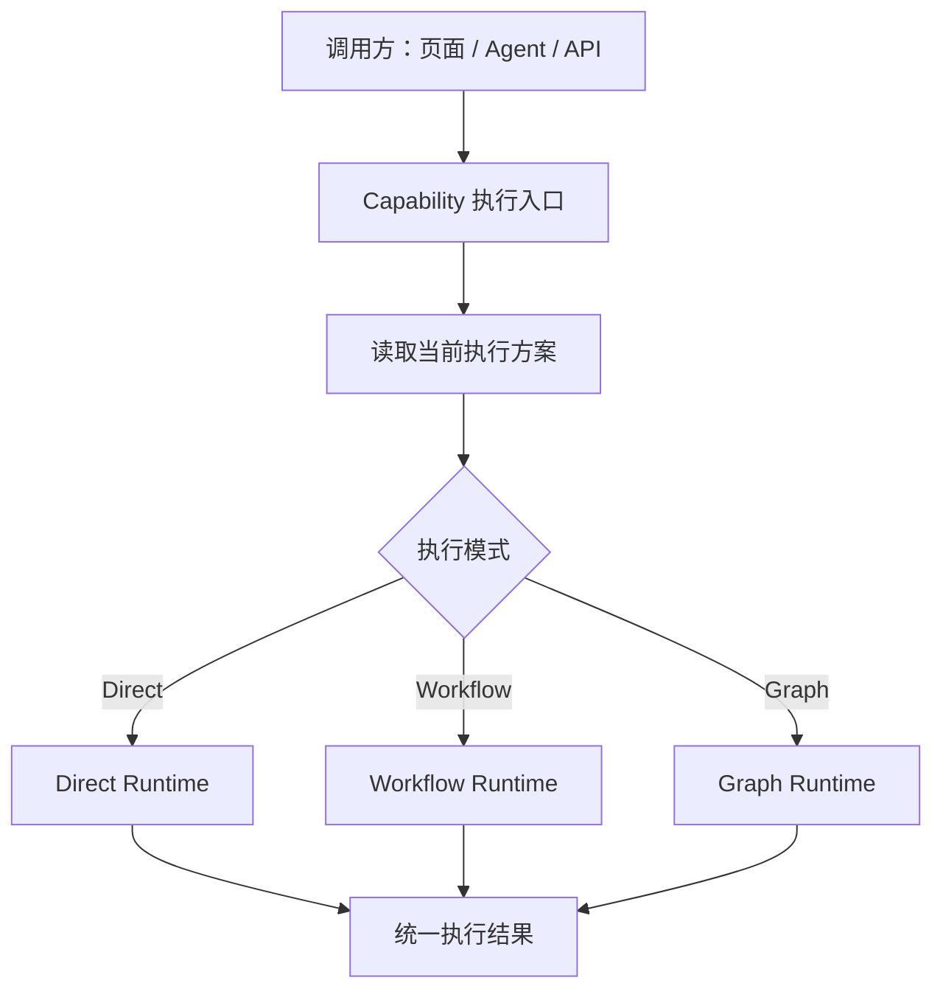
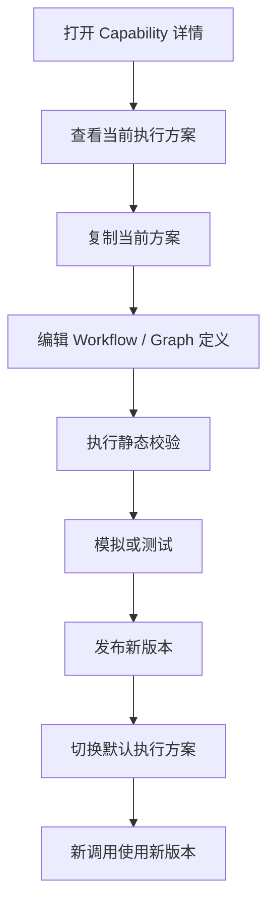

# Capability 柔性编排功能方案
## Capability Flexible Orchestration

> 版本：1.0  
> 类型：功能方案与技术实施说明  
> 范围：仅描述 Capability 的默认执行方案、重新编排、发布切换和运行机制。

---

# 1. 功能目标

为每个注册的 Capability 提供统一执行方案入口，使其既可以按原有方式直接执行，也可以根据业务需要重新编排执行过程。

核心目标：

1. 每个 Capability 自动拥有一个默认执行方案。
2. 默认方案可以是直接调用原生 Go Handler，不强制使用 Workflow。
3. 需要调整业务过程时，可以将执行方式切换为 Workflow 或 AI Graph。
4. 新方案经过校验和发布后，可以成为该 Capability 的默认执行方案。
5. 页面、Agent、API 等调用方始终使用同一个 Capability ID，不需要感知内部执行方式变化。
6. 已启动的流程实例固定使用启动时的方案版本，不受后续发布影响。
7. 编排只能调整执行过程，不能绕过领域规则、权限和事务约束。

**核心原则：统一执行入口，默认直接执行，按需柔性编排，发布后切换默认方案。**

# 2. 功能边界

## 2.1 本功能负责

- Capability 默认执行方案。
- 执行模式选择。
- 编排定义的保存和版本管理。
- Capability 与执行方案的绑定。
- 执行方案解析和调度。
- 基础校验、发布和回滚。
- 执行过程及方案版本记录。

## 2.2 本功能不负责

- 重新定义 Capability 的业务含义。
- 修改 Capability 的输入输出契约。
- 建设完整 BPMN 流程平台。
- 自行实现 Agent 或大模型推理框架。
- 替代领域服务和数据库事务。
- 第一阶段实现复杂的多层级组织、工厂、车间和生产线规则匹配。
- 让 AI 自动修改并直接发布生产流程。

# 3. 核心设计

## 3.1 整体执行链路

所有调用方使用统一 Capability ID 发起调用，系统根据当前生效的执行方案决定具体执行方式。



调用方只需要知道 Capability ID、输入参数和输出契约，不需要知道内部使用 Go Handler、Workflow 还是 Graph。

## 3.2 四个核心对象

| 对象 | 作用 |
|---|---|
| Capability | 业务能力定义，包含稳定 ID 和输入输出契约 |
| Execution Plan | 该能力的具体执行方案 |
| Plan Version | 执行方案的不可变版本 |
| Execution Binding | 指定当前 Capability 使用哪个 Plan Version |

四者保持独立，不将 Capability 定义与 Workflow 定义合并。

# 4. 执行模式

第一阶段支持三种执行模式。

| 模式 | 标识 | 执行方式 | 适用场景 |
|---|---|---|---|
| Direct | `direct` | 直接调用原生 Go Handler | CRUD、查询、简单原子业务 |
| Workflow | `workflow` | 交给 Workflow Runtime 执行 | 审批、条件分支、人工任务、跨能力组合 |
| Graph | `graph` | 通过适配器调用 Eino Graph | AI 推理、Agent 协作、智能分析 |

## 4.1 Direct

Direct 是每个 Capability 的默认执行方式。

```text
production.order.release
        |
        v
Direct Runtime
        |
        v
Go Handler
        |
        v
执行结果
```

Direct 也是正式的 Execution Plan，具有 Plan ID、版本和执行记录。

## 4.2 Workflow

当业务需要增加审批、判断、等待或组合其他能力时，可以将默认方案切换为 Workflow。

```text
生产工单下达
    |
检查工单状态
    |
检查物料齐套
    |
主管审批
    |
调用工单下达 Handler
    |
完成
```

Workflow 负责业务流程控制，实际业务写操作仍由受控的 Capability 或领域 Handler 完成。

## 4.3 Graph

Graph 用于需要 AI 推理的执行过程。

```text
生产异常分析
    |
Eino Graph
    |
检索历史异常
    |
分析设备和工艺数据
    |
生成结构化分析结果
    |
返回结果
```

第一阶段只需要提供 Graph Adapter，不需要额外建设 Graph 引擎。

## 4.4 Workflow 与 Graph 组合

不单独开发 Hybrid Runtime。需要在业务流程中使用 AI 时，由 Workflow 调用 Graph 节点即可。

```text
Workflow
   |
AI 风险分析（Eino Graph）
   |
条件判断
   |
   +--> 高风险：人工审批
   |
   +--> 低风险：继续执行
   |
调用业务 Capability
```

# 5. 默认执行方案

## 5.1 自动创建

Capability 注册成功时，系统自动创建一个 Direct Plan。

```json
{
  "planId": "production.order.release.default",
  "capabilityId": "production.order.release",
  "name": "生产工单下达默认方案",
  "mode": "direct",
  "version": 1,
  "implementationRef": "mes.production.order.release.handler",
  "status": "published"
}
```

即使用户从未配置编排，原有业务也可以正常执行。

## 5.2 默认方案规则

- 每个 Capability 必须存在一个可执行的默认方案。
- 初始默认方案为 Direct。
- 新建编排不会自动影响线上执行。
- 只有发布并切换 Binding 后，新方案才正式生效。
- 如果新方案发布或绑定失败，继续使用原有有效方案。

# 6. 重新编排与发布

## 6.1 操作流程



## 6.2 方案状态

第一阶段只需要：

| 状态 | 说明 |
|---|---|
| Draft | 草稿，可以编辑 |
| Validated | 校验通过 |
| Published | 已发布，可以被绑定 |
| Archived | 已归档，不再用于新绑定 |

Active 不必作为 Plan 的独立生命周期状态，可以由 Binding 表示当前是否生效。

## 6.3 发布规则

发布前至少检查：

- Capability 是否存在。
- 输入输出 Schema 是否兼容。
- 引用的 Handler、Capability 或 Graph 是否存在。
- 节点配置是否完整。
- 节点权限是否满足。
- 是否存在可检测的循环依赖。
- 是否存在非法或不支持的节点类型。

发布成功后生成不可变版本。

## 6.4 回滚

回滚不修改历史版本，而是将默认 Binding 切回之前已发布的版本。

- 新调用使用回滚后的版本。
- 已启动的流程实例继续使用启动时的版本。
- 发布、切换和回滚均记录操作者、时间、版本和原因。

# 7. Execution Binding：默认方案绑定

## 7.1 第一阶段范围

为了控制复杂度，第一阶段只支持：

- Platform：平台默认方案。
- Tenant：租户覆盖方案。

暂不实现应用、工厂、车间、生产线等多层级匹配。未来确实出现业务需求时再扩展。

## 7.2 解析规则

```text
优先查找当前 Tenant 的有效 Binding
            |
            +--> 存在：使用租户绑定方案
            |
            +--> 不存在：使用 Platform 默认方案
```

同一 Capability、同一 Scope 只能有一个有效 Binding。

## 7.3 Binding 示例

```json
{
  "bindingId": "binding_001",
  "capabilityId": "production.order.release",
  "scopeType": "tenant",
  "scopeId": "tenant_001",
  "planId": "release-order",
  "planVersion": 2,
  "status": "active"
}
```

如果当前系统尚无租户覆盖需求，可以先只实现 Platform Binding，数据模型保留 `scopeType` 扩展能力。

# 8. 关键执行规则

## 8.1 内部调用规则

必须区分两种调用。

**调用其他 Capability 的默认方案：**

```text
Workflow
   -> Capability Gateway
   -> Resolver
   -> 目标 Capability 当前默认方案
```

**调用当前 Capability 的原生 Handler：**

```text
Workflow
   -> Native Handler
   -> 当前 Capability 的原生 Go Handler
```

当前 Capability 的 Workflow 不得通过普通 Capability 调用再次调用自身的 Active Plan，否则可能形成无限递归。

Capability 节点提供三种调用模式：

| 模式 | 含义 |
|---|---|
| `resolve_active_plan` | 调用目标 Capability 当前生效方案 |
| `invoke_native` | 调用目标 Capability 原生 Handler |
| `invoke_pinned_plan` | 调用指定 Plan 的固定版本 |

## 8.2 递归保护

第一阶段实现：

- 静态依赖循环检查。
- 运行时调用深度限制。
- 执行超时。
- 最大节点数量限制。
- 同一执行链路的调用关系记录。

## 8.3 事务与领域规则

柔性编排不能取代领域服务。

例如库存扣减中的“检查可用量、锁定库存、写库存流水、更新库存余额”，如果要求强一致性，应由同一个 Go 领域服务在数据库事务中完成，而不是拆成多个可任意调整的 Workflow 节点。

Workflow 负责跨业务步骤协调；领域 Handler 负责业务不变量、原子事务和数据正确性。

## 8.4 执行实例固定版本

每次执行开始时记录：

- Capability ID。
- Plan ID。
- Plan Version。
- Binding ID。
- Execution ID。
- Trace ID。

新版本发布后，只影响新启动的执行实例，不改变正在运行的实例。

# 9. 可视化管理页面

第一阶段只需要在 Capability 详情页增加一个「执行方案」页面，不需要单独建设复杂的流程管理门户。

## 9.1 页面功能

```text
Capability：生产工单下达
ID：production.order.release

当前默认执行方案
--------------------------------
执行模式：Direct
版本：V1
状态：已发布

[查看方案] [复制并编辑] [新建方案]

方案列表
--------------------------------
V1  Direct       已发布
V2  Workflow    草稿
V3  Workflow    已发布

[校验] [测试] [发布] [设为默认] [回滚]
```

## 9.2 可视化编辑器

如果已有 Workflow Designer，直接复用。

如果尚未实现，先使用 DSL 编辑和基础测试界面，不要为了本功能重复建设完整画布。后续按需增加节点拖拽、连线、条件分支、节点配置、执行调试和版本差异。

# 10. 数据模型

以下为最小逻辑模型，具体字段和命名服从现有项目规范。

## 10.1 `execution_plan`

保存方案元信息：

| 字段 | 说明 |
|---|---|
| `id` | 主键 |
| `plan_id` | 方案唯一标识 |
| `capability_id` | 所属 Capability |
| `name` | 方案名称 |
| `mode` | direct / workflow / graph |
| `latest_version` | 最新版本 |
| `status` | 方案状态 |
| `created_by` | 创建人 |
| `created_at` | 创建时间 |
| `updated_at` | 更新时间 |

## 10.2 `execution_plan_version`

保存具体方案定义：

| 字段 | 说明 |
|---|---|
| `id` | 主键 |
| `plan_id` | 方案 ID |
| `version` | 版本号 |
| `definition` | 执行定义或 DSL |
| `definition_hash` | 定义摘要 |
| `status` | Draft / Validated / Published / Archived |
| `published_by` | 发布人 |
| `published_at` | 发布时间 |

已发布版本不可原地修改，修改时创建新版本。

## 10.3 `execution_binding`

保存当前默认执行方案：

| 字段 | 说明 |
|---|---|
| `id` | 主键 |
| `capability_id` | Capability ID |
| `scope_type` | platform / tenant |
| `scope_id` | 作用范围 ID |
| `plan_id` | 方案 ID |
| `plan_version` | 方案版本 |
| `status` | active / inactive |
| `updated_by` | 修改人 |
| `updated_at` | 修改时间 |

## 10.4 `execution_record`

保存每次执行记录：

| 字段 | 说明 |
|---|---|
| `execution_id` | 执行 ID |
| `capability_id` | Capability ID |
| `plan_id` | 实际执行方案 |
| `plan_version` | 实际执行版本 |
| `binding_id` | 使用的绑定 |
| `status` | 执行状态 |
| `started_at` | 开始时间 |
| `finished_at` | 结束时间 |
| `trace_id` | 链路追踪 ID |
| `error_code` | 错误码 |

第一阶段可以复用现有 Workflow Runtime 的节点执行记录，不必重复建设完整节点监控系统。

# 11. 接口设计

以下 API 仅为建议，实际遵循现有项目的路由和接口规范。

## 11.1 执行方案

```text
GET    /api/capabilities/{capabilityId}/execution-plans
POST   /api/capabilities/{capabilityId}/execution-plans
GET    /api/execution-plans/{planId}
PUT    /api/execution-plans/{planId}/draft
POST   /api/execution-plans/{planId}/validate
POST   /api/execution-plans/{planId}/publish
GET    /api/execution-plans/{planId}/versions
```

## 11.2 默认方案绑定

```text
GET    /api/capabilities/{capabilityId}/execution-binding
PUT    /api/capabilities/{capabilityId}/execution-binding
POST   /api/capabilities/{capabilityId}/execution-binding/rollback
```

## 11.3 执行记录

```text
GET    /api/capability-executions
GET    /api/capability-executions/{executionId}
```

执行接口仍使用原有 Capability Gateway，不需要为 Direct、Workflow、Graph 分别提供业务调用 API。

# 12. 安全与权限要求

至少区分以下权限：

- 查看执行方案。
- 创建和编辑草稿。
- 校验方案。
- 发布方案。
- 切换默认方案。
- 回滚方案。
- 查看执行记录。

其他要求：

1. 运行时必须重新执行权限校验。
2. Workflow 和 Graph 不得绕过 Gateway 访问受保护业务能力。
3. 租户不能修改其他租户的 Binding。
4. 高风险业务方案发布可以要求审批。
5. AI 生成的方案只能先保存为 Draft，不能自动成为生产默认方案。
6. 输入输出及运行日志中的敏感数据必须脱敏。

# 13. 开发实施计划

## Phase 1：统一执行方案入口

目标：不改变现有业务行为，让所有 Capability 都有默认执行方案。

开发内容：

1. 增加 Execution Plan 模型。
2. Capability 注册时自动创建 Direct Plan。
3. 增加 Execution Binding。
4. 实现 Binding Resolver。
5. 在现有 Gateway 中接入 Resolver。
6. 记录 Plan ID 和 Version。
7. 增加方案查询和绑定管理 API。

验收标准：

- 新注册 Capability 自动获得 Direct Plan。
- 老 Capability 可以兼容迁移并生成 Direct Plan。
- 原有调用结果和行为保持一致。
- 所有调用统一经过执行方案解析。
- 没有绑定覆盖时使用平台默认方案。

## Phase 2：支持 Workflow 重新编排

开发内容：

1. 复用现有 Workflow 定义和 Runtime。
2. 增加 Workflow Plan Adapter。
3. 支持 Native Handler 节点。
4. 支持调用其他 Capability。
5. 支持基础条件判断。
6. 增加方案版本和发布。
7. 增加 Binding 切换和回滚。
8. 增加递归检测和实例版本固定。

验收标准：

- 可以将一个 Direct Capability 重新配置为 Workflow。
- 发布后新调用自动使用 Workflow。
- 调用方无需修改。
- Workflow 能执行原生 Handler。
- 已运行实例不受新版本发布影响。

## Phase 3：接入 Eino Graph

开发内容：

1. 实现 Graph Adapter。
2. 支持注册 Graph Ref。
3. 支持 Graph 输入输出 Schema。
4. 支持 Workflow 调用 Graph。
5. 增加模型调用超时和成本限制。
6. 校验 Graph 工具调用权限。

验收标准：

- Workflow 能调用 Eino Graph。
- Graph 返回结构化结果。
- 后续节点可以使用 Graph 输出。
- AI 不得绕过 Capability 执行未经授权的业务写操作。

## Phase 4：可视化管理增强

根据实际使用情况逐步增加：

- 可视化流程编辑。
- 模拟运行。
- 节点调试。
- 版本差异。
- 灰度发布。
- 更多 Binding 作用域。

这些都不是 Phase 1 的前置条件。

# 14. 最终验收场景

以 `production.order.release` 为例。

## 场景一：默认执行

1. 注册 Capability。
2. 系统自动创建 Direct Plan V1。
3. 页面调用 Gateway。
4. Gateway 解析到 Direct Plan。
5. 执行 Go Handler。
6. 返回原有业务结果。

## 场景二：重新编排

1. 复制 Direct Plan。
2. 新建 Workflow Plan V2。
3. 增加工单校验、人工审批和原生 Handler 节点。
4. 完成校验和测试。
5. 发布 V2。
6. 将默认 Binding 切换到 V2。
7. 页面、Agent、API 后续调用自动执行 V2。

## 场景三：回滚

1. 当前默认方案为 Workflow V2。
2. 将 Binding 切回 Direct V1。
3. 新调用恢复执行 Direct V1。
4. 已经启动的 V2 实例继续使用 V2。

## 场景四：AI 参与

1. Workflow 中增加 Eino Graph 节点。
2. Graph 分析生产风险并返回结构化结果。
3. Workflow 根据结果执行确定性条件判断。
4. 高风险进入人工审批。
5. 最终通过原生业务 Handler 执行工单下达。

# 15. 最终设计结论

本功能不需要建设成一个独立、庞大的流程平台。

第一阶段只需要实现：

1. **Execution Plan**：每个 Capability 都有默认执行方案。
2. **Execution Binding**：决定当前使用哪个方案。
3. **Binding Resolver**：统一解析默认方案。
4. **Direct Runtime**：保证现有业务能力可以直接执行。
5. **Workflow Adapter**：让业务能力可以被重新编排。
6. **Graph Adapter**：让 Workflow 可以接入 Eino Graph。
7. **Version Management**：支持发布、切换和回滚。

暂时复用现有 Gateway、Workflow、Graph、权限和审计能力，不重复建设。

最终效果：

- 所有 Capability 统一调用。
- 默认使用 Direct，不增加普通业务的执行负担。
- 复杂业务可以切换为 Workflow。
- AI 推理可以通过 Graph 接入。
- 新方案发布后自动成为指定范围内的默认方案。
- 调用方不需要修改。
- 领域规则和事务安全仍由原生业务服务保证。

**一句话总结：让每个 Capability 都有一个可替换的执行方案，而不是让每个 Capability 都变成一个复杂 Workflow。**
