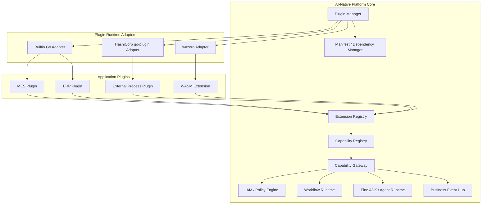
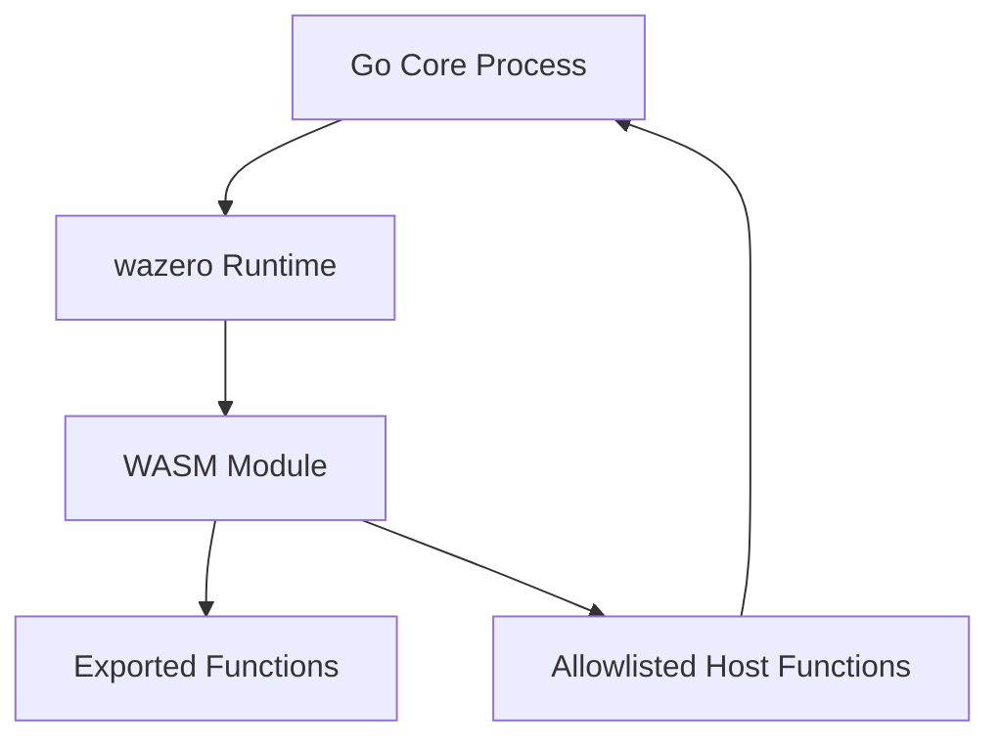
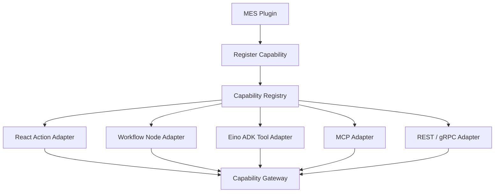
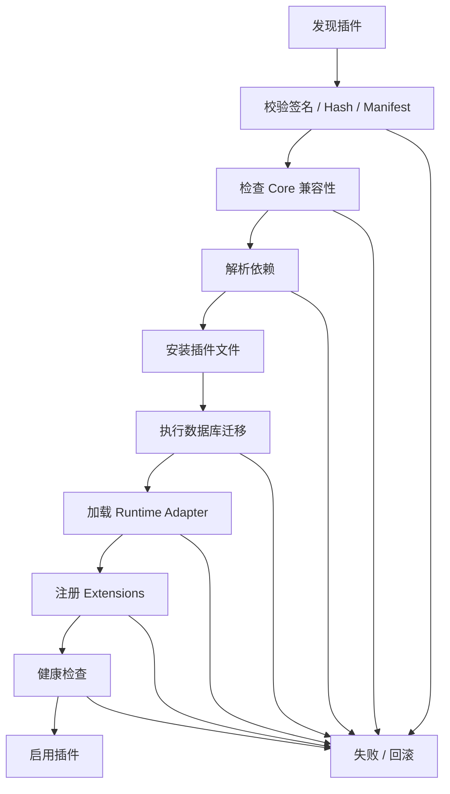
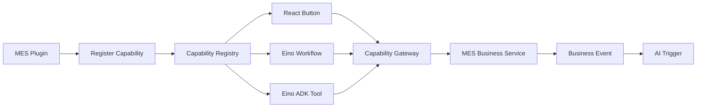

# AI-Native 信息化框架插件接入方案

> 版本：1.0  
> 类型：技术架构与接入规范  
> 技术栈：Go、React、gRPC / Protobuf、HashiCorp go-plugin、wazero、Capability Registry、Eino

## 1. 方案目标

建设一套插件系统，将平台核心与 ERP、MES、WMS、QMS、APS、CRM 等业务应用解耦。Core 只提供基础设施和稳定扩展契约；业务模块通过插件接入，不需要侵入核心代码。

插件可注册：
- Capability：业务能力及输入输出 Schema。
- Entity / Metadata：实体、字段、关系和业务元数据。
- API Routes：后端 API。
- Workflow Nodes：工作流节点。
- Agent Tools：Agent 工具。
- Business Events：业务事件。
- Permissions：权限资源和动作。
- Frontend Extensions：菜单、路由、页面、组件和页面动作。
- Database Migrations：数据库迁移。
- Configuration / I18n：配置 Schema 与国际化资源。

统一原则：页面、Workflow、Graph、Agent、MCP 和外部 API 通过不同 Adapter 调用同一 Capability，并经过 Capability Gateway 统一鉴权、业务校验、幂等、审计和结果处理。

采用三种运行模式：
1. **Go Module + Interface**：官方内置业务模块。
2. **HashiCorp go-plugin + gRPC / Protobuf**：独立进程、独立依赖或跨语言插件。
3. **wazero + WebAssembly**：受限自定义逻辑、数据转换和第三方代码扩展。

## 2. 核心设计原则

1. **Core 不依赖具体业务**：核心只认识 Plugin、Extension、Capability、Metadata、Permission、Event、Workflow Node 等通用概念。
2. **统一契约，不强求统一运行方式**：三种运行模式分别由 `BuiltinPluginAdapter`、`ProcessPluginAdapter`、`WASMPluginAdapter` 承接。
3. **Capability 是业务动作的统一抽象**：业务动作只定义一次，不为 UI、Workflow、Agent、MCP 分别复制业务逻辑。
4. **统一治理**：所有业务写操作必须经过 Capability Gateway。
5. **版本固定**：插件升级不应自动改变正在运行的流程实例。
6. **热更新能力分级**：内置 Go 插件通常随主程序部署；进程插件可以独立重启升级；WASM 模块可以加载新实例并关闭旧实例。
7. **安全默认关闭**：未授权的文件、网络、数据库和宿主能力不得暴露给插件。

## 3. 总体架构



| 模块 | 职责 |
|---|---|
| Plugin Manager | 发现、安装、启用、停用、升级、卸载、健康状态 |
| Manifest Manager | 解析插件清单、依赖、兼容性、签名和配置 |
| Extension Registry | 管理插件注册的扩展点 |
| Capability Registry | 管理能力定义、Schema、版本和发现 |
| Capability Gateway | 鉴权、校验、调用、审计和结果封装 |
| Runtime Adapters | 管理 Go、进程和 WASM 插件运行方式 |
| Workflow Runtime | 管理流程 DSL、实例和 Eino 执行适配 |
| Event Hub | 发布、订阅和路由业务事件 |
| Frontend Extension Registry | 注册菜单、路由、页面和组件 |

## 4. 三种插件运行模式

### 4.1 内置 Go 插件：Go Module + Interface

**适用：** 官方 ERP、MES、WMS、QMS、APS 等大型业务模块，以及需要直接使用 Go 业务服务、数据库事务和内部基础设施的模块。

建议目录：

```text
plugins/
  mes/
    plugin.go
    manifest.yaml
    capabilities/
    services/
    metadata/
    events/
    workflow/
    migrations/
  wms/
  qms/

sdk/
  plugin/
    contract/
    registrar/
    capability/
```

接口示例：

```go
type Plugin interface {
    Manifest() Manifest
    Register(ctx context.Context, registrar Registrar) error
    Start(ctx context.Context) error
    Stop(ctx context.Context) error
}

type Registrar interface {
    RegisterCapability(CapabilityDefinition) error
    RegisterEntity(EntityDefinition) error
    RegisterEvent(EventDefinition) error
    RegisterWorkflowNode(WorkflowNodeDefinition) error
    RegisterPermission(PermissionDefinition) error
    RegisterRoute(RouteDefinition) error
    RegisterFrontendExtension(FrontendExtension) error
}
```

以上为平台自定义 SDK 契约示例，不是第三方库现成 API。

特点：
- 与 Core 同进程，调用开销低。
- 可以使用统一 Go SDK 和内部服务接口。
- 插件可以独立目录、独立 Module、独立测试。
- 通常随主程序一起构建部署。
- 不承诺任意热卸载；更新通常需要重新构建或重启应用。
- 插件不应 import Core 的 `internal` 包，只依赖公开 SDK。

### 4.2 独立进程插件：HashiCorp go-plugin + gRPC / Protobuf

**适用：** 第三方扩展、独立依赖、跨语言插件、外部系统适配器、设备连接器和需要单独升级的服务。


运行流程：
1. Plugin Manager 读取 Manifest。
2. 检查二进制、签名、版本和依赖。
3. 启动插件可执行文件。
4. 插件启动 RPC Server。
5. Core 与插件握手并校验协议版本。
6. Core 通过 RPC 调用插件接口。
7. 插件返回结构化结果。
8. Manager 监控健康状态和进程退出。

建议定义稳定 Protobuf 协议，至少包含：
- `GetManifest`
- `RegisterExtensions`
- `InvokeCapability`
- `HealthCheck`

调用上下文建议包含 `request_id`、`trace_id`、`tenant_id`、`principal_id`、`deadline`、`idempotency_key`。

协议草案：

```protobuf
syntax = "proto3";
package platform.plugin.v1;

service PluginService {
  rpc GetManifest(GetManifestRequest) returns (GetManifestResponse);
  rpc RegisterExtensions(RegisterExtensionsRequest)
      returns (RegisterExtensionsResponse);
  rpc InvokeCapability(InvokeCapabilityRequest)
      returns (InvokeCapabilityResponse);
  rpc HealthCheck(HealthCheckRequest) returns (HealthCheckResponse);
}

message InvokeCapabilityRequest {
  string request_id = 1;
  string capability_name = 2;
  string capability_version = 3;
  string tenant_id = 4;
  string principal_id = 5;
  string trace_id = 6;
  string idempotency_key = 7;
  bytes input_json = 8;
}

message InvokeCapabilityResponse {
  bool success = 1;
  bytes output_json = 2;
  string error_code = 3;
  string error_message = 4;
}
```

注意：
- HashiCorp go-plugin 提供进程启动、握手和 RPC 连接管理；业务 RPC 契约仍由平台定义。
- 典型模式是宿主启动本机插件进程，通过本地 TCP 或 Unix Socket 通信。
- 它不是远程服务发现或集群调度系统。远程插件应作为独立 gRPC 服务接入。
- 进程隔离不等于安全沙箱。应结合独立系统用户、容器、资源限制和网络策略。
- 长任务应设计异步任务接口，不要无限期占用同步 RPC。

### 4.3 WASM 插件：wazero + WebAssembly

**适用：** 租户自定义计算逻辑、数据转换、格式校验、轻量规则和需要限制宿主资源访问的第三方扩展。



运行流程：
1. 使用 Go、Rust、TinyGo、C 等支持 WASM 目标的语言开发。
2. 编译为 `.wasm`。
3. Core 使用 wazero 加载模块。
4. Core 调用 WASM 导出函数。
5. WASM 通过 Host Functions 请求宿主明确开放的能力。
6. Runtime 回收模块实例并记录执行结果。

建议第一版采用受控 JSON ABI：
- 输入输出使用 UTF-8 JSON。
- 固定 ABI 版本。
- 导出约定明确的 `execute` 等函数。
- Host Functions 采用白名单。
- 对执行时间、内存、并发数和输出大小设限。

示例输入：

```json
{
  "abiVersion": "1.0",
  "operation": "transform",
  "input": {
    "quantity": 100,
    "unit": "PCS"
  }
}
```

适合的任务：
- 供应商数据格式转换。
- 导入文件字段校验。
- 受限字段计算。
- 租户自定义规则函数。

安全注意：
- WASM 线性内存隔离不等于完整 OS 安全沙箱。
- Host Functions 决定模块能够访问哪些宿主能力。
- 文件和网络访问默认关闭，按需显式开放。
- 不要把数据库连接或任意 SQL 执行暴露成通用 Host Function。
- 捕获 Trap、超时和资源超限。

## 5. 三种模式对比与选型

| 维度 | Go 内置插件 | go-plugin 进程插件 | wazero WASM 插件 |
|---|---|---|---|
| 执行位置 | Core 进程内 | 独立 OS 进程 | Core 内 WASM Runtime |
| 插件产物 | Go 包 / 主程序构建产物 | 可执行文件 | `.wasm` |
| 语言 | 主要 Go | 任意实现 RPC 的语言 | 支持 WASM 目标的语言 |
| 通信 | Go Interface | gRPC / net/rpc | WASM ABI / Host Functions |
| 隔离 | 无独立进程隔离 | OS 进程隔离 | WASM 线性内存隔离 |
| 独立升级 | 通常随主程序 | 支持 | 支持 |
| 复杂业务服务 | 很适合 | 很适合 | 通常不优先 |
| 受限第三方代码 | 不适合 | 需额外 OS 隔离 | 适合受限扩展 |
| 主要成本 | 依赖治理和发布耦合 | RPC、进程运维 | ABI、宿主函数和资源治理 |

推荐规则：
- 官方大型业务模块：Go 内置插件。
- 独立部署、独立依赖、跨语言：go-plugin / gRPC。
- 租户自定义函数和轻量逻辑：wazero。
- 不要为了插件化把所有模块都拆成 RPC 服务。
- 不要认为 WASM 天然安全，宿主权限仍需严格控制。

## 6. Plugin Manifest 规范

每个插件提供 `plugin.yaml`，声明身份、版本、兼容性、依赖、运行模式和扩展能力。

### 6.1 示例

```yaml
apiVersion: platform.plugin/v1
kind: Plugin

metadata:
  id: com.example.mes
  name: MES
  version: 1.0.0
  description: Manufacturing Execution System
  vendor: Example

compatibility:
  core:
    minVersion: 1.0.0
    maxVersion: 2.x
  pluginApiVersion: "1.0"

runtime:
  mode: builtin
  entrypoint: mes.NewPlugin

dependencies:
  required:
    - id: com.platform.iam
      version: "^1.0"
    - id: com.platform.metadata
      version: "^1.0"
  optional:
    - id: com.example.wms
      version: "^1.0"

extensions:
  capabilities: true
  entities: true
  events: true
  workflowNodes: true
  agentTools: true
  permissions: true
  backendRoutes: true
  frontend: true

frontend:
  package: "@example/mes-frontend"
  entrypoint: "./src/plugin"

database:
  migrations: "./migrations"

security:
  requestedPermissions:
    - capability.register
    - metadata.register
    - event.publish
    - workflow.node.register
```

不同运行模式：

```yaml
# Go 内置
runtime:
  mode: builtin
  entrypoint: mes.NewPlugin
```

```yaml
# 独立进程
runtime:
  mode: process
  executable: "./bin/mes-extension"
  protocol: grpc
  protocolVersion: "1.0"
```

```yaml
# WASM
runtime:
  mode: wasm
  module: "./dist/custom-rule.wasm"
  abiVersion: "1.0"
  limits:
    memoryPages: 256
    executionTimeoutMs: 3000
    maxOutputBytes: 1048576
```

所有路径、入口、兼容性和资源限制都必须由 Manager 校验，不能直接信任插件提交的 Manifest。

## 7. 统一 Plugin SDK 与 Extension Registry

建议 SDK 结构：

```text
platform-plugin-sdk/
├── contract/
├── manifest/
├── registrar/
│   ├── capability.go
│   ├── metadata.go
│   ├── event.go
│   ├── workflow.go
│   ├── permission.go
│   └── frontend.go
├── invocation/
├── protocol/
├── wasm/
└── testing/
```

统一注册接口示例：

```go
type Registrar interface {
    RegisterCapability(CapabilityDefinition) error
    RegisterEntity(EntityDefinition) error
    RegisterEvent(EventDefinition) error
    RegisterWorkflowNode(WorkflowNodeDefinition) error
    RegisterPermission(PermissionDefinition) error
    RegisterRoute(RouteDefinition) error
    RegisterFrontendExtension(FrontendExtension) error
}
```

MES 插件示例：

```go
func (p *MESPlugin) Register(
    ctx context.Context,
    r Registrar,
) error {
    if err := r.RegisterCapability(productionComplete); err != nil {
        return err
    }

    if err := r.RegisterEvent(productionCompleted); err != nil {
        return err
    }

    if err := r.RegisterEntity(productionOrderMetadata); err != nil {
        return err
    }

    return nil
}
```

重要约束：
- 插件依赖公开 Plugin SDK，不依赖 Core 的 `internal` 包。
- Registry 应校验重复 ID、版本、Schema 和依赖。
- 注册操作应支持事务式提交：插件注册失败时不留下半套扩展。
- 扩展记录应带 `plugin_id`、`plugin_version`、`extension_type` 和 `extension_version`。
- 插件停用后应阻止新调用，但保留历史审计与流程版本引用。

## 8. Capability Registry 集成

Capability 示例：

```json
{
  "name": "production.order.complete",
  "version": "1.0.0",
  "description": "完成生产工单",
  "inputSchema": {
    "type": "object",
    "properties": {
      "orderId": { "type": "string" },
      "completedQuantity": { "type": "number", "exclusiveMinimum": 0 }
    },
    "required": ["orderId", "completedQuantity"]
  },
  "permission": {
    "action": "production.order.complete",
    "resource": "production_order"
  },
  "riskLevel": "high",
  "invocation": {
    "mode": "sync",
    "idempotent": true
  },
  "events": {
    "onSuccess": ["production.order.completed"]
  },
  "exposure": {
    "ui": true,
    "workflow": true,
    "agent": true,
    "api": true,
    "mcp": true
  }
}
```

注册后的适配关系：



规则：
1. Capability 定义只维护一份。
2. UI、Workflow、ADK、MCP 和 API Adapter 只做协议转换。
3. 所有写操作经过 Capability Gateway。
4. 每次调用重新执行身份、租户、数据范围和业务校验。
5. Agent Tool 不得成为绕过 Gateway 的第二套业务实现。
6. Capability 版本与插件版本分别管理，并检查兼容性。

统一调用上下文建议包含：

```go
type InvocationContext struct {
    RequestID      string
    TraceID        string
    CorrelationID  string
    CausationID    string
    TenantID       string
    PrincipalID    string
    PrincipalType  string
    IdempotencyKey string
    Deadline       time.Time
}
```

Gateway 必须验证身份上下文来源，不能信任前端或插件任意传入的 TenantID / PrincipalID。

## 9. Workflow、Graph、ADK 与事件集成

- 插件注册的 Capability 默认可被 Workflow 作为通用 Capability Node 使用。
- 只有存在特殊交互或控制逻辑时，才注册专用 Workflow Node。
- Graph 节点必须声明输入输出 Schema、State 读写范围、循环限制、超时和失败策略。
- ADK Tool 优先由 Capability Definition 自动生成。
- 插件可以额外注册 Agent Definition、Skill 和上下文提供器。
- Agent 的业务写操作仍通过 Capability Gateway。
- 业务成功后通过 Transactional Outbox 发布事件，再由 Event Hub 和 AI Trigger Engine 触发后续 Agent / Workflow。
- 防止事件递归：使用 `correlationId`、`causationId`、去重键和最大触发深度。

## 10. 前端插件接入

第一阶段推荐使用 React + TypeScript + npm workspace + Extension Registry，不急于引入远程动态加载。

建议目录：

```text
frontend/
  apps/
    console/
  packages/
    plugin-sdk/
    plugin-mes/
    plugin-wms/
    plugin-qms/
```

前端插件可注册：
- 菜单和路由。
- 页面组件和区块。
- 表格列、表单字段扩展。
- 页面动作和按钮。
- 国际化资源。
- 页面上下文提供器。

接口示例：

```ts
export interface FrontendPlugin {
  manifest: FrontendPluginManifest;
  register(registry: FrontendExtensionRegistry): void;
  activate?(): Promise<void>;
  deactivate?(): Promise<void>;
}
```

后续确实需要第三方独立发布前端插件时，再评估 Module Federation。远程 JavaScript 具有较高安全风险，必须限制来源、签名、CSP、权限和 API 访问。

## 11. 插件生命周期

建议状态：

`discovered → verified → installed → registered → enabled`

其他状态：

`disabled`、`upgrading`、`failed`、`uninstalling`、`uninstalled`。

安装流程：



停用前：
1. 阻止新调用。
2. 标记为 `draining`。
3. 等待或取消在途调用。
4. 阻止新流程实例引用该插件。
5. 为等待中的流程实例制定处理策略。
6. 停止进程插件或关闭 WASM 实例。
7. 注销动态扩展。
8. 保留历史审计和版本信息。

卸载插件与删除业务数据必须分离。默认卸载不删除业务表数据。

## 12. 数据库与多租户

- 每个业务插件拥有明确的数据所有权和迁移目录。
- MES 管理生产工单、工序执行；WMS 管理库存和出入库；QMS 管理检验和质量处置。
- 跨模块协作通过公开 Service、Capability 或 Event 契约。
- 不允许插件随意写入其他插件的业务表。
- 迁移必须版本化、可审计，优先采用 Expand / Migrate / Contract。
- 不能假设所有数据库 DDL 都支持事务回滚。
- 卸载默认保留数据。
- Gateway 强制校验租户上下文，不信任请求体中的租户 ID。

## 13. 安全与治理

### 13.1 信任等级

| 级别 | 来源 | 推荐运行方式 |
|---|---|---|
| Trusted | 官方模块 | Go Module |
| Verified | 平台审核的第三方插件 | go-plugin 或受控 WASM |
| Tenant Custom | 租户自定义扩展 | 优先 WASM |
| Untrusted | 未审核来源 | 默认禁止安装 |

### 13.2 必须实施

- 插件包签名和 Hash 验证。
- Manifest Schema 校验。
- 依赖版本与漏洞扫描。
- 插件权限申请和管理员审批。
- 最小权限原则。
- 进程插件的独立 OS 用户、容器和网络策略。
- WASM Host Functions 白名单和资源配额。
- gRPC 身份验证、超时和取消。
- Capability Gateway 强制鉴权。
- 插件 API、工具调用和数据访问审计。
- 插件升级、回滚和迁移记录。
- Agent 最大迭代次数、运行时间和成本限制。

## 14. 插件管理 API 草案

| 方法 | 路径 | 说明 |
|---|---|---|
| GET | `/api/plugins` | 插件列表 |
| POST | `/api/plugins/install` | 安装插件包 |
| GET | `/api/plugins/{id}` | 插件详情 |
| POST | `/api/plugins/{id}/enable` | 启用插件 |
| POST | `/api/plugins/{id}/disable` | 停用插件 |
| POST | `/api/plugins/{id}/upgrade` | 升级插件 |
| POST | `/api/plugins/{id}/uninstall` | 卸载插件 |
| GET | `/api/plugins/{id}/health` | 健康状态 |
| GET | `/api/plugins/{id}/extensions` | 已注册扩展 |
| GET | `/api/plugins/{id}/permissions` | 申请权限 |

所有接口需要管理员权限、租户隔离、审计和幂等控制。

## 15. 项目目录建议

```text
platform/
├── apps/server/
├── sdk/plugin/
│   ├── contract/
│   ├── manifest/
│   ├── registrar/
│   ├── capability/
│   ├── event/
│   ├── workflow/
│   ├── frontend/
│   └── testing/
├── internal/
│   ├── plugin/
│   │   ├── manager/
│   │   ├── manifest/
│   │   ├── dependency/
│   │   ├── lifecycle/
│   │   ├── signature/
│   │   ├── registry/
│   │   └── adapters/
│   │       ├── builtin/
│   │       ├── process/
│   │       └── wasm/
│   ├── capability/
│   │   ├── registry/
│   │   ├── gateway/
│   │   └── policy/
│   ├── workflow/
│   ├── event/
│   └── iam/
├── plugins/
│   ├── mes/
│   ├── wms/
│   └── qms/
├── frontend/
│   ├── apps/console/
│   └── packages/
│       ├── plugin-sdk/
│       ├── plugin-mes/
│       └── plugin-wms/
├── plugin-protocol/proto/
├── manifests/
└── migrations/
```

这是逻辑目录建议。第一阶段不必拆成多个微服务或多个仓库。

## 16. 分阶段实施路线

### Phase 1：模块化核心与内置插件

交付：
1. Plugin Manifest v1。
2. Plugin SDK。
3. Plugin Manager。
4. Extension Registry。
5. Go Interface 插件加载器。
6. Capability、Metadata、Permission、Event Registrar。
7. React 前端 Extension Registry。
8. MES 或 WMS 示范插件。
9. 插件契约测试工具。

验收：
- 新增业务模块只需新建插件包。
- 不修改 Core 内部代码即可注册能力、实体、权限、事件和菜单。
- 插件可独立测试。
- Core 能检测插件 API 兼容性。

### Phase 2：独立进程插件

交付：
1. go-plugin Adapter。
2. gRPC / Protobuf 协议。
3. 插件进程启动、停止和健康检查。
4. 握手和协议版本校验。
5. 超时、取消和请求追踪。
6. 二进制签名与 Hash 校验。
7. 在途请求 Drain 和升级切换。

验收：
- 独立插件可注册 Capability。
- Core 通过 Gateway 调用该能力。
- 插件异常时 Core 保持可用并识别故障。
- 插件可以独立升级而不重新编译 Core。

### Phase 3：WASM 沙箱插件

交付：
1. wazero Runtime Adapter。
2. WASM ABI v1。
3. Host Functions 白名单。
4. 内存、执行时间和输出大小限制。
5. 模块 Hash / 签名校验。
6. Trap、超时和资源回收处理。
7. 数据转换和规则插件示例。

验收：
- WASM 模块只能访问明确授权的宿主能力。
- 超时和资源超限可被捕获。
- 未授权数据库、文件和网络资源不可访问。

### Phase 4：插件市场与企业治理

交付：
1. 插件仓库和市场。
2. 版本依赖解析。
3. 签名与供应链安全。
4. 安装、升级、回滚和卸载。
5. 租户插件授权。
6. 插件配置中心。
7. 前端远程插件加载评估。
8. 插件运行监控和审计。

## 17. 首个端到端示范：MES 插件

### 注册内容

- Entity：生产工单、工序任务、报工记录。
- Capability：工单创建、工序下发、生产报工、工单完工。
- Event：工单创建、工序开始、报工完成、工单完工。
- Permission：工单查看、创建、下发、报工、完工。
- Workflow Node：仅为特殊业务交互提供专用节点；普通动作使用通用 Capability Node。
- Agent Tool：优先从 Capability 自动生成。
- Frontend：MES 菜单、工单列表、工单详情和报工页面。

### 验收链路



验收标准：
1. 安装 MES 插件后出现 MES 菜单和页面。
2. 插件注册的 Capability 出现在能力目录。
3. 页面按钮、Workflow 和 Agent 使用同一个 Capability。
4. 所有调用经过 Capability Gateway。
5. 完工成功后发布业务事件。
6. 事件可以触发 AI 风险分析。
7. Agent 后续动作仍经过 Gateway。
8. 停用插件后阻止新调用，历史业务数据保留。
9. 升级时检查 Workflow 和 Agent 对旧 Capability 版本的引用。

## 18. 最终技术决策

| 层级 | 推荐方案 |
|---|---|
| 核心框架 | Go |
| 插件管理 | 自研 Plugin Manager |
| 插件契约 | 自研 Plugin SDK + Manifest |
| 官方业务插件 | Go Module + Interface |
| 独立进程插件 | HashiCorp go-plugin |
| RPC 协议 | gRPC + Protobuf |
| 沙箱插件 | wazero |
| 扩展注册 | Extension Registry |
| 业务能力注册 | Capability Registry |
| 统一执行入口 | Capability Gateway |
| 业务事件 | Event Hub + Transactional Outbox |
| 流程编排 | Eino Workflow / Graph |
| Agent 执行 | Eino ADK |
| 前端扩展 | React Extension Registry |
| 前端动态加载 | 后续按需评估 Module Federation |
| 插件配置 | YAML Manifest + JSON Schema |
| 可观测性 | OpenTelemetry |

**推荐落地顺序：先做 Go 内置插件架构，再做独立进程插件，最后做 WASM 沙箱。**

不要第一阶段就把 ERP、MES、WMS 全部拆成独立进程，也不要让所有业务逻辑都进入 WASM。真正需要统一的是插件身份、扩展注册契约、Capability、权限上下文、生命周期和审计。

## 19. 参考资料

- HashiCorp go-plugin：<https://github.com/hashicorp/go-plugin>
- HashiCorp 插件开发文档：<https://developer.hashicorp.com/terraform/plugin>
- wazero 官网：<https://wazero.io/>
- wazero GitHub：<https://github.com/tetratelabs/wazero>
- Go plugin 官方文档：<https://pkg.go.dev/plugin>
- gRPC：<https://grpc.io/>
- Protocol Buffers：<https://protobuf.dev/>
- Eino：<https://www.cloudwego.io/docs/eino/>

## 20. 架构总结

插件系统的核心不是“动态加载 Go 代码”，而是建立稳定的企业应用扩展契约。

- **Core**：基础设施和治理。
- **Plugin**：业务模块和扩展实现。
- **Extension Registry**：扩展点注册与发现。
- **Capability Registry**：业务能力契约与发现。
- **Capability Gateway**：统一执行治理。
- **Eino**：AI 与流程编排。
- **Event Hub**：业务事件传播和 AI 触发。

最终原则：

> **Core 不知道具体业务是什么；Core 只理解插件、扩展点、能力契约、权限、事件和执行协议。**
