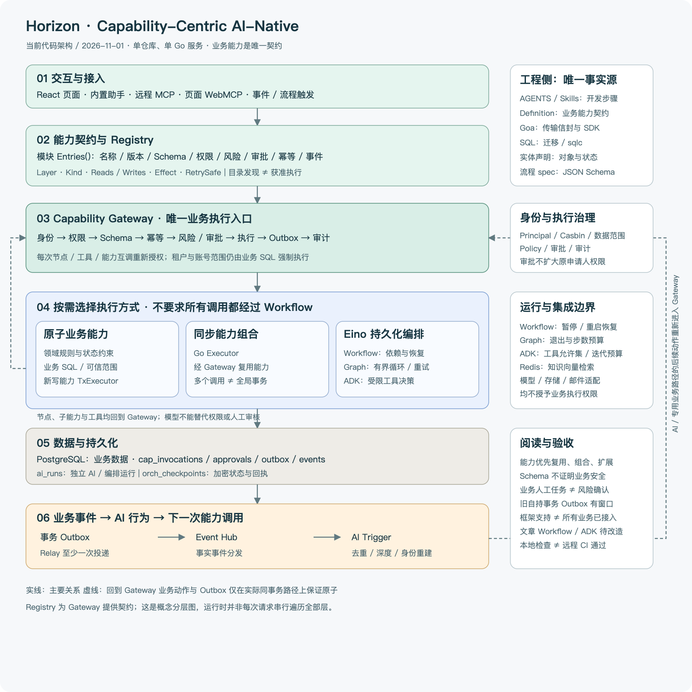
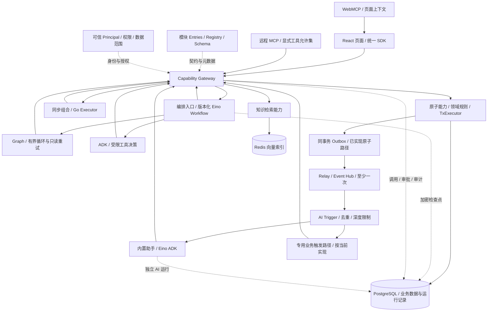

# 当前架构与分层概念

以 2026-11-01 工作区代码为依据。Horizon 为单仓库、单 Go 服务的能力中心框架：能力是业务契约，Gateway 是业务执行入口，Eino 提供持久化流程和 Agent 执行，事件将已提交事实与后续 AI 行为连接起来。图展示当前框架结构，不表示所有业务模块已完成同等程度的接入。

## 1. 执行与事件闭环

这是调用关系图，不是所有请求固定经过所有节点。Registry 是目录，不是远程执行服务；Graph 和 ADK 是按需使用的编排节点。事件可以进入通用 Agent，也可以进入专用业务路径，不能仅凭 Trigger 名称推断使用了 ADK。

## 2. 每一层解决什么问题

| 层 | 概念与职责 | 当前代码位置 |
|---|---|---|
| 交互与适配 | 页面、助手、MCP、WebMCP、事件将不同入口转换为能力调用。Goa 处理会话/系统/公开投影和统一信封；适配器不复制业务规则。 | `apps/web/src/features`、`services/api/internal/transport`、`internal/modules/mcp` |
| 能力契约 | Definition 定义输入输出、版本、权限、风险/审批、幂等、事件、日志白名单和编排元数据；Registry 统一校验与发现。能力由所属模块提供。 | `internal/platform/capability/{contracts,registry}`、模块 `Entries()`、`internal/app/capabilities.go` |
| 执行治理 | Gateway 统一身份、权限、Schema、幂等、策略/审批、执行与审计。范围过滤还必须由业务 SQL 执行；审批不扩大申请人权限。 | `internal/platform/capability/gateway`、`policy`、`approval`、`audit`、`internal/identity` |
| 业务能力 | 原子动作持有状态约束、SQL、可信范围和业务事件。同步组合 Executor 只通过 Gateway 调能力，不直接查业务库。 | `internal/modules/*`、`internal/identity`、共享 `internal/governance` |
| 编排与 AI | Workflow 表达依赖、持久化与暂停恢复；Graph 表达有界循环/重试；ADK 表达受限工具决策。普通模型分类可以直接调用 Eino 模型接口。 | `internal/ai/orchestration`、`harness`、`tools`、`workflow` |
| 存储 | PostgreSQL 保存业务事实、审批、事件及运行；sqlc/pgx 提供类型化访问。Redis 提供知识向量检索，文件服务管理受控存储根目录。 | `db/migrations`、`db/query`、`internal/repository/dbgen`、`internal/ai/knowledge` |
| 事件与自动化 | 成功业务写入 Outbox；Relay 至少一次发布，Event Hub 分发，Trigger 按策略/事件去重、限制深度并重建身份。 | `internal/platform/{outbox,eventhub}`、`internal/ai/triggers` |
| 工程约束 | AGENTS/Skills 指导能力复用和选型，Schema/生成检查限制结构漂移，实体检查与真实行为测试验证边界。 | `.agents/skills`、`docs/agent-policy.json`、`scripts`、`Makefile` |

`Layer` 与 `Kind` 是不同维度：前者描述原子或编排，后者描述 service/sql/command/external/event 形态。`Reads/Writes` 用于依赖冲突检查，`Effect` 描述副作用，`RetrySafe` 描述重试保证；这些元数据不能替代授权、事务或业务顺序。详见 [ADR 016](decisions/016-capability-taxonomy-and-orchestration.md)。

## 3. 三类执行方式与事务

1. 单个查询或原子动作直接执行能力。新模块写能力用 TxExecutor，将业务数据与 Outbox 放入同一事务。
2. 同步聚合用非事务 Executor，经 Gateway 调多个能力。TxExecutor 内不得再调用 Gateway；多个业务事务不会被组合成全局原子事务。
3. 跨请求等待和恢复使用持久化 Eino Workflow。受理只保存运行意图；节点之后逐个执行与授权。Graph 与 ADK 只按实际需要加入。

旧领域服务自持事务的模块，在业务提交后写入 Outbox 仍是 best effort；架构目标不能掩盖这个窗口。补偿是新的业务动作，也需要权限和审批，不等于数据库回滚。

Gateway 风险确认与业务人工审核分别设计。前者允许执行一个操作；后者包含审核人、对象版本、任务范围、通过/驳回与原因。当前审批恢复桥接不代表已经支持任意业务任务信号。参见 [开发工作流](agent-workflow.md)。

## 4. 数据、身份与可追踪性

- Principal 来自可信会话或已验证账号凭证；租户、账号、当前部门不能由业务输入指定。Casbin 决定操作权限，SQL 强制实际记录范围，多部门授权不合并为一份身份。
- `cap_invocations` 是业务调用，`cap_approvals` 是操作确认，`ai_runs` 是独立 AI/编排运行头；correlation/causation/depth 连接因果链。AI 失败不得推翻已提交业务事实。
- `orch_checkpoints` 保存加密运行状态、manifest 和回执，恢复前及节点执行前重建原身份。恢复沿用原节点幂等键；取消不回滚已提交动作。
- `cap_outbox`、`cap_events` 与 Trigger 执行记录实现至少一次交付与去重，不承诺 exactly-once。
- 审计仅保存允许字段。TransientResult 可防止调用结果持久化/重放，但模型回答、检查点和事件仍需独立检查敏感材料边界。

## 5. 工程契约与复用

| 唯一事实源 | 作用 | 生成 / 验证 |
|---|---|---|
| Goa `services/api/design` | 会话、系统、公开投影、能力/AI 传输信封 | Goa/OpenAPI/Orval |
| 模块 Definition/Entries | 业务输入输出与执行政策 | Schema 校验、Registry、工具适配；对外允许集另行维护 |
| SQL migrations/query | 物理结构与范围查询 | Goose、sqlc、隔离 PostgreSQL 测试 |
| 模块 entity_*.go | 字段分类、关系与状态语义 | metadata 对照迁移和能力做 E1–E10 校验 |
| orchestration/spec Go 定义 | 版本化流程结构与预算 | 流程 JSON Schema、导出示例、workflowcheck、Eino 编译 |

能力优先直接复用、Gateway 组合或兼容扩展，确有缺口才新增。工具适配与部分业务类型仍有手写部分，不把生成路线误写成全部自动生成。知识库的现有契约归属与实体声明债务保留在 [Schema 路线](agent-generation-plan.md)。

前端使用 TanStack Query 管远程状态、React Hook Form + Zod 管表单、TanStack Table 管表格；页面动作使用 capability SDK，文案走 en/zh-CN i18next。共享设置、字典、文件与通知按 [公共能力约定](shared-capabilities.md) 接入。

## 6. 当前能力与待完成项

框架已提供版本化 Workflow、Graph、ADK、操作审批中断恢复、补偿、流程规格生成和完整生命周期参考；实际装配见 `internal/transport/governance.go` 和共享 `app.CapabilityModules`。支持这些机制不等于所有业务已使用它们。

文章管理当前为投稿事件 → article.assess → 规则/直接模型分类 → article.apply；人工决定是独立能力。文章 Workflow/ADK、业务人工任务页面和完整驳回原因链仍是目标，相关安全审查缺口也尚需修复。目标流程与验收见 [文章示例](agent-workflow.md#文章发布评审目标设计示例)。

当前不提供远程任意流程上传/发布、通用可视化设计器、任意 SQL/命令执行器或 exactly-once 保证。业务人工任务、外部信号、条件分支及结构化 ADK 输出必须逐项验证或扩展，不能仅按目标图宣称支持。

## 7. 验证与运维边界

`make ci-fast` 为非浏览器门禁；SQL/权限改动加真实隔离 PostgreSQL 验证，`make test-security` 包含数据库集成集合。浏览器 E2E 依现行指示暂停；推送会触发远程 CI 的浏览器阶段，因此本地提交不等于推送授权。

模型、原生客户端、浏览器与远程 CI 验收分别记录。本地启动及手动流程按钮见 [README](../README.md)，实现细节见 [编排方案](orchestration-plan.md)、[安全约定](security.md) 和 [测试矩阵](testing.md)。
