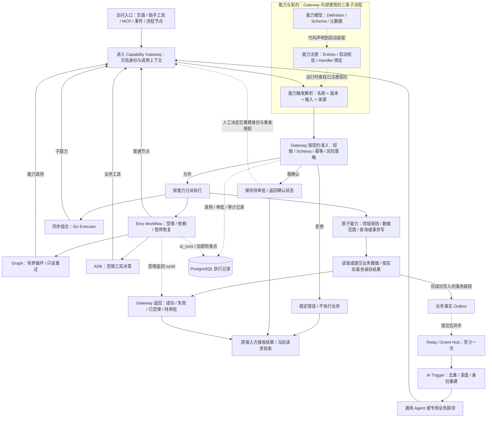

# AI-Native 概念架构与运行机制

以 2026-11-01 工作区代码为依据。Horizon 为单仓库、单 Go 服务的能力中心框架：能力是业务契约，Gateway 是业务执行入口，Eino 提供持久化流程和 Agent 执行，事件将已提交事实与后续 AI 行为连接起来。图展示当前框架结构，不表示所有业务模块已完成同等程度的接入。

## 1. 概念职责：任务组织在上，能力执行在下

概念主线与 README 保持一致：**交互与触发 → 任务与编排 → Gateway → 能力体系 → 业务执行 → 业务事实与运行记忆 → 事件反馈**。简单动作可直达 Gateway，不强制经过编排。

- 任务与编排层使用 Eino Workflow、Graph、ADK，分别组织业务主干、局部循环与受限决策。
- Gateway 是统一执行边界；能力体系在其后展开为模型、注册和触发。模型描述契约，注册使能力可发现并绑定执行者，触发将当前调用关联到已注册动作。
- Entity 与 Schema 是这套能力语言的核心：实体声明对象字段、关系与状态，Schema 描述能力输入输出和流程结构。实体需要对照迁移校验，操作参数按具体动作投影；结构校验不替代权限与业务规则。README 的关系图、任务闭环、调用时序和审核分支图分别解释这些概念如何协作。
- 业务执行产生结果，持久化保存业务事实和恢复状态；事件异步驱动后续 Agent 或专用业务路径。
- 编码 Skills、Schema、知识上下文和验证是横向支撑，不作为每次用户访问必须顺序经过的阶段。

图中编排位于 Gateway 上方是职责组织关系，不是鉴权顺序。流程启动本身是一项能力，仍先经 Gateway 受理；之后 Workflow 节点、Graph 调用和 ADK 业务工具每次再经 Gateway。模型和注册也不是运行时每次重新创建。以下展开实际调用顺序，避免把概念图理解成新的执行入口。

## 2. 从一次访问展开流程

主线为：**访问与触发入口 → Gateway → 能力与契约解析 → 执行分支 → 数据与执行记录 → 返回结果，当前调用结束**。提交后的事件走独立异步分支，再驱动下一轮访问。

能力与契约放在 Gateway 之后，表示访问先进入统一入口，再由 Gateway 使用已注册契约处理和分派。Gateway 并非先完成所有校验再读取契约；源码中先建立身份、检查请求并 Resolve，随后按契约执行权限、Schema、幂等与策略检查。模型声明和启动注册是支撑这次调用的前置工作，不是每次请求都会执行的步骤。

业务数据与 Outbox 只有在实际同一事务路径才保证原子，既有自持事务模块仍有 best-effort 窗口。知识检索、文件和外部系统是具体能力的存储/集成路径，不构成绕过 Gateway 的另一个业务入口。

## 3. 每一层包含哪些子流程

| 流程层 | 子流程与职责 | 当前代码位置 |
|---|---|---|
| 01 访问与触发入口 | 页面/SDK、助手工具、远程 MCP、页面 WebMCP、事件与流程节点将意图转成能力请求；传输层不复制业务逻辑。 | `apps/web/src/features`、`internal/transport`、`internal/modules/mcp` |
| 02 Gateway 统一入口 | 建立可信身份与调用链；使用契约完成权限、Schema、幂等、风险策略；允许则分派，拒绝则结束，需确认则持久化后返回。 | `internal/platform/capability/gateway`、`internal/identity`、`policy`、`approval` |
| 03 能力模型 | 声明名称/版本、输入输出、权限/风险、幂等、成功事件和日志白名单；关联实体与编排元数据。属于设计/代码声明过程。 | `contracts`、模块 `Definition`、`entity_*.go` |
| 03 能力注册 | 模块 `Entries()` 汇总定义与 Handler，经共享装配、启动校验和 Registry 注册，形成可发现目录。属于启动过程。 | 模块 `Entries()`、`internal/app/capabilities.go`、`registry` |
| 03 能力触发解析 | Gateway 用请求名称/版本定位已注册契约，校验输入和执行政策后取得分派结果；不重新注册，也不直接绕过 Gateway 调 Handler。 | `Gateway.Invoke`、`Registry.Resolve`、工具/事件适配器 |
| 04 执行分支 | 原子能力执行业务约束与 SQL；同步组合经 Gateway 互调；Eino Workflow 管持久化步骤，Graph/ADK 按需承接循环与工具决策，节点仍回到 Gateway。 | `internal/modules/*`、`internal/identity`、`internal/ai/{orchestration,harness,tools}` |
| 05 数据与执行记录 | 原子能力读写业务数据；调用治理保存调用/审批/审计；AI/编排保存独立运行和加密恢复状态。不同记录由对应执行者维护，不是组合能力直接访问业务表。 | PostgreSQL、sqlc/pgx、`audit`、`ai_runs`、`orch_checkpoints` |
| 06 返回与当前调用结束 | 返回稳定错误、业务结果、待审批或 runId；当前请求结束与长期流程完成分别表达，审批/重启后可继续原运行。 | Gateway Result、统一传输信封、SDK / Query / 页面状态 |
| 07 提交后异步分支 | Outbox → Relay → Event Hub → Trigger；至少一次、去重、深度和身份重建后进入下一轮能力调用。并非所有请求都有事件。 | `internal/platform/{outbox,eventhub}`、`internal/ai/triggers` |

能力“触发解析”指请求进入能力执行过程；事件“AI Trigger”指已提交事实引起的新行为，两者不是同一个阶段。工具发现只读取允许的目录，也不等于触发了业务执行。

常见路径应分别理解：

- **查询/同步写入**：访问 → Gateway / 契约解析与准入 → 原子或同步组合 → 结果返回，当前请求结束。
- **拒绝**：准入失败 → 稳定错误 → 结束，不执行业务；幂等命中可在执行前返回原结果。
- **风险确认**：保存待审批并返回 → 人工决定 → 重建申请人身份、重新授权 → 原动作执行或终止。此时原 HTTP 请求已经结束。
- **持久化流程**：先受理并返回 runId → 工作器运行 Eino → 节点回到 Gateway → 暂停/恢复 → 运行完成或失败/取消。一次查询运行状态不代表重新启动流程。
- **业务事件**：成功写入后的异步事件 → Trigger → 下一轮调用，与原请求的返回和业务成功状态分开。

工程契约与门禁属于横向支撑：AGENTS/Skills、Goa、SQL、实体和流程 spec 指导并约束上述过程，不作为用户请求必须经过的执行层。Redis 向量检索、文件存储及模型服务也按实际能力需求选择。

`Layer` 与 `Kind` 是不同维度：前者描述原子或编排，后者描述 service/sql/command/external/event 形态。`Reads/Writes` 用于依赖冲突检查，`Effect` 描述副作用，`RetrySafe` 描述重试保证；这些元数据不能替代授权、事务或业务顺序。详见 [ADR 016](decisions/016-capability-taxonomy-and-orchestration.md)。

## 4. 三类执行方式与事务

1. 单个查询或原子动作直接执行能力。新模块写能力用 TxExecutor，将业务数据与 Outbox 放入同一事务。
2. 同步聚合用非事务 Executor，经 Gateway 调多个能力。TxExecutor 内不得再调用 Gateway；多个业务事务不会被组合成全局原子事务。
3. 跨请求等待和恢复使用持久化 Eino Workflow。受理只保存运行意图；节点之后逐个执行与授权。Graph 与 ADK 只按实际需要加入。

旧领域服务自持事务的模块，在业务提交后写入 Outbox 仍是 best effort；架构目标不能掩盖这个窗口。补偿是新的业务动作，也需要权限和审批，不等于数据库回滚。

Gateway 风险确认与业务人工审核分别设计。前者允许执行一个操作；后者包含审核人、对象版本、任务范围、通过/驳回与原因。当前审批恢复桥接不代表已经支持任意业务任务信号。参见 [开发工作流](agent-workflow.md)。

## 5. 数据、身份与可追踪性

- Principal 来自可信会话或已验证账号凭证；租户、账号、当前部门不能由业务输入指定。Casbin 决定操作权限，SQL 强制实际记录范围，多部门授权不合并为一份身份。
- `cap_invocations` 是业务调用，`cap_approvals` 是操作确认，`ai_runs` 是独立 AI/编排运行头；correlation/causation/depth 连接因果链。AI 失败不得推翻已提交业务事实。
- `orch_checkpoints` 保存加密运行状态、manifest 和回执，恢复前及节点执行前重建原身份。恢复沿用原节点幂等键；取消不回滚已提交动作。
- `cap_outbox`、`cap_events` 与 Trigger 执行记录实现至少一次交付与去重，不承诺 exactly-once。
- 审计仅保存允许字段。TransientResult 可防止调用结果持久化/重放，但模型回答、检查点和事件仍需独立检查敏感材料边界。

## 6. 工程契约与复用

| 唯一事实源 | 作用 | 生成 / 验证 |
|---|---|---|
| Goa `services/api/design` | 会话、系统、公开投影、能力/AI 传输信封 | Goa/OpenAPI/Orval |
| 模块 Definition/Entries | 业务输入输出与执行政策 | Schema 校验、Registry、工具适配；对外允许集另行维护 |
| SQL migrations/query | 物理结构与范围查询 | Goose、sqlc、隔离 PostgreSQL 测试 |
| 模块 entity_*.go | 字段分类、关系与状态语义 | metadata 对照迁移和能力做 E1–E10 校验 |
| orchestration/spec Go 定义 | 版本化流程结构与预算 | 流程 JSON Schema、导出示例、workflowcheck、Eino 编译 |

能力优先直接复用、Gateway 组合或兼容扩展，确有缺口才新增。工具适配与部分业务类型仍有手写部分，不把生成路线误写成全部自动生成。知识库的现有契约归属与实体声明债务保留在 [Schema 路线](agent-generation-plan.md)。

前端使用 TanStack Query 管远程状态、React Hook Form + Zod 管表单、TanStack Table 管表格；页面动作使用 capability SDK，文案走 en/zh-CN i18next。共享设置、字典、文件与通知按 [公共能力约定](shared-capabilities.md) 接入。

## 7. 当前能力与待完成项

框架已提供版本化 Workflow、Graph、ADK、操作审批中断恢复、补偿、流程规格生成和完整生命周期参考；实际装配见 `internal/transport/governance.go` 和共享 `app.CapabilityModules`。支持这些机制不等于所有业务已使用它们。

文章管理当前为投稿事件 → article.assess → 规则/直接模型分类 → article.apply；人工决定是独立能力。文章 Workflow/ADK、业务人工任务页面和完整驳回原因链仍是目标，相关安全审查缺口也尚需修复。目标流程与验收见 [文章示例](agent-workflow.md#文章发布评审目标设计示例)。

当前不提供远程任意流程上传/发布、通用可视化设计器、任意 SQL/命令执行器或 exactly-once 保证。业务人工任务、外部信号、条件分支及结构化 ADK 输出必须逐项验证或扩展，不能仅按目标图宣称支持。

## 8. 验证与运维边界

`make ci-fast` 为非浏览器门禁；SQL/权限改动加真实隔离 PostgreSQL 验证，`make test-security` 包含数据库集成集合。浏览器 E2E 依现行指示暂停；推送会触发远程 CI 的浏览器阶段，因此本地提交不等于推送授权。

模型、原生客户端、浏览器与远程 CI 验收分别记录。本地启动及手动流程按钮见 [README](../README.md)，实现细节见 [编排方案](orchestration-plan.md)、[安全约定](security.md) 和 [测试矩阵](testing.md)。
